# ◉ Raido

**All systems in view.** A lean, Rust-native terminal workspace for people who build.

Code, project files, Git, a shell, and your AI CLI — in one keyboard-driven screen.
No Electron, no web service, no account required by Raido, no telemetry.

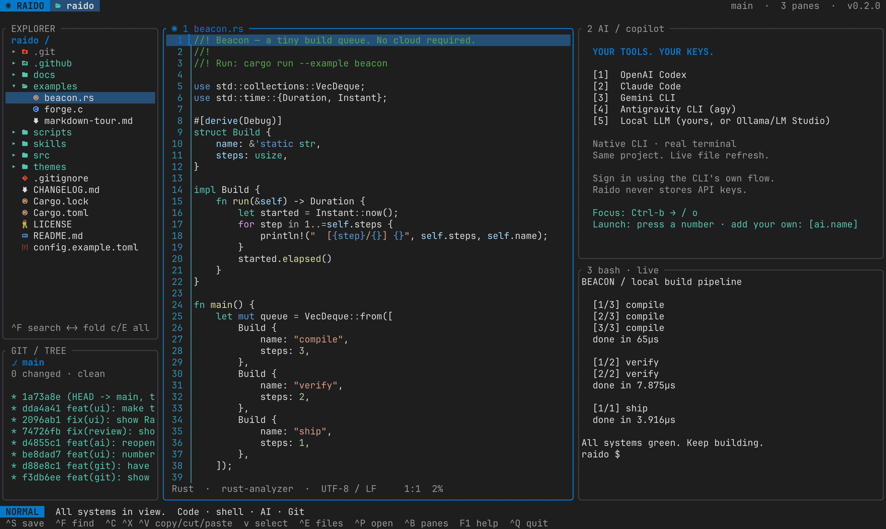

## ᚱ Why Raido

**Raido** (ᚱ, *raidō*) is the fifth rune of the Elder Futhark, the oldest runic
alphabet. Its name means *ride* or *journey*: the steady forward motion of a rider who
knows the road, keeps the rhythm and isn't thrown off course. It is one carved
stroke-shape, a single character with a whole meaning behind it, and it stands for
the right way of moving: in order, unhurried, toward where you mean to go.

That is what this workspace is for:

- **Simplicity.** One screen and one prefix key. What you need to write, run and
  review code is in view, and nothing else is.
- **Free of bloat.** A single native Rust binary: no Electron, no web service, no
  account, no telemetry, no extension marketplace to curate. It starts at once and
  stays out of your way.
- **Free of distractions.** No pop-ups competing for you, no tabs of chrome. An AI
  agent works beside your code and chimes once when it's done; its changes wait
  in a review until you've looked at them.
- **The keyboard is enough.** Every action has a key, and the keys stay where your
  hands already are. The mouse works when you want it, but you never need it.
- **Easy to reach.** One install script on macOS, Linux and Windows, and it runs
  anywhere a terminal does, over SSH included.

## Start here

- [Build from source](#build-from-source)
- [Install and update](#install-and-update)
- [Your first five minutes](#your-first-five-minutes)
- [Horizontal and vertical tiles](#horizontal-and-vertical-tiles)
- [Keyboard reference](#keyboard)
- [Markdown preview](#markdown-preview)
- [Jupyter notebooks](#jupyter-notebooks)
- [Nmap scan reports](#nmap-scan-reports)
- [Spreadsheets, CSV and databases](#spreadsheets-csv-and-databases)
- [Archives](#archives)
- [Files that aren't text](#files-that-arent-text)
- [Copy and paste](#copy-and-paste)
- [Language servers](#language-servers-lsp)
- [Sessions: pick up where you left off](#sessions)
- [Command reference](#commands)
- [Interactive documentation](#interactive-documentation)
- [AI CLIs: Codex, Claude, Gemini, Antigravity](#ai-authentication)
- [Themes and plugins](#themes-and-command-plugins)
- [Troubleshooting](#troubleshooting)

## Build from source

### Install script

On **macOS or Linux**, one script installs everything Raido needs and then Raido:

```sh
scripts/install.sh
```

Or, without a checkout (it clones Raido first):

```sh
curl -fsSL https://raw.githubusercontent.com/yukselberkay/raido/main/scripts/install.sh | bash
```

It installs, skipping whatever is already there:

1. **A C compiler and linker, Git, curl, xz and fontconfig.** On macOS these come
   with the Xcode Command Line Tools; if they're missing, macOS opens its
   installer, and you run the script again when it's done. On Linux it uses the
   system package manager (apt, dnf, yum, pacman, zypper or apk) through `sudo`.
2. **Rust**, through [rustup](https://rustup.rs), or `rustup update stable` when
   the installed Rust is older than 1.88. Rust from a distribution package that
   is too old is reported, not replaced.
3. **[Language servers](#language-servers-lsp)** for the languages Raido's editor
   understands (diagnostics, hover, completion), from the system's own package
   manager: apt on Debian and Ubuntu, dnf (or yum) on Fedora and RHEL, pacman on
   Arch (all are in its official repos, so no AUR helper is needed), zypper on
   openSUSE, apk on Alpine, Homebrew on macOS. The step's heading names the system
   and the package manager it found.

   | Language | Server | apt | dnf / yum | pacman | zypper | apk | Homebrew |
   | --- | --- | --- | --- | --- | --- | --- | --- |
   | Rust | rust-analyzer | rustup | rustup | rustup | rustup | rustup | rustup |
   | C / C++ | clangd | `clangd` | `clang-tools-extra` | `clang` | `clang-tools` | `clang-extra-tools` | Command Line Tools, else `llvm` |
   | Go | gopls | `gopls` | `golang-x-tools-gopls` | `gopls` | `gopls` | `gopls` | `gopls` |
   | Python | pyright or pylsp | `python3-pylsp` | `python3-lsp-server` | `pyright` | `python3-python-lsp-server` | `py3-lsp-server` | `pyright` |
   | Shell | bash-language-server | npm | `nodejs-bash-language-server` | `bash-language-server` | npm | npm | `bash-language-server` |
   | Shell warnings, formatting | ShellCheck, shfmt | `shellcheck`, `shfmt` | `ShellCheck`, `shfmt` | `shellcheck`, `shfmt` | `ShellCheck`, `shfmt` | `shellcheck`, `shfmt` | `shellcheck`, `shfmt` |
   | TypeScript, JavaScript | typescript-language-server + TypeScript 6 | npm | npm | npm | npm | npm | npm |
   | YAML | yaml-language-server | npm | npm | `yaml-language-server` | npm | npm | `yaml-language-server` |
   | JSON | vscode-json-language-server | npm | npm | `vscode-json-languageserver` | npm | npm | `vscode-langservers-extracted` |
   | Dockerfile, Docker Compose | docker-language-server | `go install` | `go install` | `go install` | `go install` | `go install` | `go install` |
   | Assembly (x86, ARM, RISC-V) | asm-lsp | `cargo install` | `cargo install` | `cargo install` | `cargo install` | `cargo install` | `asm-lsp` |

   gopls only where Go is installed (it needs Go itself), falling back to
   `go install`. Docker's server is in no package, so `go install` builds it, which
   takes a few minutes: only where Docker (or Podman) and Go are installed (Go fetches
   the newer Go it needs, 1.25, unless your Go is set to stay local). Without a system package for Python it tries `uv tool install
   basedpyright`, `pipx install python-lsp-server`, then `npm install -g pyright`;
   TypeScript's always from npm (`npm install -g typescript-language-server
   typescript@6`: it drives TypeScript 6's `tsserver`, which TypeScript 7 doesn't
   have, and Homebrew's comes with 7); for the shell, YAML and JSON servers, `npm install -g bash-language-server`,
   `yaml-language-server` and `vscode-langservers-extracted` (Node.js 20 or later);
   and for shfmt, `go install` where Go is. asm-lsp is in no Linux distribution's
   packages, so `cargo install asm-lsp` builds it there (a minute or two).
   A server already there is kept; one that can't be installed is noted and
   skipped, never failing the install (`--no-lsp` skips them all).
4. **JetBrains Mono Nerd Font**, Raido's [font](#fonts) and the source of the explorer's
   Nerd Font file icons, which Raido then shows by default (`icons = true`): Homebrew's cask on macOS
   when Homebrew is installed, otherwise the latest Nerd Fonts release into
   `~/Library/Fonts` or `~/.local/share/fonts` (`--no-font` skips it).
5. **Raido**, built with `cargo install --locked` into `~/.cargo/bin/raido`.
6. **`raido` on your PATH**, so it runs by name. If your terminal can't find it yet, it
   links it into a folder already on your PATH that you can write to
   (`~/.local/bin`, `~/bin`, `/opt/homebrew/bin` or `/usr/local/bin`), so it works in
   that terminal at once; without one, it adds `~/.cargo/bin` to your shell's startup
   file (zsh, bash or fish; once, marked) for new terminals. Another `raido` already
   first on PATH is reported, not replaced.
7. **The [Raido skill](#ask-your-ai-agent-about-raido)** for AI agents, for every project
   of your user (`--no-skill` skips it; a failure here only warns).

**On [Omarchy](https://omarchy.org)** it uses Omarchy's own commands:

- System packages and language servers come through `omarchy pkg add`.
- Raido follows the desktop's theme: `theme = "omarchy"` goes into a new config, or
  at the top of one that names no theme (a theme you picked stays), so
  `omarchy theme set <name>` re-themes Raido too. See [Omarchy themes](#theme-plugins--no-rebuild-needed).
- `omarchy tui install` adds Raido to the app launcher, with its icon: SUPER + SPACE,
  then Raido, opens it tiled in your default terminal (`--no-launcher` skips it;
  `omarchy tui remove Raido` takes it out).
- Omarchy ships JetBrainsMono Nerd Font as its terminal font, so there's nothing to
  set.

Run it as yourself, not with `sudo`; it asks for `sudo` only for system packages.
To do the same steps by hand, read on.

### 1. Prerequisites

Raido runs on **Linux, macOS and Windows 10/11** (see [Windows](#windows) for the
Windows specifics). You need:

- Rust **1.88 or newer** and Cargo. Current stable Rust is recommended.
- A C compiler/linker and platform development headers.
- A UTF-8 terminal with 256-color support; true color is recommended.
- Git for the Git sidebar. No Git repository is required just to edit files.
- Python 3 only if you want to run the optional PTY smoke test.

On Debian/Ubuntu, install the compiler and Git:

```sh
sudo apt update
sudo apt install build-essential git curl
```

On Fedora:

```sh
sudo dnf install gcc gcc-c++ make git curl
```

On macOS, install the Xcode Command Line Tools:

```sh
xcode-select --install
```

Install Rust using the official [rustup instructions](https://rustup.rs/).
Choose the stable toolchain. Open a new terminal afterward, or load Cargo's
environment in your current shell:

```sh
. "$HOME/.cargo/env"
rustc --version
cargo --version
cc --version
git --version
```

If Rust is already installed but too old, use `rustup update stable`.

### Windows

On **Windows**, `scripts\install.ps1` does the same in PowerShell, using winget for
the programs: Git, the Visual Studio C++ build tools (Rust's linker; a large
download), Rust through rustup, the language servers (rust-analyzer; clangd from
LLVM's winget package; gopls through `go install` when Go is installed; pyright from
npm, else basedpyright from uv or python-lsp-server from pipx; bash-language-server
from npm with ShellCheck and shfmt from winget; yaml-language-server and VS Code's
JSON server from npm; docker-language-server
through `go install` when Docker and Go are installed; asm-lsp through `cargo
install`), JetBrains Mono Nerd Font (for your
user, no administrator rights), Raido, the AI-agent skill, and `%USERPROFILE%\.cargo\bin`
on your user PATH, so `raido` runs in that window at once and in every new one:

```powershell
powershell -ExecutionPolicy Bypass -File scripts\install.ps1
# without a checkout:
irm https://raw.githubusercontent.com/yukselberkay/raido/main/scripts/install.ps1 | iex
```

`-NoFont`, `-NoLsp` and `-NoSkill` skip those parts. Afterwards pick
"JetBrainsMono Nerd Font Mono" in Windows Terminal (Settings → Profiles → Defaults →
Appearance → Font face). By hand instead:

1. Install Rust with [rustup-init.exe](https://rustup.rs/) and accept the default
   (MSVC) toolchain; when asked, let it install the Visual Studio C++ Build Tools.
2. Install [Git for Windows](https://git-scm.com/download/win).
3. Use **Windows Terminal** (built into Windows 11) for true color and full key
   support. For explorer icons, set a [Nerd Font](https://www.nerdfonts.com/) in its
   profile; without one, Raido shows plain colored markers instead.

Then build and install from PowerShell exactly as below (`cargo build --release
--locked`, `cargo install --path . --locked`); the binary is `raido.exe` in
`%USERPROFILE%\.cargo\bin`, which rustup adds to `PATH`.

On Windows, terminal panes start **PowerShell** (`pwsh`, else Windows PowerShell,
else `cmd.exe`; override with `shell = "…"`), configuration lives in
**`%APPDATA%\raido\config.toml`** (themes in `%APPDATA%\raido\themes`), and the clipboard
goes through PowerShell's `Get-Clipboard` / `Set-Clipboard`. CLIs installed with npm
(`codex`, `gemini`, `pyright-langserver`, …) are found through their `.cmd` shims.
Omarchy themes are Linux-only and simply do not appear.

### 2. Get the source and build

Extract the supplied **source ZIP**, or use your existing Raido checkout, then
enter the directory containing `Cargo.toml`:

```sh
cd raido
cargo build --release --locked
./target/release/raido --version
```

There is no public repository URL or crates.io installation assumed by this
guide. The first build downloads dependencies; subsequent builds reuse Cargo's
cache. `--locked` uses the versions recorded in `Cargo.lock`.

The executable is `target/release/raido`. No Node.js, browser, or Python runtime
is needed to run the editor. The README screenshots come from `scripts/screenshots.sh`
(test-only code plus headless Chrome); none of it is part of the application.

### 3. Run without installing

```sh
./target/release/raido .                   # Browse the current project
./target/release/raido examples/forge.c    # Open a specific file
./target/release/raido . --demo            # Rust example + AI launcher + shell
./target/release/raido --help
```

Run these inside an interactive terminal, not through a pipe. When opening a
file inside a Git repository, Raido uses that repository as its workspace root;
outside Git it uses the file's parent directory.
When opening a directory, that directory is the workspace. Shell panes start
there, and editor command paths are resolved relative to it.

`--demo` looks for `examples/beacon.rs` in the selected directory. It opens an
AI **launcher**, not an authenticated model session. It does not use an API key
or make model requests. Recommended screen: **140 × 40** or larger; a three-pane
layout is more comfortable at **168 × 48**. In a smaller window the sidebar hides by
itself, so the code keeps its room ([details](#a-small-window)).

### A small window

When the window gets too small for the sidebar, it hides by itself and comes back as
soon as there's room again, so the code isn't squeezed into a few columns beside it:

- **Narrow:** the explorer and the Git section hide when the panes would have fewer
  than 70 columns beside them: under 99 columns with the default `sidebar_width` of
  29. The first time, the status line says so.
- **Short:** under 24 rows the Git section hides first and the explorer gets its
  rows; under 16 rows the whole sidebar does.
- **Still there when you ask:** `Ctrl-e` (or `:files`) opens the explorer and
  `Ctrl-b g` the Git section while you use them, beside panes that keep 25 columns;
  back in a pane, they hide again. `Ctrl-b s` keeps the sidebar on screen whatever
  the size, and again hides it as before.
- `auto_hide_sidebar = false` keeps the sidebar in any window 70 columns or wider.

## Install and update

From the source directory, install into Cargo's user-level bin directory:

```sh
cargo install --path . --locked
raido --version
raido ~/projects/my-project
```

By default the binary is installed at `~/.cargo/bin/raido`. Cargo's bin directory
must be on `PATH`; `. "$HOME/.cargo/env"` sets that up for the current shell.
Do **not** run `cargo install` with `sudo`.

For an explicit alternative installation location:

```sh
cargo install --path . --locked --root "$HOME/.local"
export PATH="$HOME/.local/bin:$PATH"
raido --version
```

Add that PATH line to your shell startup file if you want it to persist.
After obtaining a newer source checkout/archive, update with:

```sh
cargo install --path . --locked --force
```

If you chose a custom root, repeat `--root "$HOME/.local"` when updating.
For a Cargo-managed default installation, uninstall with:

```sh
cargo uninstall raido
```

For the custom-root installation, use
`cargo uninstall --root "$HOME/.local" raido`.
The **package** is named `raido`; its **executable** is named `raido`.
Uninstalling does not remove your projects or user configuration.

### Versions

`raido --version` prints the version. Raido uses
[Semantic Versioning](https://semver.org): while it is 0.x, a minor release
(0.2 → 0.3) may change keys, settings or behavior, and a patch release only fixes
things. [CHANGELOG.md](CHANGELOG.md) lists what changed in each version.

## Your first five minutes

1. **Open a project:** run `raido /path/to/project` (or the local binary above).
   A directory opens a scratch editor plus the file/Git sidebar. The terminal tab
   takes the project folder's name while Raido runs, so a tab per project tells
   them apart, and gets its own title back when you quit.
2. **Choose a file:** press `Ctrl-e`, use Up/Down to select a file or directory,
   Right to expand, Left to collapse, and Enter to open. Focus moves to the editor.
3. **Edit:** the bottom bar initially says `NORMAL`. Press `i` to enter `INSERT`,
   type your changes, then press Escape to return to normal mode.
4. **Save:** press `Ctrl-s`, or type `:w` and Enter from normal mode. For a scratch
   buffer use `:w notes.txt`. To create another file use `:e notes.txt`, then save.
   Parent directories must already exist. A new buffer is not a disk file until saved.
5. **Navigate:** type `:25` and Enter to jump to line 25. Type `/needle` and Enter
   to search; `n` and `N` find the next/previous occurrence.
6. **Run tools:** press `Ctrl-b`, release, then `c` to open a shell below the
   current pane. Type build/run commands there as in any other terminal.
7. **Return to editing:** press `Ctrl-b`, release, then an arrow to focus a pane,
   or `o` to cycle panes. Use `Ctrl-b z` to temporarily maximize the active pane.
8. **Exit:** `Ctrl-q` or `:qa` refuses to exit with unsaved changes. Use `:wa` to
   save modified named buffers first. `:qa!` explicitly discards changes and exits.

Press **F1** for the built-in field guide. It docks on the right and opens focused:
**↑/↓**, `j`/`k`, **PageUp/PageDown**, Space and `g`/`G` scroll it, with no modifier
keys (Alt-↑/↓ also works where Alt is free). **Esc** returns to your work while the
guide stays open, so you can follow it step by step as you type commands and edit;
any other key also goes straight to your work. **F1** focuses the open guide again,
and F1 on a focused guide (or `:help`) closes it. Editor commands
such as `:w` are entered in Raido, not the shell. While a terminal is focused,
use **Ctrl-b then `:`** to open Raido's command prompt.

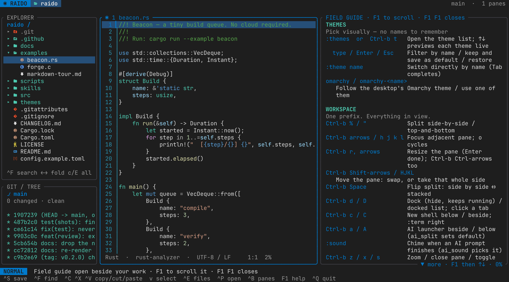

## Horizontal and vertical tiles

The names describe the dividing border: a **vertical split** creates left/right
panes; a **horizontal split** creates top/bottom panes.

| Layout | Shortcut | Raido command |
| --- | --- | --- |
| Side-by-side editor panes | `Ctrl-b %` | `:vsplit` |
| Stacked editor panes | `Ctrl-b "` | `:split` |
| Shell below the active pane | `Ctrl-b c` | `:term` |
| Shell beside the active pane | `Ctrl-b C` | `:term right` |
| Move the pane (swap, or to a whole side) | `Ctrl-b Shift-arrows` / `H J K L` | `:move right` |
| Side by side ↔ stacked | `Ctrl-b Space` | `:flip` |

Splits nest inside the focused pane. Splitting an editor initially shows the
same buffer in both views; Tab or `:bn` in the new view shows another open file there
(a file you open gets a pane of its own anyway). The buffer contents, cursor, and scroll position are shared when two views
show the same buffer. Closing a terminal pane stops its terminal child process.
A new shell starts in the folder the shell you're in has `cd`'d to (or the one you
used last, or any other open shell), so `Ctrl-b c` in `/tmp/x` gives you another
shell in `/tmp/x`; the status line names the folder. With no shell open it starts in
the project, as AI panes and `:run` commands always do.
The number in a pane's title counts the panes that are open, docked ones included,
in the order you opened them: close one and the rest renumber, so they always run
1 to N.

### Docking panes

`Ctrl-b d` (or `:dock`) hides the focused pane without stopping it: a shell, an AI
agent or a server keeps running, and the panes around it take its room. Docked
panes wait as numbered tabs in the top bar (` dock  1 claude  2 zsh `). Click a tab,
or press `Ctrl-b D` and choose with ↑↓ Enter (or the number), to bring one back to
the same place and size; `x` in that list closes it for good. `:undock 2` or
`:undock claude` works too. An AI pane that finishes while docked still chimes and
says so in the status line. Docked panes are saved with the session; the last pane
on screen can't be docked, and closing it brings back the newest docked one.

### Reproduce the C + terminal screenshot

From the Raido source directory:

```sh
raido .
# Without installing: ./target/release/raido .
```

Then use these keys **inside Raido**:

1. Type `:e examples/forge.c`, then Enter — open the C source in the first pane.
2. `Ctrl-b %` — create a right-hand editor pane (vertical dividing border).
3. Type `:e README.md`, then Enter — open this guide in the right-hand pane.
4. `Ctrl-b c` — create a terminal below the README (horizontal dividing border).
5. In that terminal, compile and run the included C program:

   ```sh
   mkdir -p target
   cc -std=c11 -Wall -Wextra -Werror examples/forge.c -o target/forge
   ./target/forge
   ```

6. `Ctrl-b o` cycles back to the C editor; `Ctrl-b z` zooms/unzooms it.
   To give the C editor more room, use `Ctrl-b Ctrl-Right` a few times.

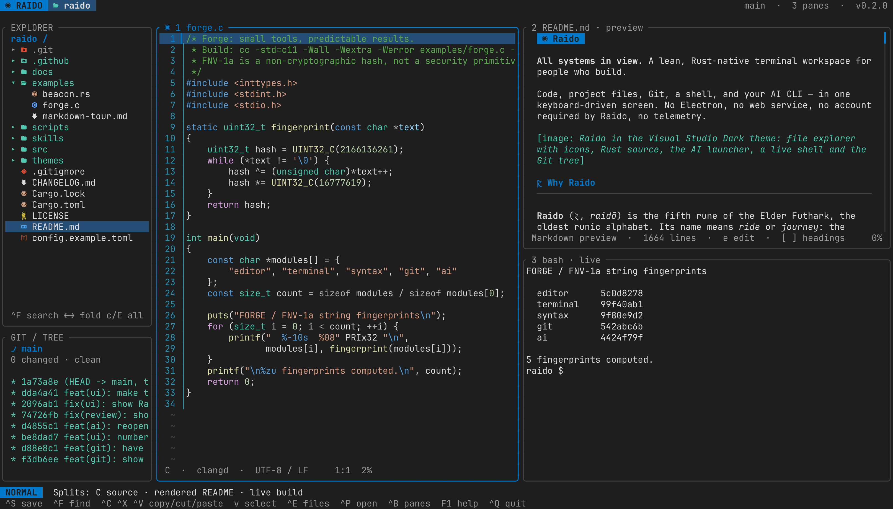

This is a live application capture, not a mockup. The file explorer and Git
history remain visible alongside both split directions.

Start with `raido .` as above even if you extracted a ZIP: the archive does not
contain Git history. To enable Git for a new project, run `git init` in its root;
the history graph appears after you make commits.

## What works

- **Modal text editing:** Vim-inspired normal/insert modes, arrows/hjkl, words,
  line jumps, delete/change, grouped undo/redo, search with wrap,
  automatic indentation, bracketed paste, horizontal/vertical scrolling.
- **Copy and paste:** `v`/`V` or Shift+arrows select, Ctrl-a selects the whole
  file; Ctrl-c/Ctrl-x/Ctrl-v and `y`/`d`/`p` share the **system clipboard** with
  your other apps.
- **Language servers:** diagnostics, hover docs, go-to-definition, completion and
  formatting for Rust, Go, Python, C and C++, TypeScript and JavaScript, shell
  scripts, YAML, JSON and Docker via their standard servers.
- **Markdown preview:** `.md` files open rendered — headings, lists, task
  lists, tables, highlighted code blocks, quotes and GitHub alerts — with a live
  side-by-side preview that follows your cursor while you edit.
- **Jupyter notebooks:** `.ipynb` files open as their cells, as Jupyter shows them —
  Markdown rendered, code highlighted with `In [3]:`, and each cell's output, error
  and traceback beneath it; `e` edits the notebook's JSON.
- **Nmap scan reports:** `.nmap`, `.gnmap` and Nmap XML open as a readable report —
  hosts at a glance, ports colored by state, script output under its port, noise
  folded away.
- **Spreadsheets, CSV and databases:** Excel and OpenDocument workbooks (`.xlsx`,
  `.xlsm`, `.xlsb`, `.xls`, `.ods`) and SQLite databases open read-only as a grid,
  laid out as Excel left them, long text wrapped, numbers in their own formats
  (`15%`, `1,234.50`, `€ 9.99`, dates); CSV and TSV files open the same way and stay
  editable as text.
- **Archives** (zip, jar, whl, tar.gz, tar.xz, 7z, .gz…) open as a tree of their
  files, read by Raido itself (no unzip or tar needed); a file in one opens as a
  read-only copy.
- **Files that aren't text** open read-only as hex, with what kind of file each is
  (`PNG image, 1200 × 800`, `Mach-O executable, ARM64`).
- **Interactive documentation:** `Ctrl-b /` asks an AI agent how to do something in
  the language you write, what a function does, or how this project does a thing,
  and it answers beside the code like the official docs and Stack Overflow: the
  function and its import, how to call it, an example and what it prints.
- **Source highlighting:** bundled Rust, C, C++, Python, Go grammars, plus the
  other bundled Syntect languages (JSON and YAML among them) and Raido's own
  grammars: TypeScript and JavaScript with JSX (`.ts`, `.tsx`, `.js`, `.jsx`, `.mjs`,
  `.cjs`), TOML (`pyproject.toml`, `Cargo.toml`, `config.toml`), Dockerfiles,
  PowerShell (`.ps1`, `.psm1`, `.psd1`), `.env` files (`.env.local` too), INI
  (`.ini`, `.cfg`, `.editorconfig`, `.gitconfig`, systemd units), ignore files
  (`.gitignore`, `.dockerignore`, `.npmignore`…), SCSS, Terraform / HCL (`.tf`,
  `.tfvars`, `.hcl`, `docker-bake.hcl`) and Protocol Buffers (`.proto`); Markdown
  code blocks by any of their names (```` ```terraform ````, ```` ```pwsh ````). Files
  without an extension are known by name (`Makefile`, `.bashrc`). They're loaded the
  first time a file needs one, so Raido starts as fast. Absolute/relative line
  numbers.
- **Shell scripts:** `.sh`, `.bash`, `.zsh`, `.bashrc`, `.zshrc`, `PKGBUILD`, and
  scripts without an extension by their `#!` line, highlighted and indented
  (`fi`, `done` and `esac` line up with what they close); with the Bash language
  server, ShellCheck's warnings, completion, hover, go to definition and shfmt's
  formatting. [Details](#shell-scripts).
- **Assembly for x86, ARM and RISC-V:** `.s`, `.S`, `.asm`, `.nasm` files in GNU
  as's syntax (AT&T or Intel), NASM's, MASM's or Go's, for x86 and x86-64, 32-bit
  ARM and Thumb, AArch64 (Apple's too) and RISC-V. Instructions, branches,
  registers, directives, labels, immediates and relocations each have their color;
  which CPU a file is for comes from its code (`%rax`, `x0`, `a0`), its name
  (`memmove_arm64.s`) or the project's `.asm-lsp.toml`. With asm-lsp, hover docs
  for instructions and registers, completion and go to definition.
  [Details](#assembly-x86-arm-and-risc-v).
- **YAML and JSON, checked against their schemas:** GitHub Actions workflows,
  Kubernetes manifests, `package.json`, `tsconfig.json` and the hundreds of other
  files SchemaStore knows, with errors, completion and hover docs from the schema.
  [Details](#yaml-and-json-checked-against-their-schemas).
- **Docker:** Dockerfiles and Containerfiles (`Dockerfile.dev`, `api.dockerfile`
  too) highlighted, instructions that go on over lines indented, and Docker Compose
  files (`compose.yaml`, `docker-compose.yml` and their overrides) known as Compose;
  with Docker's language server, Compose completions, checks and formatting.
  [Details](#docker-dockerfiles-and-compose-files).
- **File explorer:** keyboard traversal, folders that fold one at a time or all at
  once, dotfiles always shown, VS Code-style Git status colors and letters, new
  file buffers, visible-path completion, open-buffer cycling.
- **Tiling:** recursively nested horizontal/vertical splits, directional focus,
  resize, zoom, and close. Up to 12 panes; editor views can share buffers.
- **Terminals:** real PTYs, ANSI/256/true-color rendering, resize propagation,
  application cursor keys, bracketed paste, terminal query responses, and
  bounded scrollback. Shells and CLI tools run in the project directory.
  `raido FILE` typed in one opens FILE in a pane of this Raido, not a second Raido.
- **AI panes:** run **OpenAI Codex**, **Claude Code**, **Gemini CLI**, the
  **Antigravity CLI** (`agy`) or **OpenCode** as installed executables, beside or
  below your code.
  These are the real tools, not imitations or provider-specific chat widgets.
- **Review AI changes:** everything Codex, Claude Code or any AI pane changes shows
  up as a diff, like VS Code's agent edits; keep or undo each change, each file or
  all of them ([Review AI changes](#review-ai-changes)).
- **AI panes see your editor:** as with its VS Code extension, Claude Code knows the
  file you're on and the lines you select; `Ctrl-b i` hands any AI pane a reference
  to them ([AI panes see your editor](#ai-panes-see-your-editor)).
- **Git sidebar:** current branch, changed/untracked files, and recent ASCII
  commit graph. Enter opens a changed file. Git is read-only here; perform
  staging/commits in the terminal or your preferred Git TUI.
- **Changes in the gutter:** VS Code-style added / changed / removed line marks
  against Git, live as you type, with `]c` / `[c` to jump between them.
- **Minimap:** the whole file from far away beside the code, as in VS Code: where
  you are, what changed, find matches and errors; click or drag it to go there
  ([Minimap](#minimap)).
- **External-change refresh:** open files show what AI/shell tools write to them
  within a quarter of a second, cursor kept, merged with your unsaved edits; where a
  change meets yours, yours are kept there and the rest still comes in (`:e!` / `:w!`
  choose), and the explorer shows files
  they create, delete or rename within half a second. Dirty buffers remain yours; saving detects conflicting disk changes.
- **Extensions:** user-owned TOML themes and explicitly invoked command plugins.

## Keyboard

`Ctrl-b` is a prefix: hold Ctrl and press `b`, release both, then press the
following key. `Ctrl-b %` is not three simultaneous keys. `%` and `"` require
Shift on many keyboard layouts. On macOS, **Ctrl means Control, not Command**.

| Shortcut | Action |
| --- | --- |
| `Ctrl-e` | Focus the file explorer (also from the Git section); in the explorer, return to the pane |
| `Ctrl-p` | [Open a file by a few of its letters](#prompt-and-buffer-behavior) (`mnrs` → `src/main.rs`), the ones you opened last first; `main.rs:42` goes to line 42 |
| `Ctrl-s` | Save editor buffer |
| `Ctrl-q` | Quit, refusing unsaved buffers |
| `Ctrl-b %` / `Ctrl-b "` | Side-by-side / stacked editor split |
| `Ctrl-b arrows` or `Ctrl-b h/j/k/l` | Move between panes; the one taking your keys has Raido's `◉` before its title |
| `Ctrl-b Ctrl-arrows` | Resize the closest split on that axis (or drag the border between panes with the mouse) |
| `Ctrl-b r` | Resize mode: arrows or `h j k l` resize the focused pane, as often as you like, Enter or Escape when done (macOS keeps Ctrl+arrows for switching desktops, so use this there) |
| `Ctrl-b Shift-arrows` or `Ctrl-b H/J/K/L` | Move the pane: it trades places with the pane on that side, or, at the edge already, takes that whole side of the window (`:move right`) |
| `Ctrl-b Space` | Flip the pane's split between side by side and stacked (`:flip`) |
| `Ctrl-b o` | Cycle panes |
| `Ctrl-b c` / `Ctrl-b C` | New terminal below / beside, in the folder your shell is in |
| `Ctrl-b a` / `Ctrl-b A` | New AI launcher beside / below; 1 Codex, 2 Claude, 3 Gemini, 4 Antigravity |
| `Ctrl-b z` / `x` | Maximize (zoom) / close current pane; a maximized pane shows `⛶ MAXIMIZED · N more panes` on its border |
| `Ctrl-b y` | Hand the mouse to the terminal for selecting and copying (layout unchanged); again to take it back ([Mouse](#mouse)) |
| `Ctrl-b d` / `Ctrl-b D` | Dock (hide) the pane, still running / list docked panes to bring one back ([Docking panes](#docking-panes)) |
| `Ctrl-b +` / `-` / `0` | [Text size](#text-size) bigger / smaller / reset; keep pressing `+` or `-` to repeat |
| `Ctrl-b s` / `g` | Toggle the sidebar (one hidden in a [small window](#a-small-window) comes back and stays) / focus the sidebar's Git section |
| `Ctrl-b G` | Open the [Git pane](#git-pane); again focuses it, and when focused maximizes / restores it |
| `Ctrl-b v` | [Review what AI agents changed](#review-ai-changes): keep or undo each change; again focuses the review, and when focused maximizes / restores it |
| `Ctrl-b i` | [Hand the AI pane where you are](#ai-panes-see-your-editor): the file and the lines you selected, typed into its prompt as `@file#L10-20`, and on to that pane |
| `Ctrl-b I` | [Give the AI pane a screenshot](#screenshots-and-images-in-ai-panes): the image on the clipboard, else the one you just took, attached to its prompt |
| `Ctrl-b n` | [A new conversation in the AI pane](#a-new-conversation-in-an-ai-pane): its agent or local model starts again there, on the same model; in the docs pane, a new topic |
| `Ctrl-b /` | [Interactive documentation](#interactive-documentation) beside the code: ask how to do something, or Enter for the name under the cursor or the code you selected |
| `PageUp` / `PageDown` (Fn-↑/↓ on a Mac) | Scroll a terminal or AI pane's history half a page; then ↑/↓ one line, Home/End top/bottom, Esc or typing returns. Full-screen programs (vim, less) get the keys instead |
| `Ctrl-b [` | [Copy mode](#copying-from-terminal-and-ai-panes) in a terminal or AI pane |
| `Ctrl-b Z` | [Copy view](#copying-from-terminal-and-ai-panes): only the focused pane's text; again to return |
| `Ctrl-b b` | Send literal Ctrl-b to the terminal |
| `Ctrl-b :` | Command prompt, including from terminal panes |
| `F1` | Field guide beside your work, focused: ↑/↓ PgUp/PgDn scroll, Esc back to work (stays open); F1 refocuses / closes |

`Ctrl-q`, `Ctrl-e`, `Ctrl-p`, F1 and the Ctrl-b prefix are reserved by Raido even
inside a terminal. Other ordinary terminal keys go to the child CLI; Escape alone
does **not** leave a terminal pane. `Ctrl-s` saves in an editor but passes through
in terminal panes. Use Ctrl-b plus arrows or `o` to leave a terminal.

### File explorer and Git

These shortcuts apply while the sidebar has focus (`FILES` or `GIT` in the status bar).

| Key | Action |
| --- | --- |
| Up/Down or `k`/`j` | Select previous/next entry; a selected file is **previewed** in a pane beside your editor while focus stays here |
| PageUp/PageDown (Fn-↑/↓ on a Mac), Home/End | Move 5 entries up/down, or to the first/last entry (also in the Git section and in search results) |
| Right or `l` | Expand directory; enter its first child if already expanded; open file |
| Left or `h` | Collapse current directory or select parent |
| Enter | Toggle directory / open selected file in a pane of its own and move focus to it |
| Space | Fold or unfold the selected folder; on a file, fold the folder holding it |
| `c` | Collapse all folders (also `:collapse`) |
| `E` | Expand the selected folder and every folder inside it; on a top-level file, the whole project. `.git`, `target` and `node_modules` stay folded (also `:expand`) |
| `r` | Refresh the file tree now (it follows files made, removed or renamed in a terminal or by an AI by itself, within half a second) |
| `n` | Start a new-file command; supply the path and press Enter |
| Tab | Switch between file explorer and Git section |
| Escape | Return focus to the active pane |
| `Ctrl-e` | From the Git section: jump to the explorer; in the explorer: return to the pane |
| `Ctrl-f` | [Search the project](#search-the-project): file names and text in files |

### Search the project

`Ctrl-f` in the explorer turns it into a search: type, and the results come in as
you type, grouped by file — files whose names match first, then every line holding
the text (with its line number). Case is ignored until you type a capital letter.
↑↓ preview a result in the editor with the match highlighted, Enter (or a click)
opens it with the cursor on the match, `Ctrl-u` clears, and Escape goes back to the
file tree; the search stays until then, so `Ctrl-e` returns to it. It searches what
Git sees (ignored files left out) or, outside a repository, everything but `.git`,
`target` and `node_modules`; binary files and files over 2 MB are skipped, and it
stops at 2,000 results.

Dotfiles and dot-directories (`.github`, `.env`, `.git`, `.raido`, …) are always shown.
Only `target` and `node_modules` build output is left out of the tree; `Ctrl-p` still
opens files there by their full path.

Like VS Code, the explorer shows what Git sees, refreshed every few seconds:

| Mark | Color | Meaning |
| --- | --- | --- |
| `M` | yellow | Modified |
| `U` | green | Untracked (new, not yet added) |
| `A` | green | Added to the index |
| `R` | green | Renamed or copied |
| `D` | red | Deleted (shown on the folder that held it) |
| `!` | red | Merge conflict |
| `●` | most urgent inside | A folder holding changes |
| dimmed | — | Ignored by `.gitignore`, and `.git` itself |

The name takes the mark's color too. Colors come from the theme's terminal palette
(bright green and red) and its `warning` color.

Each entry shows a **file-type icon** in its language's color, the same Nerd Font glyphs
Omarchy's terminal tools use (Rust, C/C++, Python, Go, JS/TS, Markdown, TOML, YAML,
shell, images, archives, Git files, Docker, licenses…). They need a Nerd Font in your
terminal, which Omarchy ships by default. With the default `icons = true`, Raido uses
them when your terminal bundles Nerd Font symbols (kitty, WezTerm, Ghostty) or a Nerd
Font is installed, and otherwise shows plain markers in the same colors (`●` files,
`■` folders) instead of `?` or boxes. Force a style with `icons = "nerd"` or
`icons = "basic"`, or hide icons with `icons = false`.

**Each file you open gets a pane of its own**, beside the editor you're in, which
stays as it is: from the explorer, `Ctrl-p`, `:e`, the Git section, search results,
the review or an AI agent. Side by side while both halves keep about 60 columns of
code, otherwise one above the other. A file already on screen is focused instead of
opened twice, and the empty pane Raido starts with is filled rather than split. With
12 panes open, the file takes the focused pane's place (the status line says so).
Going to a definition (`gd`) and back (`Ctrl-o`) stay in the pane you're in, as in
Vim; Tab and `:bn` switch a pane between the files you opened.

Browsing previews in one pane beside your editor, reusing a single preview buffer
(like a VS Code preview tab), so walking past many files does not leave them all
open. A previewed file stays open once you press Enter on it or edit it. In the Git
section, Up/Down previews changed files the same way and Enter opens one. Git is
read-only in the sidebar and refreshes periodically. Common status codes include
`??` (untracked), `M` (modified), and `A` (added); the two columns distinguish
index and working-tree status. Symlink directories are not recursively expanded.

### Text size

`Ctrl-b +` (or `=`) zooms in, `Ctrl-b -` zooms out and `Ctrl-b 0` resets; right
after one of them, `+`, `-` and `0` keep working without the prefix for a second.
`:zoom in`, `:zoom out` and `:zoom reset` do the same (`:zoom` alone maximizes the
pane, like `Ctrl-b z`). The layout, editors and terminal panes reflow to the new size.

In macOS Terminal the size sticks: the next Raido starts at the size you zoomed to.
Raido writes it as `font_size` in `config.toml` for you, the way the theme picker
keeps your theme, so there's no file to edit. `:font size 12.5` sets an exact size,
kept the same way; sizes take decimals (12.5, 12.75, or `12,5` where your region
writes decimals with a comma). `Ctrl-b 0` goes back to the default (14 pt with Raido's font,
otherwise your profile's size) and forgets the kept size.

A terminal program can't scale its own text, so Raido asks the terminal window:

| Terminal | How |
| --- | --- |
| macOS Terminal | AppleScript, 1 pt per step, only for Raido's own tab (your profile is untouched); the size is kept for the next launch |
| xterm | Its font menu escape (`allowFontOps`, on by default) |
| kitty | `kitty @ set-font-size`, when remote control is on (`allow_remote_control` and `listen_on`) |
| Others (iTerm2, Ghostty, WezTerm, Alacritty, Windows Terminal, …) | Raido names your terminal's own keys: Cmd-+ / Cmd-- / Cmd-0 on macOS, Ctrl-+ / Ctrl-- / Ctrl-0 elsewhere |

### Fonts

Raido's font is **JetBrains Mono Nerd Font Mono at 14 pt** (`font` and `font_size` in
`config.toml`). The font belongs to the terminal window, so how far Raido can apply
it depends on the terminal:

- **macOS Terminal:** while Raido runs, its tab switches to that font and size, and
  gets its own font back when Raido exits. Your profile and other tabs don't change.
  The size you zoom to is kept for the next launch; `Ctrl-b 0` returns to 14 pt.
- **Other terminals** can't have one window's font changed from outside, so they
  keep their own font. Make JetBrains Mono your terminal's font with
  `:font family "JetBrainsMono Nerd Font Mono"` (below) or in its settings.
- **Font not installed:** every terminal keeps its own font.
  [`scripts/install.sh`](#install-script) installs it.

Set `font = ""` to always keep the terminal's font. To change it in the terminal
itself, `:font` edits the terminal's config:

| Command | What it does |
| --- | --- |
| `:font` | Names your terminal and how its font is set |
| `:font size 12.5` (or `:font 12.5`) | Decimals work. macOS Terminal: sizes Raido's tab and keeps it for next time. Elsewhere saves the size in the terminal's config: foot (`foot.ini`), Ghostty, Kitty, Alacritty — Alacritty and Kitty also change at once |
| `:font family "JetBrainsMono Nerd Font"` | On **Omarchy** runs `omarchy font set` (all terminals); elsewhere saves it in the terminal's config |
| `:font list` | Installed monospace fonts |
| `:font +` / `-` / `reset` | Same as `Ctrl-b +` / `-` / `0` above |

Raido finds the terminal from its environment, or on Linux from the process that
started it (foot under Omarchy sets no variable). Only the font lines change; the
rest of the file is kept. For WezTerm, Windows Terminal and iTerm2 (and the family in
macOS Terminal), `:font` says where the setting lives. Use a [Nerd Font](https://www.nerdfonts.com/) for the
explorer icons.

### Git pane

The sidebar shows a short summary. For the full picture, `:git` or `Ctrl-b G` opens
the **Git pane**, docked full-width along the bottom:

- **Branches** — every local and remote branch, yours first (`●`), then by recent
  activity, with ahead/behind counts against the upstream (`↑2 ↓1`) and their age.
- **Commit graph** — up to 400 commits across all branches, newest first. Each lane
  keeps its own color, so a branch reads as one line from where it forks to where it
  merges. Refs appear as badges (`◉ main` checked out, local branches, `origin/…`
  remotes, `◆ v1.0` tags), then the subject, author and age.
- **Details** — the selected commit's author, date, full message and changed files.
- **Changes** — Enter on a commit shows its whole diff: the message and file summary,
  then each changed file with its hunks and old and new line numbers. The code keeps
  its language's colors from your theme, as in the editor; a green or red tint and
  the `+` / `-` sign mark added and removed lines (the same colors as the editor's
  change marks). Renames show as `old → new`, and tabs are expanded so Go code lines
  up.
- **Explain a commit** — `e` on a commit (or in its changes), or `:explain <commit>`
  with any commit id, branch or `HEAD~2`, asks the agent in your AI pane to explain
  and review it. Raido types the request into the AI pane you used last (Claude
  Code, Codex, Gemini, any agent) and focuses it; the agent reads the commit's
  message and changes with `git show`, and the code around them, in your repository
  with its own tools, and answers there in four parts: what the commit does and why,
  how it works, a review (bugs, risks, edge cases, missing tests, with file and
  line), and a one-line verdict. It's asked not to change any files. You can ask
  follow-up questions right there. `:explain` alone explains the commit on screen in
  the Git pane, else `HEAD`. It uses that agent's session and tokens, like any
  question you'd type; with no AI pane open, `Ctrl-b a` starts one.

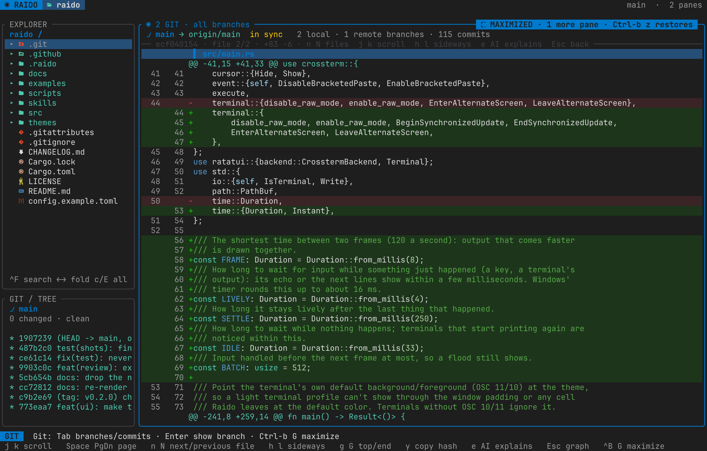

It refreshes every few seconds while you work. Press `Ctrl-b G` while it is focused
to maximize it (same as `Ctrl-b z`) and again to put it back; set `git_pane = true`
to have it open on every start.

| Key | Action |
| --- | --- |
| Tab | Switch between the branch list and the commit graph |
| Up/Down or `k`/`j`, PageUp/PageDown, `g`/`G` | Move; selecting a branch jumps to its newest commit |
| Enter | On a branch: show only its history (again: all); on a commit: show its changes |
| `a` or Escape | Show all branches again |
| `d` | Show/hide the details panel |
| `y` | Copy the selected commit hash |
| `e` | Have the AI pane's agent explain and review the selected commit |
| `r` | Refresh now |

In a commit's changes:

| Key | Action |
| --- | --- |
| `j`/`k`, Up/Down, Space/PageDown/PageUp, `Ctrl-d`/`Ctrl-u` | Scroll |
| `n` / `N` (or `]` / `[`) | Next / previous file (back from the first file: the message) |
| `h` / `l` | Scroll long lines sideways |
| `g` / `G` | Top / bottom |
| `y` | Copy the commit hash |
| `e` | Have the AI pane's agent explain and review this commit |
| Escape, `q` or Enter | Back to the graph |

Very large commits are cut off after 20,000 lines. `Ctrl-b G` maximizes the pane for
more room.

### Review AI changes

Like VS Code shows what Copilot or Claude changed, Raido shows what your AI panes
change, whichever CLI runs in them (Codex, Claude Code, Gemini, a local model):
**`Ctrl-b v`** or `:changes` opens the review. Each changed file is listed with its
hunks, old and new line numbers and the agent that made it. The code keeps its
language's colors from your theme, as in the editor; a green or red tint and the
`+` / `-` sign say whether a line was added or removed. It updates live while the
agent works.

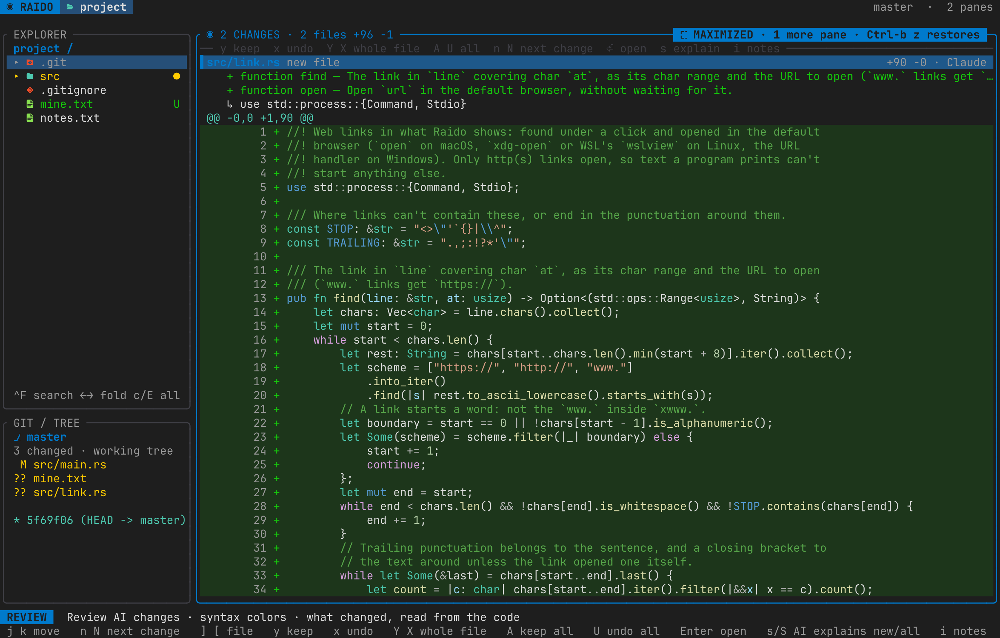

```text
╭ ◉ 4 CHANGES · 2 files +2 −1 ─────────────────────────────╮
│── y keep  x undo  Y X file  A U all  n N next  ⏎ open ────│
│▌app.py                                       +1 −1 · Codex │
│ @@ -1,1 +1,1 @@                            y keep · x undo │
│    1      - print(1)                                       │
│         1 + print(2)                                       │
│                                                            │
│ notes.md new file                            +1 −0 · Codex │
│ @@ -0,0 +1,1 @@                                            │
│         1 + note                                           │
╰────────────────────────────────────────────────────────────╯
```

The bar on the left is the cursor. **`y` keeps** the change it's on, and the review
stops showing it. **`x` undoes** it: that part of the file goes back to how it was
before the agent. On a file's heading, or with `Y` / `X`, they act on the whole
file; `A` keeps everything and `U` undoes everything. Undoing a whole file or
everything asks first (`y` to confirm), because the agent's version is gone after.
An undone new file is deleted, and an undone deletion brings the file back. Enter
opens the file at that line.

| Key | Action |
| --- | --- |
| `j`/`k`, Up/Down, Space/PageDown/PageUp, `Ctrl-d`/`Ctrl-u`, `g`/`G` | Move the cursor |
| `n` / `N` | Next / previous change (hunk) |
| `]` / `[` | Next / previous file |
| `y` / `x` | Keep / undo the change under the cursor (the whole file on its heading) |
| `Y` / `X` | Keep / undo the whole file |
| `A` / `U` | Keep / undo every file (`:changes keep`, `:changes undo`) |
| Enter or `o` | Open the file at that line |
| `h` / `l` | Scroll long lines sideways |
| `s` / `S` | Ask an AI to explain the new changes / all of them again (uses tokens; see below) |
| `i` | Hide / show the summaries |
| `r` | Look again now |
| `q` | Close the review |

**What changed, at a glance.** Under each file's name the review lists what the
change did to the code, and at the end it sums up the whole change:

- **Without any AI (free, always on):** Raido reads the code with the same grammars it
  highlights with and lists the functions, types and sections that are new (`+`),
  changed inside (`~`) and gone (`−`), the imports added and the tests added. A new
  definition shows the first sentence of the comment written above it, which agents
  nearly always write, so you read *what* it's for, not just its name. The summary
  at the end counts it all up, names new and deleted files, and lists the new
  definitions with their comments.
- **With an AI, by itself:** once an agent stops changing files, an AI reads the
  diff and writes a sentence per file and a few sentences about the change as a
  whole: what it does, how the pieces fit together, and what's worth checking. They
  appear above the outline, marked `◆`, usually by the time you open the review.
  It asks once per round of agent changes, and only the files with new changes go;
  keeping or undoing changes yourself asks nothing. `s` asks at once instead of
  waiting, and with `review_ai_auto = false` nothing is sent until you press `s`.
  Only the diff goes, cut to 60 KB. Raido runs the AI you have without tools or a
  saved session, from an empty folder outside the project: Claude Code on its small model (Haiku, a few
  seconds and a few thousand tokens), Codex, Gemini CLI, or a local model with
  Ollama (on your machine, nothing billed), on the model you choose (see
  `review_ai` below). When the agent changes more afterwards, the
  summary says it's from before the latest changes, and what it said about a file
  that changed since is dimmed. `s` then sends only the files whose changes are
  new: the rest keep what was said about them, which goes along in a line each so
  the account of the whole change covers everything. With nothing new, `s` sends
  nothing. `S` explains everything again from scratch.
- **When a change is too large for one request** (more than 60 KB of diff, or 16 KB
  for one file), the review says so instead of looking complete: a file read only
  in part is marked "read in part", and the summary says "Explained 6 of 9 files:
  the rest didn't fit". The files it didn't read go in the next request, which
  follows by itself as long as each answer explains more (or press `s`).
- **What it cost** shows under the summary, as the AI reports it: `3.9k tokens
  ($0.004)` from Claude Code (tokens and price), tokens only from Codex, and the
  total for every explanation since Raido started. Most of a small request is the
  CLI's own instructions: about 3.5k tokens for Claude Code, about 13k for Codex.

| Setting | Default | |
| --- | --- | --- |
| `review_summary` | `true` | The outline under each file and at the end; `false` hides it (`i` toggles it in the review) |
| `review_ai_auto` | `true` | Explain new agent changes by themselves once the agents stop; `false` waits for `s` |
| `review_ai` | `"auto"` | Who explains the changes, or a list to try in order (the first one installed answers). `"auto"` tries Claude Code, Codex, Gemini, Antigravity, OpenCode, then a local model. Name one with `"claude"`, `"codex"`, `"gemini"`, `"agy"`, `"opencode"` or `"local"`, and a model after a colon, as that CLI names it: `"claude:sonnet"`, `"local:llama3.2"`, `"codex:<model>"`, `"gemini:<model>"`. Also a command that reads the prompt on its input and answers on its output, or `"off"` |

Without a model, Claude Code uses Haiku (cheap and quick, which suits a summary;
`claude:sonnet` explains more carefully for more), Codex and Gemini their own
default, and `local` the first model Ollama has. For example:

```toml
review_ai = ["local:qwen3", "claude"]   # free on your machine; Claude when Ollama isn't installed
```

| AI | What it reports | Checked |
| --- | --- | --- |
| Claude Code | tokens and price | yes |
| Codex | tokens | yes |
| Gemini CLI | tokens | from Gemini's documented output; not run here |
| Local (Ollama) | nothing (free) | from Ollama's documented flags; not run here |

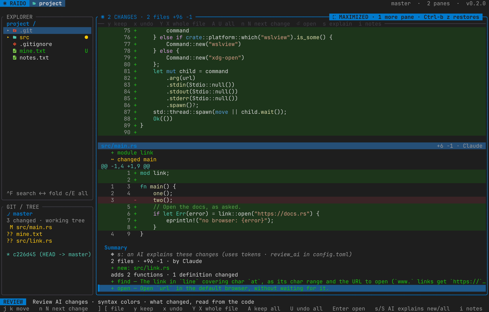

When an AI pane finishes a prompt, the status line says how many files it changed
(`Claude finished · 3 files to review: Ctrl-b v`), and its title shows
`✎ 3 files · ^B v` until you've kept or undone them.

**How it knows what the agent changed:** while AI panes are open, Raido snapshots the
project with Git every couple of seconds while an agent works, and every few seconds
while they wait. Files that change while an agent is working are the agent's; the
review compares each one with how it was before the agent first touched it, so
changes from several prompts add up until you keep or undo them. Files you change
while no agent works, or save from Raido's editor, are yours and stay out of the
review. Edits you make in another editor *while* an agent works can't be told apart
and show up too (keep them with `y`). It works with every CLI, needs no setup, and
never writes to your repository: the snapshots go into Raido's own Git index and
object store in your cache folder, deleted when Raido quits. `.gitignore`d files
(build output, `node_modules`) are left out, except notes: gitignored `.md` and
`.txt` files are reviewed too, as named by `review_ignored`.

**Gitignored notes** (`review_ignored = ["*.md", "*.txt"]`, the default): a
`TODO.txt` or a `plans/` folder you keep out of Git is still reviewed when an agent
edits, adds or deletes in it, and keeping or undoing works as for any file. They
stay ignored in your repository; only Raido's own snapshot takes them in. A pattern
matches file names (`"*.md"`, `"NOTES*"`; `*` is any characters, letters match in
either case), or the path from the project folder when it has a `/`
(`"plans/*.md"`). Left out whatever the patterns say: files over 2 MB, and anything
under dependency, build and cache folders (`node_modules`, `target`, `build`,
`dist`, `.venv`, `__pycache__`…), nested repositories and Python environments. A
large ignored folder is looked through 5,000 entries at a time. `[]` reviews no
gitignored file.

The review needs a Git repository (`git init` makes one) and lasts while Raido runs.
Set `review_changes = false` to turn it off.

### Screenshots and images in AI panes

Three ways to hand an AI pane a screenshot:

- **`Ctrl-V` in the AI pane** (Control, also on a Mac), as outside Raido: Claude
  Code and Codex read the image on the clipboard themselves and attach it
  (`[Image #1]`). Claude Code reminds you: switch back to Raido with an image on
  the clipboard and it shows `Image in clipboard · ctrl+v to paste`.
- **⌘V on a Mac** (`paste_screenshots`, on by default). A terminal's ⌘V pastes
  only text, and a screenshot has none, so while an AI pane is open Raido watches
  the clipboard: a screenshot put there is saved, and its path added beside the
  image as text (the status line says `Screenshot on the clipboard · ⌘V pastes it
  into the AI pane`). ⌘V in the AI pane then pastes the path, and Claude Code,
  Codex and OpenCode attach the image; the Local LLM gets the path to ask about.
  The path is there only while Raido is in front (its terminal is the active app
  and, as far as the terminal reports it, Raido's window has the focus): switch to
  another app, a browser to paste into GitLab or GitHub, Slack, Messages, and the
  clipboard holds the screenshot exactly as copied, with its path again when you
  come back. Closing the last AI pane or quitting Raido puts it back too. Text you
  copy is never touched. `paste_screenshots = false` turns it off. Terminals that send an empty paste for an image work without
  it too (`raido --keys`, ⌘V: `Pasted nothing (an image paste)`).
- **`Ctrl-b I`** (or `:image`) from any pane, in any terminal: Raido takes the
  image on the clipboard, else the screenshot you took in the last 30 minutes (the
  newest image in your screenshot folder, the Desktop on a Mac unless you changed
  it, `~/Pictures/Screenshots` on Linux), and types its path into the AI pane's
  prompt, which then has the focus. Claude Code and Codex attach a pasted image
  path; Gemini gets it as `@path`. The image is kept in Raido's cache folder for a
  week, so the conversation can still read it. So `⌘⇧4`, then `Ctrl-b I` works
  without the clipboard at all.

**Local models** take screenshots too, when the model reads images:

- **OpenCode** attaches the pasted path like Claude Code. On your
  [model server](#your-own-model-server-ollama-vllm), Raido tells OpenCode which
  models take images: vLLM doesn't say, so it goes by the name (Qwen2.5-VL,
  Qwen3-VL, InternVL, Pixtral, Gemma 3, Llama 4, llava…); text models are left
  text only, so OpenCode never sends them an image they'd refuse.
- **The Local LLM** (`ollama run`): `Ctrl-b I` types the path and a space; ask your
  question and Ollama attaches the image.
- When the model the pane started on can't read images (Ollama says so: a model
  without the `vision` capability), the status line tells you, with vision models
  to try instead: `gemma3`, `qwen2.5vl`, `llama3.2-vision`.

Reading the clipboard's image uses `osascript` on a Mac, `wl-paste` or `xclip` on
Linux and PowerShell on Windows.

### A new conversation in an AI pane

**`Ctrl-b n`** (or `:ai new`) starts a new conversation in the AI pane you're in, or
the one you used last. Raido starts the pane's CLI again in the same place, as it was
started (the same agent, the model you chose, your `[ai.<name>]` command) but on a
new conversation, so it works the same for Claude Code, Codex, Gemini CLI,
Antigravity, OpenCode, the Local LLM (Ollama, LM Studio, your `[ai.local]`) and your
own launchers. The pane's focused for your first prompt, and the status line says
`New Claude Code conversation`. The CLIs that keep conversations still have the last
one, to go back to with their own `/resume`; a local model's chat just starts over.

While the agent is answering a prompt, `Ctrl-b n` asks first (`Claude Code is still
answering`); press it again within five seconds to stop it and start the new
conversation. To keep the pane and open another beside it, use `:ai claude new`.

### Model and effort in AI panes

The bottom right of a Claude Code or Codex pane shows the model and effort it works
with, such as `Opus 5.5 · xhigh` or `gpt-5.6-sol · medium` (only the model when the
pane is narrow). Raido reads them from the conversation the agent writes: what the
last answer used, and what you switched to since. Switching in the pane (Claude
Code's `/model` or `/effort`, or the effort in its `/model` picker; Codex's
`/model`) updates it within a moment, without waiting for an answer. Before the
agent has said anything it shows the model you started it with
(`:ai claude:sonnet`), if any. Other CLIs show the model they were started with,
if any.

### AI panes see your editor

As with Claude Code's VS Code extension, Claude Code in an AI pane knows where you
are. Open a file, start Claude Code (`Ctrl-b a`, then 2) and it connects to Raido by
itself: its prompt shows `⧉ In beacon.rs`, or `⧉ 4 lines selected` while you have
lines selected (`v` / `V`), and that holds after you switch to its pane to type. Ask
"what does this do?" or "fix this" without pasting anything. Claude Code can also
ask Raido for the files you have open and your language servers' errors and
warnings, and open a file for you while you keep typing in its pane.

- Raido listens on 127.0.0.1 only. As VS Code's extension does, it writes the port
  and a fresh secret to Claude Code's own folder (`~/.claude/ide/`, or
  `$CLAUDE_CONFIG_DIR/ide`), readable only by you, and Claude must present the
  secret to connect. The file goes when Raido quits.
- `:ide` says whether Claude Code is connected. A Claude Code started outside Raido
  connects with `/ide`, which lists Raido for this project.
- Claude Code shows the edits it proposes in its own pane as usual, and the
  [review](#review-ai-changes) has them afterwards.
- Raido only listens when Claude Code is installed; `claude_ide = false` turns the
  connection off.

**Any agent: `Ctrl-b i`.** In an editor, `Ctrl-b i` (or `:mention`) types a
reference to the file, and to the lines you selected, into the AI pane on screen
(the one you used last), then takes you there to type your question:

| Agent | Gets |
| --- | --- |
| Claude Code | `@src/app.rs#L120-140`, its own format |
| Codex, Gemini and others | `@src/app.rs (lines 120-140)` |

With nothing selected it's the file alone. From the AI pane, `Ctrl-b i` refers to the
editor you came from. The agent reads the file itself, and nothing is sent until you
press Enter.

### Interactive documentation

`Ctrl-b /` (or `:ask`) opens a docs pane beside the code, and an AI agent answers
in it like the official documentation, Stack Overflow and a guide to your project
in one. Ask how to do something in the language you write, what a function does,
or where this project does a thing:

```text
❯ how do I count how often each word appears in a list?
```

The answer is short and to the point, then it ends: the function that does it
and its import (`collections.Counter`), a minimal example in your language, and
**what the example prints**. The agent gives the output it knows; when it isn't
sure, an agent that can run commands here (Claude Code, Codex, OpenCode) runs the
example in a scratch folder of its own and shows what it really printed, and the
others mark it **Expected output**. It looks at your project only when the
question is about it. Agents that can are asked for little reasoning effort, so the
answer comes quickly. Code wraps to the pane's width, however narrow it gets.

| In the docs pane | |
| --- | --- |
| Type, Enter | Ask; follow-ups know what was asked before (`and in reverse?`) |
| Enter on an empty line | Explain the name under the cursor (`read_csv`), or the code you selected, in the file you came from |
| `Ctrl-y` | Copy the code example on screen |
| ↑↓ PgUp PgDn, Home End | Scroll the answers |
| `Ctrl-u` | Clear the question |
| `Esc` | Stop an answer on its way; else back to your code |
| `Ctrl-b n` | A new topic: the questions before are forgotten |

`:ask how do I parse a date?` asks at once. The question goes with where you are:
the file and its language, the line, and what you selected. While the agent works,
the pane says what it's doing (`reading app.py`, `searching the web for …`,
`running python3 example.py`).

**Which agent:** `docs_ai` in `config.toml`, `"auto"` by default: the first installed
of Claude Code (on Sonnet), Codex, Gemini CLI, Antigravity, OpenCode, then a local
model. Name one (`docs_ai = "codex"`), one with a model (`"claude:opus"`), a list to
try in order, a command of yours that reads the question on its input, or `"off"`.
It runs in the background with your sign-in and subscription, one run per question;
no skill is needed, as every agent gets the same instructions with the question.

**It changes nothing in your project.** Each agent runs read-only: Claude Code with
only its reading, search and web tools, and commands in its sandbox, which may write
only in the scratch folder; Codex in its sandbox, writing only there; Gemini and
Antigravity in plan mode. OpenCode is told to keep to the scratch folder. The pane
keeps its answers with your [session](#sessions).

### Editor: normal mode

| Key | Action |
| --- | --- |
| Arrows or `h j k l` | Move left/down/up/right |
| `w` / `b` | Next / previous word |
| `0` / `^` / `$` | Line start / first non-whitespace / line end |
| `gg` / `G` | First / last line |
| `42G` or `:42` then Enter | Go to line 42 (line numbers are one-based) |
| `15j` / `15k`, `15` Enter / `15-`, `:+15` / `:-15` | Jump 15 lines down / up — the numbers shown by `:set rnu` |
| `d3j` / `d3k`, `y3j` / `y3k`, `gc3j` / `gc3k` | Delete / copy / comment the cursor's line and the 3 below / above it |
| `10j`, `3w`, `5x`, `3dd` | Repeat a movement, character or line deletion |
| PageUp / PageDown | Move 20 lines up/down |
| `Ctrl-u` / `Ctrl-d` | Move 15 lines up/down |
| `i` / `a` | Insert at cursor / append after cursor |
| `I` / `A` | Insert at line start / append at line end |
| `o` / `O` | Open an indented line below / above and enter insert mode |
| `x` / Delete | Delete character under cursor |
| `dd` / `17dd` | Cut the line / 17 lines from the cursor's (to the clipboard; one `u` undoes) |
| `D` / `C` | Delete to line end / delete to end and enter insert mode |
| `yy` / `17yy` / `p` / `P` | Copy the line / 17 lines / paste below (after cursor) / above (at cursor) |
| `v` / `V` | Select characters / whole lines (see [Copy and paste](#copy-and-paste)) |
| `K` / `gd` / `Ctrl-o` | Hover docs / go to definition / jump back |
| `gcc` / `3gcc`, `gc` on a selection, `Ctrl-/` in any mode | Comment out the line / three lines / the selected lines, or back in (see below) |
| `]d` / `[d` | Next / previous diagnostic |
| `]c` / `[c` | Next / previous [change from Git](#changes-in-the-gutter) |
| `u` / `Ctrl-r` | Undo / redo |
| `/text` then Enter | Search, wrapping through the file |
| `n` / `N` | Next / previous search result |
| `Ctrl-f` / `Ctrl-h` | [Find / find and replace](#find-and-replace), like VS Code |
| `:noh` | Clear search highlights |
| Tab / Shift-Tab | Cycle next / previous open buffer |
| `:` | Open command prompt; Enter runs it, Escape cancels |

### Language-aware typing

Typing follows the language of the file, like VS Code:

| Language | Enter indents after | Also |
| --- | --- | --- |
| Python | a line ending in `:` (`def f():`, `if x:`) | dedents after `return`, `pass`, `break`, `continue`, `raise`; `else:` / `elif` / `except` / `finally` move back under their `if` / `try` |
| Rust, Go, C/C++, JS/TS, Java, Kotlin, Swift, C#, PHP, CSS, JSON | `{`, `(`, `[` | Go and Makefiles indent with tabs |
| YAML, Docker Compose, Makefile | `:` | |
| Dockerfile | an instruction ending in `\` | its next lines line up one level in; the line after the last goes back to the instruction's |
| Shell | `then`, `do`, `else`, `case … in`, a case's pattern (`start)`), a line ending in `\` | `fi`, `done`, `esac`, `else`, `elif` go back under the `if`, loop or `case` they close as you finish typing them; `;;` goes back to the patterns; the line after a command that goes on goes back to its start |
| Lua / Ruby | `then`, `do`, `function` / `def`, `class`, `if`, `do \|x\|` … | |
| Markdown | | lists continue (`- `, `1.` → `2.`, `- [ ]`); Enter on an empty item ends the list |

- Enter between brackets (`{|}`) opens an indented line and puts the closer on its own
  line; a closer typed on a blank line lines up with its opener.
- `(`, `[`, `{`, `"`, `'` (and `` ` `` in JS, Go, shell, Markdown) close themselves when
  the next character is a space, a closer or the line end, never right after a letter
  (`don't`; Python's `f"` and `r'` still close). Typing the closer steps over it,
  Backspace in an empty pair removes both, and typing an opener over a Shift-selection
  wraps it. Python's `"""` and `/*` in C-like languages close as you open them
  (`"""|"""`, `/*| */`), so the rest of the file doesn't turn into string or comment
  color while you write.
- The indentation unit comes from the file (tabs, or its most common step), else the
  language (tabs for Go, 4 spaces for Python, 2 for YAML), else `tab_width`. Tab goes to
  the next stop, Shift-Tab dedents the line, and Backspace in leading spaces removes a
  whole level.
- `o` indents the new line the same way Enter would.

These rules are instant and local; language servers keep to completions, diagnostics
and formatting on save. Turn them off with `smart_indent = false` / `auto_pairs = false`.

### Find and replace

**`Ctrl-f`** opens a find bar in the editor's top-right corner, filled in with the
selection, or else the word under the cursor (select it and Ctrl-f to find a
variable). Matches light up as you type, the current one in the accent color, and
the bar counts them ("3 of 12"). Typing replaces the filled-in text.

| Key in the bar | Action |
| --- | --- |
| Enter / ↓, ↑ | Next / previous match |
| `Ctrl-w` | Whole words only (`count` no longer matches `counter`) |
| Tab or `Ctrl-h` | Show the replace field and switch between the two |
| Enter (in Replace) | Replace this match and go to the next |
| `Ctrl-a` | Replace all matches; one `u` undoes them all |
| `Ctrl-u` / `Ctrl-v` | Clear the field / paste into it |
| Esc | Close; `n` / `N` keep going, `:noh` clears the highlights |

**`Ctrl-h`** opens the bar with the replace field ready. Searches ignore case until
you type a capital letter (`Count` then matches only `Count`; the bar shows `Aa`).

Character movement is UTF-8-aware, not grapheme-cluster-aware. This is a documented
Vim subset, not full Vim: block selection, arbitrary operators (`d3j`, `dw`) and
macros are not implemented.

### Changes in the gutter

Like VS Code, the editor marks lines that differ from Git in the column between the
line numbers and the text, updating as you type (unsaved edits count):

| Mark | Color | Meaning |
| --- | --- | --- |
| `▌` | green | Added line |
| `▌` | blue | Changed line |
| `▁` | red | Lines removed below this line (`▔` above the first line) |

The comparison is with the file's version in the Git index, as in VS Code and
`git diff`: after `git add` or a commit, those marks go away. Untracked files and
files outside Git have none. `]c` / `[c` jump to the next / previous change. Colors
come from the theme's terminal palette (bright green, blue and red).

### Minimap

Beside the code, the minimap shows the whole file from far away, as in VS Code. Each
character cell is a Braille block of four lines by eight columns, so the code keeps
its shape at a quarter of its size, in the color most of that text has.

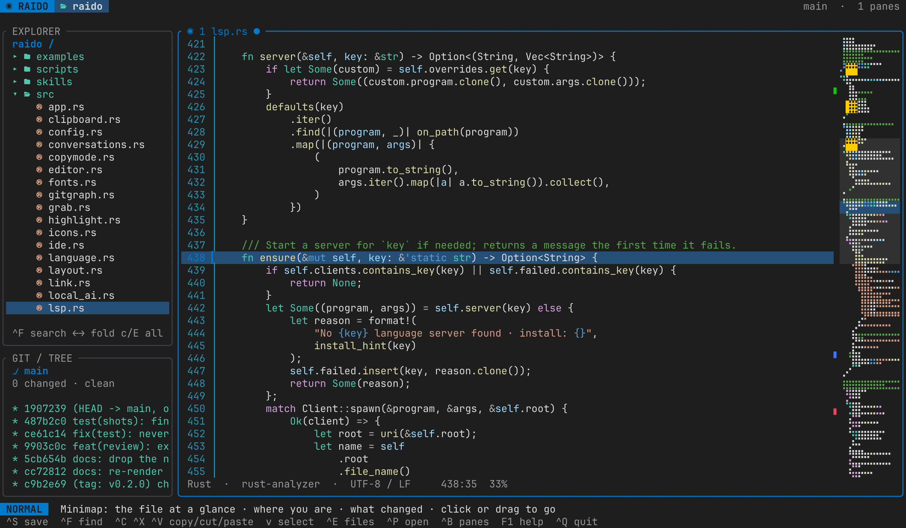

- **Where you are:** the lighter band is the part on screen; the cursor's row has
  the current line's color.
- **What changed:** lines that differ from Git are marked on its left edge, in the
  [gutter's](#changes-in-the-gutter) colors. A mark's top or bottom half says which
  two of the four lines.
- **Find matches** show in yellow, **errors and warnings** in red and yellow, so you
  see where they are in the whole file.
- **Click** it to jump there: that line comes to the middle of the screen. **Drag**
  the band to scroll, like a scrollbar. The wheel over it scrolls the editor.
- A file longer than the map scrolls it along with the view, so both ends stay in
  reach.

An editor needs room for 60 columns of code beside it, so narrow splits go without.
`:minimap` hides and shows it until you quit; `minimap = false` in config.toml keeps
it off.

**Comment out lines** with `Ctrl-/` (in any mode, on the line or the selected
lines), `gcc` (the line; `3gcc` three) or `gc` on a selection, as in VS Code and
Vim's commentary: the language's mark goes at the lines' shared indentation (`//`,
`#`, `--`, `;`…), blank lines are left alone, and the same keys comment lines back in
once they all are. Languages without a line comment get one around each line
(`<!-- … -->` in HTML, XML and Markdown, `/* … */` in CSS). `u` undoes it at once.
Terminals send `Ctrl-/` as `Ctrl-_`, which works too.

### Editor: insert mode

Type normally. Enter indents for the language ([Language-aware
typing](#language-aware-typing)); Tab indents. Backspace/Delete, arrows, Home/End and
PageUp/PageDown work. Escape returns to normal mode. `Ctrl-s` saves without leaving
insert mode.

**Autocomplete:** after two letters of a word, suggestions pop up: the language
server's (Rust, Go, Python, C/C++, when installed), or else the language's keywords
and the words already in your open files of that language, most used first. They
also pop up after `.`, and `Ctrl-Space` or `Ctrl-n` asks any time (macOS keeps
Ctrl-Space for switching keyboard languages when you have more than one). Up/Down or `Ctrl-n`/`Ctrl-p`
choose, **Tab** accepts, Escape closes the list, and typing keeps filtering it. Enter
accepts a suggestion you picked with Up/Down (or one you asked for); otherwise it
starts a new line, so a list that popped up never eats a newline. A suggestion
that needs an import brings it, as in VS Code: accepting `useState` in TypeScript adds
`import { useState } from "react";`, and Go, Rust, Python and C++ servers do the
same; the status line says what was added, and `u` takes both back.
The list stays inside the pane you're typing in, never over another, and one that
pops up by itself shows at most six suggestions. It opens below the line you're on
(above only when there's hardly any room below), so the code you just read stays in
view, and it goes away once the word is typed out or you've moved past it. Inside
strings and comments it doesn't pop up by itself; `Ctrl-Space` still asks there.
`autocomplete = false` keeps it to `Ctrl-Space` and `.`.

Mac-style moves work in insert and normal mode, as far as your terminal passes the
keys on (`raido --keys` shows what arrives; a key that prints nothing never reaches
Raido):

| Keys | Action |
| --- | --- |
| Option+← / → (Alt; Ctrl on Linux and Windows) | Previous word / end of word |
| Shift+Option+← / → | Select by word |
| Option+Backspace | Delete the word before the cursor |
| Cmd+← / → / ↑ / ↓ (with Shift: select) | Line start / end, top / bottom of the file |
| Fn+Shift+← / → in macOS Terminal | Line start / end (Terminal sends Home / End) |

macOS Terminal keeps Cmd+arrows for itself, so use Fn+Shift+←/→ there, or a terminal
that passes Cmd on (kitty, WezTerm, Ghostty). If a combination prints nothing in
`raido --keys`, macOS Terminal can be taught to send it in Settings → Profiles →
Keyboard; for example Shift+Option+← / → as `\033[1;4D` / `\033[1;4C`.

### Copy and paste

One clipboard, shared with the rest of your desktop: everything you copy in Raido can
be pasted in other apps and vice versa (via `wl-copy`/`wl-paste` on Wayland,
`xclip` or `xsel` on X11, `pbcopy`/`pbpaste` on macOS; without them Raido copies through
the terminal's OSC 52, which most terminals support, even over SSH).

| Keys | Action |
| --- | --- |
| Shift + arrows / Home / End | Select from the cursor, in normal or insert mode |
| `v` / `V` | Start a character / line selection, then move with any motion |
| `Ctrl-a` | Select the whole file, in any mode (terminal and AI panes keep Ctrl-a for their program) |
| `Ctrl-c` or `y` | Copy the selection — or, with nothing selected, the whole line |
| `Ctrl-x` or `d` | Cut the selection — or the whole line |
| `Ctrl-v` | Paste at the cursor; a copied **line** goes above the cursor line |
| `p` / `P` | Paste after / before the cursor; lines go below / above |
| `c` | Replace the selection: delete it and start typing |
| Backspace / Delete | Delete the selection without copying |
| Escape | Cancel the selection |

A Shift-selection made while typing behaves like any text field: typing replaces it
and a plain arrow cancels it. Your terminal's own paste (⌘V on a Mac, `Ctrl-Shift-V` on Linux, `Ctrl-V` in
Windows Terminal) also works in any mode: it inserts at the cursor, or replaces the
selection. Pasted text goes in as it is, tabs and spaces included: nothing indents it
again or closes brackets for it, and its line breaks become the file's own, whether
the terminal sends `\n`, `\r\n` or the lone `\r` tmux and xterm paste.

Text copied from a terminal, AI, preview or Git pane is read off the screen, where a
tab is already spaces. For code exactly as written, copy it from an editor.

### Mouse

The wheel scrolls whatever is under the pointer, focused or not: an editor (the
cursor stays on screen), a terminal's history, the Git pane, the Markdown preview,
the explorer or the guide. Programs that handle the mouse themselves get the wheel:
Claude Code's full-screen mode, htop; other full-screen programs like `less` get
arrow keys, as in a normal terminal. A click focuses a pane, puts the editor cursor
on the character you clicked, or opens an explorer entry. A click on the
[minimap](#minimap) jumps there; dragging its band scrolls.

**Drag a border to resize.** Pick up the line between two panes and drag it: the
panes on both sides follow, every one along the line, as in tmux. With panes stacked
on the left and one on the right, dragging the line between them makes the right one
wider or narrower and all the stacked ones with it. Focus stays where it was; a click
on a border without dragging (a stacked pane's title) focuses that pane.

**Drag to select and copy.** The selection stays inside the pane you started in, so
running past its edge never picks up the explorer, borders or the pane next to it.
Let go and the text is on the clipboard; paste it anywhere.

- In a **terminal or AI pane** (and the preview, Git and review panes) the drag
  selects what's on screen there, highlighted until your next key or click. Lines
  the terminal wrapped are copied as one line, and the padding at line ends is
  dropped.
- In an **editor** the drag is a normal selection of the file's text, tabs and
  spaces exactly as they are: line numbers and change marks are never copied,
  dragging past the top or bottom scrolls, and the selection stays so you can type
  over it, delete it (`d`), or clear it with Escape.
- **Paste over a selection elsewhere.** Selecting with the mouse copies, but pasting
  straight over that selection (`Ctrl-v`, `p`, or the terminal's `Ctrl-Shift-V` /
  ⌘V) puts in what you copied *before* it, which stays on the clipboard. So: drag
  over code in one pane, then in another pane drag over what it replaces and press
  `Ctrl-v`, as often as you like. The status line says so: `Copied 10 characters ·
  Ctrl-v or p pastes your previous copy over it`.
- **Double-click** copies a word: in an editor the word under the pointer, in other
  panes the whole name, path or URL.

**Open links.** Hold Option (Alt on Linux and Windows) or Ctrl and click a web link,
in any pane, editors included; Cmd-click works too in terminals that pass Cmd on.
In terminal and AI panes a plain double-click on a link opens it as well, and copies
it. Raido finds `http(s)://` and `www.` links itself, even ones the terminal wrapped
onto two rows, leaves the punctuation around them out, and opens them in your
default browser (`open` on macOS, `xdg-open` or WSL's `wslview` on Linux, the URL
handler on Windows). Where no browser can start (an SSH session without a desktop)
the link is copied instead. To copy a link without opening it, drag over it.
`raido --keys` shows which modifiers your terminal reports with a click.

To use your terminal's own selection instead (for rectangle selection, or to copy
across panes):

- **`Ctrl-b y`** (or `:mouse off`) hands the mouse back to the terminal and leaves the
  layout as it is: drag to select, ⌘C (Ctrl-Shift-C on Linux), paste anywhere. A
  `⇱ MOUSE RELEASED` badge in the top bar reminds you; `Ctrl-b y` again (or
  `:mouse on`) brings back the wheel and clicks.
- **Copy view (`Ctrl-b Z`)** does the same with only the focused pane on screen, edge
  to edge, so a selection can't pick up the explorer, borders or line numbers.
- Your terminal's bypass key works too (Option in iTerm2, Shift in most Linux
  terminals), and `mouse = false` in config.toml leaves the mouse to the terminal
  for good.

### Copying from terminal and AI panes

Dragging with the mouse selects and copies inside one pane (see [Mouse](#mouse)). For
the keyboard, or text that has scrolled off screen, there are two more ways:

**Copy mode (`Ctrl-b [`, or `:copymode`)** freezes the focused terminal or AI pane,
including its scrollback (2,000 lines), and gives you a cursor, like tmux:

| Keys | Action |
| --- | --- |
| Arrows / `h` `j` `k` `l` | Move |
| `w` / `b`, `0` / `^` / `$` | Next / previous word; line start / first character / end |
| PageUp / PageDown, `Ctrl-u` / `Ctrl-d` | Page / half page |
| `g` / `G` | Oldest line / bottom |
| `/` / `?` then Enter, `n` / `N` | Search down / up (case-insensitive); next / previous match |
| `v` / `V` | Select characters / whole lines (again to cancel) |
| `y`, Enter or `Ctrl-c` | Copy the selection (or the cursor line) to the clipboard and leave |
| `q` / Escape | Leave (Escape first clears a selection) |

Lines the terminal wrapped are copied as one line, and the padding at line ends is
dropped. Text a program wrapped itself (many AI CLIs do) keeps its line breaks. The
pane keeps running underneath; leaving shows its live output again. `Ctrl-b` and
`Ctrl-q` still work and leave copy mode first.

**Copy view (`Ctrl-b Z`, or `:copyview`)** shows only the focused pane, edge to edge:
no sidebar, header, status lines, borders, line numbers or change marks, and Raido
lets go of the mouse. Select with the mouse as usual, then `Ctrl-b Z` again to
return. Keys keep working in the pane, so you can scroll a terminal with PageUp
while in it. A reminder
shows for the first two seconds only, so it can't end up in a copy.

In editors, select with `v` / `V` and copy with `y` instead: that copies the exact
text, however long, without anything from the screen.

### Language servers (LSP)

Raido starts the standard language server for a file the first time you open it, in
the project root, and talks to it in the background. The [install
scripts](#install-script) set them up for your system (Docker's where Docker and Go
are installed); by hand, install a server once:

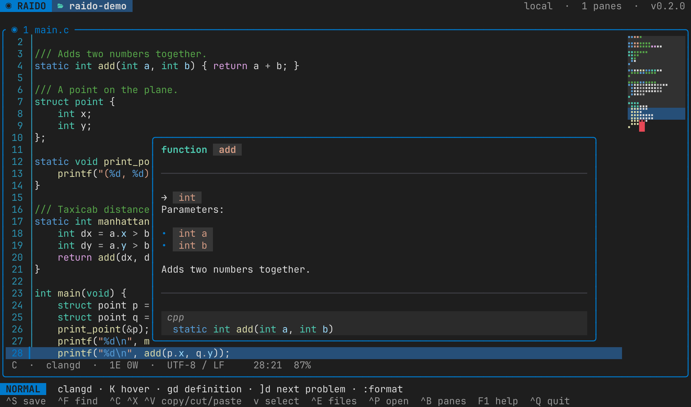

| Language | Server Raido looks for | Install |
| --- | --- | --- |
| Rust | `rust-analyzer` | `rustup component add rust-analyzer` |
| Go | `gopls` (also found in `~/go/bin`, where `go install` puts it) | `go install golang.org/x/tools/gopls@latest` |
| Python | `pyright-langserver`, `basedpyright-langserver`, `pylsp` or `jedi-language-server` | `npm install -g pyright` or `pip install python-lsp-server` |
| C / C++ | `clangd` (also found in Homebrew's `llvm` and the Xcode tools on macOS, `C:\Program Files\LLVM\bin` on Windows) | Arch `pacman -S clang` · Debian/Ubuntu `apt install clangd` · Fedora `dnf install clang-tools-extra` · macOS Xcode tools · Windows `winget install LLVM.LLVM` |
| TypeScript, JavaScript | `typescript-language-server`, with the project's own TypeScript, else TypeScript 6 installed beside it | `npm install -g typescript-language-server typescript@6` |
| YAML | `yaml-language-server` | `npm install -g yaml-language-server` (Homebrew and Arch: `yaml-language-server`) |
| JSON | `vscode-json-language-server` (VS Code's) | `npm install -g vscode-langservers-extracted` (Homebrew: `vscode-langservers-extracted` · Arch: `vscode-json-languageserver`) |
| Shell (sh, bash, ksh) | `bash-language-server`, with `shellcheck` for warnings and `shfmt` for formatting (also found in `~/go/bin`) | `npm install -g bash-language-server` (Homebrew and Arch: `bash-language-server`) · `brew` / `apt` / `pacman install shellcheck shfmt` (Fedora, openSUSE: `ShellCheck`) |
| Dockerfile, Docker Compose | `docker-language-server` (also found in `~/go/bin`) | `go install github.com/docker/docker-language-server/cmd/docker-language-server@latest`, or a binary from its [releases](https://github.com/docker/docker-language-server/releases) |
| Assembly (x86, ARM, RISC-V) | `asm-lsp` (also found in `~/.cargo/bin`), for the files it reads right: [details](#assembly-x86-arm-and-risc-v) | `cargo install asm-lsp --locked` (Homebrew: `asm-lsp`) |

| Feature | How |
| --- | --- |
| Diagnostics | A `●` in the gutter, underlined code, and an error's or warning's message, faint, after the line (`inline_diagnostics`); on the cursor's line it's at the bottom of the pane instead. The marks move with their lines as you type, before the server checks again. `]d` / `[d` jump between them. The underline takes the problem's color in terminals that color underlines (iTerm2, Ghostty, kitty, WezTerm, foot, VS Code, tmux); elsewhere, including macOS Terminal.app, it's plain and the `●` keeps the color |
| Hover | `K` shows types and docs in a popup; any key closes it |
| Go to definition | `gd` opens the definition (even in another file); `Ctrl-o` jumps back |
| Completion | Pops up after two letters or `.`; `Ctrl-Space` or `Ctrl-n` asks; keywords and words from your files without a server. Accepting one that needs an import adds it (`useState` → `import { useState } from "react"`), as VS Code does |
| Format | `:format` formats the file with the server's formatter (rustfmt, gofmt, clang-format…); a `.json` file is laid out by Raido itself, no server needed ([JSON](#json-formatting)) |
| Tidy on save | Go files are tidied every time you save, as in VS Code: [details below](#go-tidy-on-save) |
| Status | The pane footer names the server and counts errors/warnings; `:lsp` lists every language; `:lsp restart` restarts them |

A missing server is reported once, with its install command, and never interrupts
editing. C/C++ projects give clangd the best results with a `compile_commands.json`
(CMake: `-DCMAKE_EXPORT_COMPILE_COMMANDS=ON`). To use a different server, or turn
LSP off, see `lsp` and `lsp_enabled` in [config.example.toml](config.example.toml).

#### Python: virtual environments (uv, Poetry, venv)

Raido runs the Python server on the project's virtual environment, as VS Code does
once you pick its interpreter, so packages installed there resolve; there is nothing
to select or configure:

- **Which one:** the activated one (`$VIRTUAL_ENV` when you started Raido), else
  `.venv` or `venv` beside the file or in a folder above it, up to the project root:
  where `uv sync`, Poetry (in-project) and `python -m venv` make it. `:lsp` says which
  (`python: pyright-langserver ready on .venv`).
- **Packages added later** (`uv add`, `uv remove`, `pip install`) and modules created,
  deleted or renamed outside Raido (by an AI, in a terminal) reach Pyright and
  basedpyright within about two seconds, as VS Code's file watcher tells them; edits
  to `pyproject.toml` or `pyrightconfig.json` too. Other servers restart when
  packages change.
- **A venv made later or rebuilt** (`uv sync` in a new clone, a new Python): the
  server starts again on it by itself.
- **The project's own server:** a `pyright-langserver` or `basedpyright-langserver`
  in the venv (`uv add --dev basedpyright`) is used before one on PATH.

`[tool.pyright]` `venvPath` / `venv` in `pyproject.toml` still take precedence for
Pyright.

#### Go: tidy on save

Saving a `.go` file (`Ctrl-s`, `:w`, `:wq`, `:wa`) first lets **gopls** do what VS Code's
Go extension does on save:

1. **Organize imports** (like `goimports`): add missing imports, remove unused ones,
   and sort and group them.
2. **Format** the file (`gofmt`): tabs, spacing and alignment.

Then the file is written. Both steps are ordinary edits, so `u` undoes them. The
status line says what happened (`imports organized and formatted by gopls`). If gopls
isn't installed, fails, or takes longer than two seconds (it may while loading a
large module), the file is saved exactly as typed and the status line says why.
`:w other.go` (a different name) also saves the text as is.

The languages are listed in `format_on_save` (default `["go"]`). Add `"rust"`,
`"python"`, `"c"`, `"typescript"`, `"shell"`, `"yaml"` or `"docker"` (Compose files) to do
the same with their servers, `"json"` for [JSON](#json-formatting), or set
`format_on_save = []` to turn it off.

#### TypeScript and JavaScript

Raido highlights `.ts`, `.mts`, `.cts`, `.tsx`, `.js`, `.mjs`, `.cjs` and `.jsx` files
with its own grammar: keywords, functions, classes and types (the names interfaces,
type aliases, enums and classes declare, PascalCase names and the built-in ones),
constants, template literals with their `${…}`, regular expressions (told apart from
division), decorators, and JSX in `.tsx`, `.jsx` and `.js` files: tags, components,
attributes and `{expressions}`. In a `.ts` file `<T>(x) => x` is a generic, never an
element. ```` ```ts ````, ```` ```tsx ```` and ```` ```js ```` blocks in Markdown too.

**`typescript-language-server`** serves both languages, as VS Code's TypeScript
support does: type errors as you type, completion of members and imports, `K` for
types and docs, `gd` across files and into `node_modules`, and `:format`; add
`"typescript"` to `format_on_save` to organize imports and format on every save. It
uses the project's own TypeScript (`node_modules/typescript`) when that has
`tsserver`, else the TypeScript 6 installed beside it. TypeScript 7, the new native
compiler, has no `tsserver`, and no documented way yet for other editors to start
its own language server, so the server needs TypeScript 6 beside it:
`npm install -g typescript-language-server typescript@6`.

#### YAML and JSON, checked against their schemas

Red Hat's **YAML server** (`yaml-language-server`) and **VS Code's JSON server**
(`vscode-json-language-server`, see the table above) check a file against the schema
published for its kind, as VS Code does: a key that doesn't belong, a value of the
wrong type or a required key that's missing is underlined, and completion and `K`
offer the keys and values the schema allows, with their docs.

- **Which schema:** [SchemaStore](https://www.schemastore.org)'s catalog names the
  schema for hundreds of kinds of files by their names: GitHub Actions workflows
  (`.github/workflows/*.yml`), GitLab CI, `package.json`, `tsconfig.json`,
  `.eslintrc.json`, `renovate.json`, `appsettings.json`… A **Kubernetes manifest**
  has no telling name, so Raido knows one by its top-level `apiVersion:` and `kind:`
  and has it checked against Kubernetes' schemas (custom resources too, from
  [Datree's CRD catalog](https://github.com/datreeio/CRDs-catalog)). Any other YAML
  file can name its own with a first line `# yaml-language-server: $schema=<url>`.
- **JSON with comments:** `tsconfig.json`, `jsconfig.json`, `.eslintrc.json`,
  `.babelrc`, `devcontainer.json`, VS Code's `.vscode/*.json`, `.jsonc` and
  `.code-workspace` files may hold comments and trailing commas, as VS Code allows.
- **Formatting:** `:format` lays out YAML with the server (`"yaml"` in
  `format_on_save` to do it on save) and JSON with comments with VS Code's; a
  `.json` file Raido [lays out itself](#json-formatting).
- **Online:** the schemas are downloaded as files need them, and SchemaStore's
  catalog once a week (with `curl`, into Raido's cache). Set `lsp_schemas = false`
  in config.toml to stay offline: then only the syntax is checked. A project inside
  a folder whose name starts with a dot (`~/.config/…`) misses the catalog's
  patterns, as in VS Code.

#### Shell scripts

Raido knows a **shell script** by its extension (`.sh`, `.bash`, `.ksh`, `.zsh`,
`.fish`, `.bats`, `.command`), by name (`.bashrc`, `.bash_profile`, `.profile`,
`.zshrc`, `.zprofile`, `.envrc`, `PKGBUILD`), and, without an extension, by the `#!`
line it starts with (`#!/bin/bash`, `#!/usr/bin/env -S bash -e`, `#!/bin/sh`).
Typing a `#!` line into a new file makes it one at once. The status line names the
shell (`Shell (bash)`), and ```` ```sh ````, ```` ```bash ```` and ```` ```shell ````
blocks in Markdown are highlighted too.

Typing follows the script's blocks: Enter indents after `then`, `do`, `else`,
`case … in` and a case's pattern; `fi`, `done`, `esac`, `else` and `elif` go back
under the `if`, loop or `case` they close (matched through the blocks in between,
so nesting works) once you type the space, `;` or Enter after them; `;;` goes back
to the patterns; and a command that goes on over lines ending in `\` indents them,
the line after going back to its start.

The **Bash language server** (`bash-language-server`, see the table above) adds,
for sh, bash and ksh scripts:

- **ShellCheck's warnings** as diagnostics: unquoted variables, typos (`$nam` where
  `$name` is set), unreachable code, missing `cd ... || exit`.
- **Completion** of variables, functions, commands and builtins, **hover** docs for
  builtins and commands (`K`), **go to definition** of functions and variables
  (`gd`), across files a script `source`s.
- **`:format` with shfmt**, keeping the file's own indentation (tabs stay tabs, two
  spaces stay two); add `"shell"` to `format_on_save` to format on every save.

ShellCheck and shfmt are separate programs the server runs when they're installed;
`:lsp` says when one is missing (`shell: bash-language-server ready (shfmt not
installed)`). Raido hands the server their paths when they're off PATH, as `go
install` leaves shfmt. zsh scripts are highlighted and indented as above, fish
scripts highlighted (fish closes its blocks with `end`); both go without the server,
as ShellCheck doesn't read them and would flag every line.

#### Docker: Dockerfiles and Compose files

Raido knows a **Dockerfile** by its name: `Dockerfile`, `Containerfile`,
`Dockerfile.dev`, `api.dockerfile` (but not `Dockerfile.dockerignore`). Its own
grammar colors instructions (in any case), images and build stages (`AS build`,
`--from=build`), flags, `ENV` / `ARG` / `LABEL` keys, variables (`$VAR`,
`${VAR:-default}`), strings and comments, and reads `RUN`, `CMD` and `ENTRYPOINT`
as shell, heredocs (`RUN <<EOF`) included. An instruction that goes on over lines
ending in `\` stays one instruction, comment lines in it too. Enter after such a
line indents the next one level, and the line after the last goes back.
```` ```dockerfile ```` blocks in Markdown are highlighted too.

A **Compose file** is `compose.yaml` or `docker-compose.yml` (`.yml` or `.yaml`),
and the ones beside them: `compose.override.yaml`, `docker-compose.prod.yml`. It is
highlighted and indented as YAML, the status line says *Docker Compose*, and
completion offers Compose's keys (`depends_on`, `healthcheck`, `restart`…).

**Docker's language server** (`docker-language-server`, see the table above) adds,
once installed:

- **Compose files:** completion of keys and values, errors, hover docs, go to
  definition of services, networks and volumes, and `:format` (add `"docker"` to
  `format_on_save` to format on every save).
- **Dockerfiles:** warnings from BuildKit's checks (it needs Docker with Buildx)
  and, with `K` on a `FROM` image, what Docker Scout knows about it.

Raido tells the server not to send usage reports to Docker (`telemetry: off`).

#### Assembly (x86, ARM and RISC-V)

`.s`, `.S`, `.sx`, `.asm`, `.nasm` and `.yasm` files are highlighted with the
grammar for the CPU they're written for, and the status line names it: *Assembly
(x86)*, *Assembly (ARM)* for 32-bit ARM and Thumb, *Assembly (AArch64)*, *Assembly
(RISC-V)*. Each knows its assembler's syntax: GNU as (AT&T, and Intel after
`.intel_syntax`), NASM, YASM and MASM on x86; GNU as, Clang (Apple's too) and armasm
on ARM; GNU as on RISC-V; Go's assembler on all of them. Labels, instructions,
branches and calls (in the control-flow color), registers (`%rax`, `eax`, `x0`,
`v0.4s`, `a0`, `mstatus`), directives (`.globl`, `section`, `.word`), immediates
(`$60`, `#1`, `0x10`, `0FFh`), relocations (`@PLT`, `:lo12:`, `msg@PAGEOFF`,
`%hi(msg)`), sizes (`qword ptr`), strings, comments and `.S` files' `#include` and
`#define` lines each get their color.

The extensions don't say which CPU, so Raido reads it from, in turn:

1. the project's `.asm-lsp.toml` (the nearest one above the file, up to the folder
   with `.git`), whose `instruction_set` (`"x86/x86-64"`, `"arm"`, `"arm64"`,
   `"riscv"`) names it for the whole project or, in a `[[project]]`, for a folder;
2. the file's name: `memmove_arm64.s`, `asm_amd64.s`, `start-riscv.S`,
   `boot_rv64gc.S` (`.nasm` and `.yasm` are x86's);
3. its code: registers and instructions only one CPU has (`%rax`, `w0`, `adrp`,
   `a0`, `ecall`, `8(sp)`); comments and strings don't count;
4. its folders: `arch/arm64/kernel/head.S`;
5. the CPU Raido runs on.

An empty `.s` file starts as this computer's, and switches as soon as the code
typed in it says otherwise. ```` ```nasm ````, ```` ```armasm ````, ```` ```arm64 ````
and ```` ```riscv ```` blocks in Markdown are highlighted too, and an ```` ```asm ````
block by its code.

Enter after a label on a line of its own (`loop:`) indents the next line; a label
typed on an indented line goes back to where the labels above it start. `Ctrl-/`
and `gc` comment lines out with the mark the file's assembler reads, the one its
comments already use: `;` for NASM, `@` for 32-bit ARM, `//` for AArch64 and Go,
`#` for GNU as on x86 and RISC-V (GNU as reads `;` as a statement separator, not a
comment).

**asm-lsp** adds hover docs for instructions, registers and directives, completion,
go to definition and references for labels, and the assembler's errors. Without
settings it reads every file as GNU as for the CPU it runs on, and checks files by
assembling them with `gcc`, so Raido starts it only for those files: another CPU's
code, or NASM's, would get the wrong docs and an error on most lines. For the rest,
`:lsp` says what to write. Put a `.asm-lsp.toml` in the project's root (or in
`~/.config/asm-lsp/`, `%APPDATA%\asm-lsp\` on Windows) naming the CPU and the
assembler, and Raido serves every file with it; its `instruction_set` also picks Raido's grammar, so one setting does both:

```toml
[default_config]
assembler = "gas"        # or "nasm", "masm", "go"
instruction_set = "riscv"  # or "x86/x86-64", "arm", "arm64"

# A folder of the project with another CPU's code.
[[project]]
path = "firmware"
assembler = "gas"
instruction_set = "arm"
```

`asm-lsp gen-config` writes one by asking. A `compile_commands.json` or
`compile_flags.txt` tells it how the project assembles (a cross-assembler, include
folders); see [asm-lsp's README](https://github.com/bergercookie/asm-lsp#readme).

#### JSON formatting

`:format` in a `.json` file lays it out one value per line, indented, without a
language server. Nothing else changes: keys keep their order, and strings and
numbers keep their exact text (`1.50` stays `1.50`, long integers keep every digit).
The indentation is the file's own (two spaces stay two), else `tab_width`; `{}` and
`[]` stay on one line, the cursor stays on its character, and `u` undoes it. JSON
that isn't valid is left as it is: the status line says where and why (a missing
comma, a trailing comma, a comment) and the cursor goes there. Add `"json"` to
`format_on_save` to format on every save.

### Markdown preview

Existing `.md`/`.markdown` files open **rendered**; new or empty ones open as
source so you can write. The preview is read-only and re-renders on every edit,
and when an AI or shell tool rewrites the file on disk.

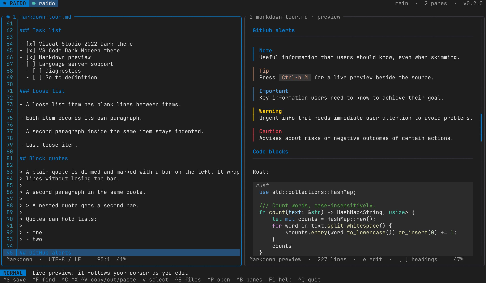

| Key / command | Action |
| --- | --- |
| `j` `k` / arrows | Scroll one line |
| Space, `Ctrl-d` `Ctrl-u`, PageUp/PageDown | Page down / half page / page up |
| `g` / `G` | Top / end |
| `]` / `[` | Next / previous heading |
| `e`, `i` or Enter | Edit the source at the block you were reading |
| `/` | Switch to the source and search it |
| `:preview` or `Ctrl-b m` | Toggle rendered view / source, keeping your place |
| `:preview split` or `Ctrl-b M` | Live preview beside the source; it follows the cursor |

Rendered: headings, emphasis, strikethrough, inline code, links (their target is
shown dimmed), images (as alt text), nested bullet/numbered/task lists, block quotes,
GitHub alerts (`> [!NOTE]`, `[!TIP]`, `[!IMPORTANT]`, `[!WARNING]`, `[!CAUTION]`),
fenced code with syntax highlighting, tables with alignment, rules, footnotes and
YAML front matter. HTML is reduced to its text. Prose wraps to the pane and is
centered at a 100-column reading width; wide tables shrink and truncate cells.
Colors come from the active theme.

### Jupyter notebooks

Notebooks (`.ipynb`) open as their **cells**, the way Jupyter and GitHub show them:
Markdown cells rendered, code cells highlighted in the kernel's language with their
execution count (`In [3]:`), and under each what it printed, what it returned
(`Out[3]:`), and its error with the traceback, without its terminal colors. A plot or
another image is named for what it is (`▣ PNG image, 640 × 480`), since a terminal
can't show it; HTML results show as their text, and a data frame as its table text.
The footer names the kernel and counts the cells.

The keys are the [Markdown preview](#markdown-preview)'s, with `]` / `[` going from
cell to cell. A notebook is its JSON: `e` edits it at the cell you were reading,
`Ctrl-b m` switches back, and `Ctrl-b M` puts the JSON beside the cells, which follow
the cursor from cell to cell and re-render as you type. Raido doesn't run cells; a
notebook a kernel rewrites on disk shows its new outputs.

### Nmap scan reports

Nmap output opens as a **report** in the preview pane, like Markdown. That covers all
three files `nmap -oA` writes: normal (`.nmap`), grepable (`.gnmap`) and XML. It also
covers any other file that starts like one, such as `nmap -oN scan.txt`.

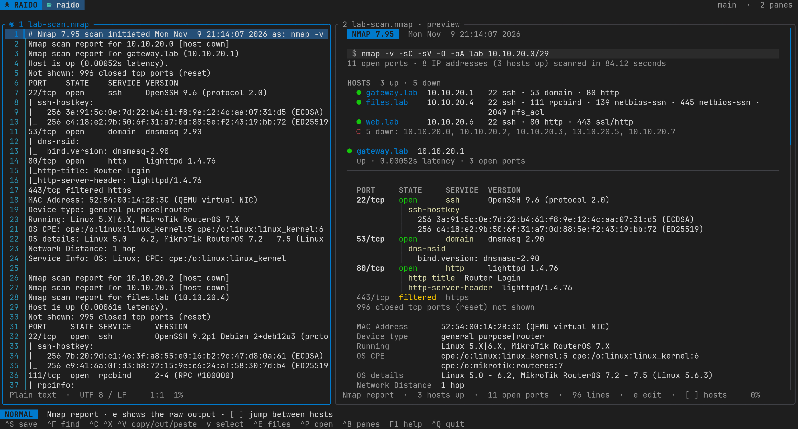

- **Summary first:** the command, when it ran, the open port count, and a line per
  host listing its open ports. Hosts that were down (listed with `-v`) share one line.
- **A section per host:** `]` / `[` jump between hosts. Ports sit in columns colored
  by state: open is green, closed red, filtered yellow. Closed and filtered rows are
  dimmed so open ports stand out, and long versions wrap in their own column.
- **Script output under its port:** each script's name in color, its output indented
  behind a gutter, columns (like `rpcinfo`'s) kept aligned. Host script results get
  a block of their own; MAC address, OS details and service info line up in a list.
- **Noise folded:** scripts that failed to run (`ERROR: Script execution failed`)
  share one line, and the fingerprints Nmap asks you to submit fold to one line.
- **Live:** a file Nmap is still writing re-renders as hosts finish. Until Nmap
  writes its closing line, the report says the scan is still running.

The keys are the Markdown preview's: `e` shows the raw output at the host you were
reading, `:preview` or `Ctrl-b m` switches back, and `Ctrl-b M` puts the report
beside the raw file. Reports use up to 140 columns, for version strings and script
output. Try it with [examples/lab-scan.nmap](examples/lab-scan.nmap).

### Spreadsheets, CSV and databases

Three kinds of data open as a grid: from the explorer (browsing previews them, as it
does other files), `Ctrl-p`, `:e` or `raido budget.xlsx`.

- **Spreadsheets**, read-only: Excel workbooks (`.xlsx`, `.xlsm`, `.xlsb`, `.xls`)
  and OpenDocument ones (`.ods`), one sheet at a time with the sheets as tabs.
- **SQLite databases**, read-only: any file whose first bytes say it's one (`.db`,
  `.sqlite` or any other name), each table and view as a tab, the column names on
  top. Raido opens it read-only and never writes to it. A table's first 100,000 rows
  are shown, and the tab says how many there are in all.
- **CSV and TSV files** open as a grid the way Markdown opens rendered, and stay
  editable text: `e` edits the text at the row you're on, `Ctrl-b m` (`:preview`)
  switches back and forth, and `Ctrl-b M` (`:preview split`) puts the grid beside
  the text, following your edits and cursor. The separator is found for you (`,`,
  `;`, tab or `|`), and quoted fields may hold separators, quotes and line breaks.

Column letters run along the top and row numbers down the side; rows kept at the
top stay there as you scroll (Excel's frozen rows, else the first row as a header).
Below the grid is the selected cell in full, wrapped over a few lines with its
formula and its exact number when the cell shows it rounded; Enter opens the whole
cell over the grid, to scroll and copy. Then come the sheets as tabs and the size.

- **Laid out as Excel left it:** each column's width from the workbook, its frozen
  columns kept at the left (narrowed when the pane is small), hidden columns left
  out, merged cells across their columns, and the sheet and cell it was saved on.
- **Long text wraps** in its column and the row grows, as Excel shows cells set to
  wrap (in CSV and databases, `w` wraps any long text). Other text runs on into the
  empty cells to its right, as in Excel, and is cut short with `…` where it meets a
  value. `w` switches between wrapped rows and one line per row.
- **Values as Excel shows them:** each number in its cell's format (decimals,
  thousands separators, percent, currency, scientific, negatives in parentheses),
  `General` numbers in up to 11 characters as Excel does, dates and times in ISO
  order (`2024-03-15 14:30`), durations as `37:30:00`, `TRUE`/`FALSE`, and errors
  such as `#DIV/0!` in the warning color. A number too wide for its column shows as
  `####`, never cut short. Bold cells are bold.
- **Formulas aren't recalculated.** A cell shows the value the file saved. A formula
  with no saved value (some libraries write files that way) shows dimmed as
  `=SUM(B2:B3)`.
- **Databases:** `NULL` dimmed, blobs as their size, numbers lined up on the right.
- **Live:** when a script rewrites the file (or a program writes to the database),
  the grid reads it again and keeps your place on each sheet.
- **Not covered:** charts, images, colors and rows hidden in Excel. Hidden sheets are
  listed as tabs, marked hidden. Workbooks over 64 MiB, and password-protected
  ones, say so instead.

| Key | Action |
| --- | --- |
| `h` `j` `k` `l` / arrows, Tab / Shift-Tab | Move one cell |
| Space, PageUp/PageDown, `Ctrl-d` `Ctrl-u` | Page down / up / half a page |
| `g` / `G` | First / last row |
| `0` or Home / `$` or End | First / last column |
| `]` / `[`, `Ctrl-PageDown` / `Ctrl-PageUp` | Next / previous sheet or table (a click on a tab works too) |
| `/` then Enter, `n` / `N` | Find text in the sheet, next / previous |
| `y` or `Ctrl-c` / `Y` | Copy the cell as it shows / its row, tab-separated |
| Enter | The whole cell over the grid (`j` `k` scroll, `y` copies, Esc closes) |
| `w` | Wrapped rows / one line per row |
| `e` (CSV) | Edit the text at this row |
| `r` or `:reload` | Read the file again |
| `q` | Close the pane |

The mouse wheel scrolls and a click selects a cell. In a spreadsheet or database
`Ctrl-s` only says it's read-only; in a CSV grid it saves the text.

### Archives

Archives open as a tree of their files, read-only, from the explorer, `Ctrl-p`, `:e`
or `raido release.zip`. Raido reads them itself, in Rust: no `unzip`, `tar` or `7z`
is needed, so they open the same on macOS, Linux and Windows. It knows an archive
by its first bytes, whatever its name:

- **Zip** and what's built on it: `.zip`, `.jar`, `.war`, `.whl`, `.apk`, `.vsix`,
  `.nupkg`, `.epub`, `.docx`, `.pptx` (`.xlsx` and `.ods` open as spreadsheets).
- **tar**, plain or compressed with gzip, bzip2, xz or Zstandard: `.tar`, `.tar.gz`,
  `.tgz`, `.tar.bz2`, `.tar.xz`, `.tar.zst`, `.crate`.
- **One compressed file**: `.gz`, `.bz2`, `.xz`, `.zst` (a log's `server.log.gz`).
- **7z**.

RAR isn't read (its only full decoder is proprietary C++): it opens as hex, named.

Above the tree: the kind of archive, its files and folders, and their size (and
packed size). Folders show how many files they hold; files their size and date. A
small archive opens whole; a large one shows its top level (inside its only folder
when it has one). Enter on a file copies it out, read-only, to a folder in your
temporary directory and opens it as any file opens: text in an editor (with its
highlighting and language server), a spreadsheet as a grid, an image as hex, an
archive inside the archive as another tree. Saving that copy is refused. Copies
older than a week are cleared away; paths that would lead outside the folder, and
files that hold more than the archive says, are refused.

| Key | Action |
| --- | --- |
| `j` `k` / arrows, PageUp/PageDown, `g` `G` | Move / page / top and end |
| Enter, `l` or → | Open a file; Enter opens or closes a folder, `l` opens it |
| `h` or ← | Close the folder, or go to the one it's in |
| Space / `c` / `E` | Fold the folder / close all / open all |
| `/` then Enter, `n` / `N` | Find a file by part of its name or path (case ignored unless you type a capital) |
| `y` or `Ctrl-c` | Copy the selected path |
| `r` or `:reload` | Read the archive again (it also does when the file changes) |
| `q` | Close the pane |

A click selects a row; a second click opens it.

### Files that aren't text

Any other file the editor can't take as text in any encoding (zero bytes outside
UTF-16, or many control characters) opens **read-only as hex** instead of being
refused: images, PDFs, executables, fonts, RAR archives. Above
the bytes Raido says what the file is, from its first bytes: `PNG image, 1200 ×
800`, `PDF document, version 1.7`, `ELF 64-bit executable, x86-64`, `Mach-O
executable, ARM64`, `Windows DLL, x86-64`, `Zip archive`, `SQLite database`,
`UTF-16 text`, and about thirty more, with its size.

Each row shows its offset, 16 bytes in hex (8 or 4 in a narrow pane) and the same
bytes as characters, colored by kind: NUL dimmed, letters and digits plain,
whitespace and control characters in the secondary color, bytes past ASCII in the
accent color. The selected byte is lit in both columns, and the line below gives its
offset and value. Only the part on screen is read, so a file of any size opens at
once.

| Key | Action |
| --- | --- |
| `h` `l` / `j` `k`, arrows | Previous / next byte, row up / down |
| Space, PageUp/PageDown, `Ctrl-d` `Ctrl-u` | Page down / up / half a page |
| `g` / `G` | Start / end of the file |
| `0` / `$` | Start / end of the row |
| `/` then Enter, `n` / `N` | Find text (case ignored unless you type a capital), or bytes in hex: `ff d8 ff`, `0xcafe` |
| `y` or `Ctrl-c` | Copy the row's bytes in hex |
| `r` or `:reload` | Read the file again (it also does when the file changes) |
| `q` | Close the pane |

### Text in other encodings

Files that aren't UTF-8 open as text all the same, to edit and save as they were
written; the status bar names the encoding where it says `UTF-8 / LF` for others.

- **UTF-16**, with a byte order mark (Windows PowerShell's `>` and many Windows tools
  write it) or without one, told by its zero bytes.
- **Older encodings**, guessed from the text as browsers guess them: Windows-1252
  and Latin-1 (Western), Windows-1254 (Turkish), Windows-1251 and KOI8-R
  (Cyrillic), Windows-1250, -1253, -1255, -1256, -1257, Shift_JIS, EUC-JP, GBK,
  Big5, EUC-KR and the rest of the ISO-8859 family. Your locale's country (the `TR`
  in `tr_TR.UTF-8`) helps the guess.
- **UTF-8 with a byte order mark** keeps it.

Saving writes the same encoding, byte for byte. A character the encoding has no
bytes for (typing `✓` into a Latin-1 file) stops the save and says so, rather than
writing something else. `:encoding` names the file's encoding, `:encoding utf-8`
saves it as UTF-8 from then on (any encoding by name: `latin1`, `windows-1254`,
`utf-16le`, `utf-8-bom`), and `:encoding! windows-1254` reads the file again as
that encoding when the guess was wrong (`u` brings back unsaved edits). Project
search, and the Git marks in the gutter, read these files the same way.

### Prompt and buffer behavior

Command and search prompts support typing, Backspace, Enter and Escape.

**`Ctrl-p` opens a file by a few of its letters**, as VS Code's quick open and fzf
do: `mnrs` finds `src/main.rs`, `srcapp` finds `src/app.rs`. The letters go in order,
anywhere in the path; the best matches come first: letters at the start of a name or
word, one after another, in the file's own name, shorter paths among equals. The
matched letters are highlighted, each file shows its name and then its folder, and
`●` marks the ones already open. With nothing typed, the files you opened last come
first. Case is ignored unless you type a capital. ↑/↓ (`Ctrl-n`/`Ctrl-p`, Tab) choose,
Enter opens, `Ctrl-u` clears, Escape closes, and a paste goes into the query.
`main.rs:42` opens it on line 42. It lists the project's files as Git sees them
(new ones too, ignored ones not), else every file but `.git`, `target` and
`node_modules`, read in the background. A path nothing matches opens as a new file
(in a folder that exists), and a folder's path shows it in the explorer.

Editor paths may be absolute or workspace-relative;
`~` and shell variables are not expanded there. Type paths with spaces directly,
without shell quotes. Shell commands follow your shell's normal quoting rules.

### Opening files from a terminal pane

Inside one of Raido's terminal panes, `raido FILE` doesn't start a second Raido inside
the first. It opens FILE in this Raido, in a new editor pane beside the terminal,
and returns you to the shell prompt with `Opened FILE in Raido`. Relative paths are
relative to the shell's current directory.

- A file that doesn't exist yet opens as a new buffer; `Ctrl-s` creates it.
- A file already on screen brings its pane forward instead of opening another.
- Markdown files open rendered, as they do from the explorer.
- `raido DIR` (or bare `raido`) for a folder of this project shows it in the explorer.
  A folder of another project, or `raido --nested FILE`, starts a separate Raido as before.

On macOS and Linux, Raido listens on a socket in a private temporary directory (mode
`0700`, removed when Raido exits) and passes its path to every terminal pane as
`RAIDO_SOCKET`. On Windows it listens on a local port (127.0.0.1 only) and hands its
panes a random secret with the port; a request without it is turned away.

### Sessions

Raido reopens a project the way you left it. When you quit — or simply close the
terminal window — and later run `raido` in the same project, you get back:

- the same panes in the same layout, with the same pane focused (and zoomed);
- every open file at its cursor position, **including unsaved edits** (still marked
  unsaved, so nothing is written to disk until you `:w`);
- each terminal's output and scrollback, with the shell started again in the
  directory you had `cd`'d to;
- AI panes back in their conversation. Each Claude Code pane is started with its own
  conversation id (`--session-id`) and reopens exactly that conversation
  (`--resume <id>`), even with several Claude panes or other Claude sessions in the
  same folder. If you switch conversations inside the pane (`/resume`, `/clear`, a
  fork), Raido follows: it reads which conversation the pane's Claude is in from
  Claude's own registry (`~/.claude/sessions/<pid>.json`) whenever it saves, and
  reopens that one. A pane that never got a message starts fresh under the same id.
  Gemini CLI 0.46 and later is pinned the same way. Codex picks its own ids, so
  Raido matches each Codex pane to the conversation that started in the project
  after the pane opened, and reopens it with `codex resume <id>`. Older Gemini
  (`--resume latest`), Antigravity and OpenCode (`--continue`) and Codex panes saved by an older
  Raido (`resume --last`) reopen their latest conversation in the project. Other
  launchers restart below their previous output. Claude panes from a
  session saved by an older Raido open Claude's conversation picker;
- the AI launcher, Markdown previews, the Git pane and its branch filter.

The same works without quitting. Close an AI pane, open that CLI again (launcher
key, `:ai claude`), and it reopens the closed pane's conversation, the newest closed
one first. The launcher marks those CLIs with "reopens your last conversation".
Press `n` there before the number, or use `:ai claude new`, to start a new
conversation instead. A Codex pane that never got a message has nothing to reopen
and starts fresh; local models and your own `[ai.<name>]` launchers always do.

The session lives in `.raido/session.json` in the project root, readable only by you.
A session only ever starts the AI CLIs Raido knows and your own `[ai.<name>]` entries,
with conversation ids and models it checks first, so a repository that carries a
`.raido/session.json` of its own can't start a program of its choosing when you open it.
`.raido/` contains its own `.gitignore`, so it is never committed. Raido saves on quit and every few seconds while you work (only when something
changed), so a closed window or a crash loses at most a few seconds.

Sessions are kept automatically in Git repositories and wherever `.raido/` exists, so
opening Raido in an arbitrary directory leaves nothing behind; `:session save` starts
one anywhere. Programs that were running are started again, not continued:
a shell gets a fresh prompt below its old output, and `:run` plugins come back as a
shell instead of running again.

| Command | Action |
| --- | --- |
| `:session` | Where this project's session is saved, or why it is not |
| `:session save` | Save now, and keep a session here even outside a Git repository |
| `:session forget` | Delete the saved session and stop saving until the next start |
| `raido --fresh` | Start without reopening the session (it is replaced when you quit) |

Set `restore_session = false` in `config.toml` to turn sessions off everywhere.

### Commands

```text
:w [path]                 Save atomically; unnamed buffers need a path
:w!                       Save over the file even though something else changed it
:wa                       Save all modified buffers
:wq                       Save and close view
:q / :q!                  Close view / close it and discard its unsaved edits
:qa / :qa!                Quit / discard unsaved changes and quit
:e path                   Open a file, or a new buffer if absent
:reload                   Reload a clean file
:e! / :reload!            Load the file as it is on disk; `u` brings your unsaved edits back
:encoding [name]          The file's encoding / save it as name from now on (utf-8, latin1…)
:encoding! name           Read the file again as name (its encoding was guessed wrong)
:new                      New scratch editor pane
:split / :vsplit          Stack / side-by-side split
:term                     New shell (in it, `raido FILE` opens FILE here)
:ai [codex|claude|gemini|agy|opencode] [new] [right|below]
                          AI launcher, or launch a CLI, beside or below
                          (reopens a closed pane's conversation; new: a new one)
:ai new                   A new conversation in the AI pane: its CLI starts again there (Ctrl-b n)
:ai local [model]         Your local LLM ([ai.local], else your model server, else Ollama / LM Studio)
:ai <name> [model]        A launcher you defined as [ai.<name>]
:ask [question]           Interactive documentation beside the code; a question is asked at once (Ctrl-b /)
:themes                   Theme picker with live preview (also Ctrl-b t)
:theme name               Switch theme directly (e.g. dracula or visual-studio-dark)
:preview [split]          Rendered Markdown or Nmap report in place / beside the source
:format                   Format the file with its language server (JSON: by Raido)
:lsp / :lsp restart       Language server status / restart all servers
:font [size N|family X|list]  Terminal font: show, save size or family, list fonts
:docs                     Open the full Raido manual (rendered)
:skill [install|remove]   Install / remove the Raido skill for AI agents
:set rnu / :set nornu     Relative / absolute line numbers
:minimap [on|off]         Hide / show the minimap beside editors
:run name                 Launch an explicitly configured command plugin
:git / :git all           Git pane: open, focus, or maximize / show all branches
:changes [keep|undo]      Review AI agents' changes / keep all / undo all (asks)
:mention                  Type a reference to your file and selection into the AI pane (Ctrl-b i)
:image                    Attach the clipboard's image, else your latest screenshot, in the AI pane (Ctrl-b I)
:explain [commit]         Have the AI pane's agent explain and review a commit (e in the Git pane)
:ide                      Whether Claude Code is connected to Raido
:files / :git side        Focus sidebar section
:session [save|forget]    Session status / save now / delete and stop saving
:bn / :bp                 Next / previous buffer
:help                     Field guide
```

Closing a view does not delete its buffer: reopen it with Tab or `:bn` in an editor.
With multiple panes, `:q!` closes an unsaved view and discards its unsaved edits, so
opening the file again shows it as it is on disk, with whatever an AI or a tool wrote
to it meanwhile (`u` there brings your edits back while the file hasn't changed again).
When another pane still shows the same file, the edits stay there.
Closing the last pane with `:q!` exits and discards unsaved buffers.
`:qa!` explicitly discards all unsaved buffers; the next session opens those files as
they are on disk. Raido does not automatically save
files on exit. `:wa` stops on an error (for example an unnamed dirty buffer); use
`:w filename` on that buffer before retrying.

## Ask your AI agent about Raido

Raido ships an **agent skill** — interactive documentation your AI agent reads on its
own. Ask it things like *"how do I make the font bigger in Raido?"*, *"how do I open
Git?"* or *"set my theme to Dracula"*, and it answers with the exact keys (or edits
your config for you).

The skill uses the open [Agent Skills](https://agentskills.io) format (`SKILL.md`),
so it works with **Claude Code, Codex, Gemini CLI, OpenCode, GitHub Copilot** and any
other agent that reads skills. It is installed **once per user, not per project**, so
every project on the machine has it; there is nothing in a project's `.raido` folder.
It lives in Raido's data folder (`~/.local/share/raido/skills/raido`,
`~/Library/Application Support/raido/…` on macOS, `%APPDATA%\raido` on Windows), linked
into the shared `~/.agents/skills` (read by Codex, Gemini CLI, OpenCode, Copilot and
others) and into `~/.claude/skills` and `~/.codex/skills` when Claude Code or Codex is
installed or has been used, so even an agent's very first session finds it. This is
the same layout Omarchy uses for its own skills. Windows gets copies instead of
links. Raido never replaces an `raido` skill it did not create.

It gets there, and stays current with your Raido version:

- **`scripts/install.sh`** installs it as its last step (`--no-skill` skips it). If
  that step fails, the script only warns: Raido is installed either way.
- **Each time Raido starts**, it refreshes the skill in the background, but only when
  an AI agent is installed or has been used on the machine. Without one, Raido
  leaves the agents' folders alone, and nothing in Raido needs an agent.
- **Launching an agent** from Raido's launcher checks it again.

The skill bundles this manual, the theme guide and the example config, so answers
match your Raido version. Agents without skill support can still read it: every Raido
pane sets **`$RAIDO_DOCS`** to the manual's path. You can read it yourself with `:docs`.

| Do it yourself | |
| --- | --- |
| `raido --install-skill` / `:skill` | Install or refresh now (without launching an agent) |
| `raido --remove-skill` / `:skill remove` | Remove every link and copy Raido made |
| `ai_skill = false` | Never install or refresh it automatically |

## AI authentication

Install the desired CLI separately using its official instructions:

| Launcher key | CLI | Command | Install |
| --- | --- | --- | --- |
| 1 | [OpenAI Codex](https://github.com/openai/codex) | `codex` | `npm install -g @openai/codex` |
| 2 | [Claude Code](https://code.claude.com/docs/en/overview) | `claude` | see its docs |
| 3 | [Gemini CLI](https://github.com/google-gemini/gemini-cli) | `gemini` | `npm install -g @google/gemini-cli` |
| 4 | [Antigravity CLI](https://codelabs.developers.google.com/genai-for-dev-antigravity-cli) | `agy` | `curl -fsSL https://antigravity.google/cli/install.sh \| bash` |
| 5 | **Local LLM** — your `[ai.local]`, else your [model server](#your-own-model-server-ollama-vllm), else Ollama or LM Studio | see below | see below |
| 6 | [OpenCode](https://opencode.ai) — any provider or local model | `opencode` | `npm install -g opencode-ai` |
| 7–9 | **Your own** `[ai.<name>]` entries | anything | — |

Letters work too: `c` Codex, `a` Claude, `g` Gemini, `y` Antigravity, `l` Local,
`o` OpenCode. A restored Codex, Gemini, Antigravity or OpenCode pane reopens that
CLI's latest conversation in the project; a Claude Code pane reopens exactly its own.

**They start in auto mode:** each agent works without asking before every command or
file edit, new or reopened. `ai_auto_mode = false` starts them in their own default
modes, which ask.

| CLI | Starts with |
| --- | --- |
| Claude Code | `--permission-mode auto`: it acts by itself, and still stops risky actions |
| Codex | `--dangerously-bypass-approvals-and-sandbox` (its yolo mode) |
| Gemini CLI | `--yolo` |
| Antigravity | `--dangerously-skip-permissions` |
| OpenCode | nothing: it asks only before reading `.env` files to begin with |

The yolo modes run any command with your user's rights, so run Raido in a container
or VM for code you don't trust. Your own `[ai.<name>]` launchers, and the Local LLM,
run exactly as you wrote them.

**OpenCode on your Ollama models:** with Ollama installed, `6` / `o` (or `:ai opencode`)
first lists the models you've pulled (`ollama list`) in the pane: ↑↓ and Enter, or
`1`–`9`, start OpenCode on that model; `0` leaves the model to OpenCode (its last
one; `/models` inside switches). `:ai opencode <model>` skips the list, and a restored
pane reopens on the same model. Raido hands OpenCode the model in
`OPENCODE_CONFIG_CONTENT` (with `--standalone` where OpenCode has it, so its own server
reads it) and changes no config file. OpenCode 2 finds Ollama's models by itself; an
older one needs an `ollama` provider in its `opencode.json`. Without Ollama, if it
isn't running or has no models, or with an `[ai.opencode]` of yours, OpenCode still
starts, on its own choice.

**Placement:** `Ctrl-b a` or `:ai` opens AI panes **beside** your code; `Ctrl-b A` or
`:ai below` stacks them **below**. Add `below`/`right` to any `:ai` command
(`:ai claude below`), or set the default with `ai_split = "below"` in config.toml.
A missing CLI is reported with its install command.

**Done sound:** when an AI pane finishes a prompt, or stops to ask you something,
Raido plays a short chime (macOS Glass; the desktop's "complete" sound on Linux;
Windows' notification sound) and,
if you're in another pane, names the pane in the status line. Raido hears the agent
working (its spinner keeps drawing after you press Enter) and then going quiet, or
the agent ringing the terminal bell, so it works with every CLI and needs no setup.
Pick another sound with `ai_sound` (a system sound such as macOS `"Hero"` or Windows
`"Windows Ding"`, a file, `"bell"`, or `"off"`);
`:sound` plays it.

**Review what it changed:** `Ctrl-b v` shows every file the AI panes changed as a
diff, to keep or undo change by change ([Review AI changes](#review-ai-changes)).

**Show it your code:** Claude Code sees the file you're on and the lines you select,
and `Ctrl-b i` types a reference to them into any AI pane
([AI panes see your editor](#ai-panes-see-your-editor)).

### Bring your own model (local LLMs)

Any AI tool or local model becomes a launcher entry with a few lines in
`~/.config/raido/config.toml`. Raido runs it in a real terminal pane in your project —
no API keys or model traffic pass through Raido.

```toml
[ai.<name>]            # shows up in the launcher (keys 7–9) and as :ai <name>
program = "aider"      # any executable on PATH
args = ["--model", "openai/{model}"]   # {model} = :ai <name> <model>, else `model`
model = "qwen2.5-coder"
env = { OPENAI_API_BASE = "http://localhost:8080/v1", OPENAI_API_KEY = "local" }
```

**`[ai.local]`** is special: it is what launcher key **5** and `:ai local [model]` run.
Without it, Raido finds a local runtime on its own — **Ollama** (`ollama run` with your
first pulled model, or the one you name) or **LM Studio** (`lms chat`) — and otherwise
tells you how to add one. Defining `[ai.codex]` etc. overrides a built-in entry.

Recipes:

| Setup | Config |
| --- | --- |
| Ollama chat | nothing — key 5 works; or `:ai local qwen3-coder` |
| Claude Code / Codex / OpenCode on Ollama (v0.15+) | `[ai.local]` `program = "ollama"`, `args = ["launch", "claude"]` (or `"codex"`, `"opencode"`) |
| Codex on a local model | `[ai.codex-local]` `program = "codex"`, `args = ["--oss", "--local-provider", "ollama", "-m", "{model}"]`, `model = "gpt-oss:20b"` (`lmstudio` also works) |
| llama.cpp | `[ai.local]` `program = "llama-cli"`, `args = ["-m", "/models/qwen.gguf", "-cnv"]` |
| Any OpenAI-compatible server (llama-server, vLLM, LM Studio, LocalAI) + aider | the `[ai.<name>]` example above, pointing `OPENAI_API_BASE` at the server |

Make the CLIs you want available on `PATH`; launch them in an AI pane and
follow their own sign-in/authentication flow. Existing CLI logins work normally.
For API-key authentication, use the CLI's documented credential manager or
environment setup **outside Raido**, then start Raido from that environment.
Do not put API keys into project files or Raido's TOML config.

Raido does not store keys or wrap model requests. It starts the CLIs in their
auto or yolo modes, through their own flags ([above](#ai-authentication));
`ai_auto_mode = false` leaves their approvals and sandboxes as their settings say.
AI tools run with the same OS permissions as the user, and their own usage/billing
applies. The only model requests Raido makes
itself are the review's explanations and the
[interactive documentation](#interactive-documentation)'s answers, to the AI you name
in `review_ai` and `docs_ai` (through its CLI, or your model server's API). A missing CLI produces a visible error without
destroying a pane.

### Your own model server (Ollama, vLLM)

The agents and your code stay on this machine; the model runs on another one, a GPU
box or a server you rent, the way Claude Code runs here and its model on Anthropic's
servers. Tell Raido where the server is:

```toml
[model_server]
url = "http://gpu-box:11434"     # Ollama · vLLM: "http://gpu-box:8000"
# kind = "vllm"                  # "auto" (default) asks the server; also "ollama"
# tunnel = "gpu-box"             # reach it through SSH (url as seen from gpu-box)
# key_env = "VLLM_API_KEY"       # the variable holding its API key (vLLM --api-key)
```

Then everything that picks a model uses the server's:

- **OpenCode** (key 6, `:ai opencode`) lists the server's models (↑↓ Enter, 1–9, or 0
  for OpenCode's own choice) and runs on the one you pick. Raido hands OpenCode the
  server's address in its config for that pane; your OpenCode config isn't changed.
  On Ollama, OpenCode's own Ollama provider finds the models and which can use tools.
  On vLLM, Raido lists them with tools on, since an agent needs them: start vLLM
  with `--enable-auto-tool-choice --tool-call-parser <parser>` for your model.
- **Local LLM** (key 5, `:ai local [model]`) on Ollama runs `ollama run` here,
  talking to the server (`OLLAMA_HOST`), on its first model or the one you name; it
  needs Ollama's command installed here, not its models. vLLM has no chat command
  of its own: use OpenCode.
- **The review's explanations** with `review_ai = "local"` come from the server's
  first model (or `"local:<model>"`), with the tokens they used.

`kind = "auto"` asks the server once: Ollama answers `/api/version`; anything else is
taken for the OpenAI API that vLLM, llama.cpp's server, LM Studio and SGLang speak.
Raido talks to it with `curl`, which macOS, Linux and Windows 10 and later have.

**Keep the server private.** Ollama has no password, so don't open its port to a
network you don't trust. With `tunnel = "gpu-box"`, the server can keep listening
only on its own `localhost`: Raido forwards a local port with `ssh -N -L` the first
time it's needed, reopens it if the connection drops, and closes it when Raido
quits. It needs an SSH login without a password prompt (a key or `ssh-agent`); a
private network such as Tailscale works without one. For vLLM, start it with
`--api-key` and name the variable holding the key in `key_env`: the key goes to the
server in a header, never into Raido's config or onto a command line.

| Server | Checked |
| --- | --- |
| Ollama | yes: the Local LLM pane and the review, on Ollama 0.34 |
| vLLM | against a stand-in server speaking its API (models, chat, API key) |
| OpenCode on either | built from OpenCode's documented config; not run here |

## Themes and command plugins

Configuration lives at `~/.config/raido/config.toml` on Linux and macOS,
`%APPDATA%\raido\config.toml` on Windows, or `$XDG_CONFIG_HOME/raido/config.toml` when
that is set. See [config.example.toml](config.example.toml).
Raido never loads configuration or executable plugins from the project being opened.

### Bundled dark themes

These themes are embedded in the binary: **no downloads, plugins, or file copying
are required**. Each coordinates the UI, syntax highlighting, and terminal's 16
ANSI colors. **Visual Studio Dark is the default.** Raido's original `phosphor` and
`amber` also remain available.

| Theme | Command | Palette |
| --- | --- | --- |
| Visual Studio 2022 Dark (the IDE) | `:theme visual-studio-dark` | Charcoal, VS-blue accent, teal line numbers, lilac control flow |
| VS Code Dark 2026 | `:theme vscode-dark-2026` | VS Code's newest built-in dark theme: near-black #121314, teal-blue accent |
| Dracula | `:theme dracula` | Purple, pink, mint, pale yellow |
| Nord | `:theme nord` | Polar gray, frost blue, soft green |
| One Dark | `:theme one-dark` | Slate, blue, violet, gold |
| Gruvbox Dark | `:theme gruvbox-dark` | Warm charcoal, olive, orange, aqua |
| Tokyo Night | `:theme tokyo-night` | Midnight blue, lavender, cyan |
| Catppuccin Mocha | `:theme catppuccin-mocha` | Dark mauve, pastel blue, pink, peach |
| Solarized Dark | `:theme solarized-dark` | Deep teal, restrained blue, green, yellow |
| Monokai | `:theme monokai` | Warm black, lime, hot pink, cyan |
| GitHub Dark | `:theme github-dark` | Near-black, blue, coral, lavender |

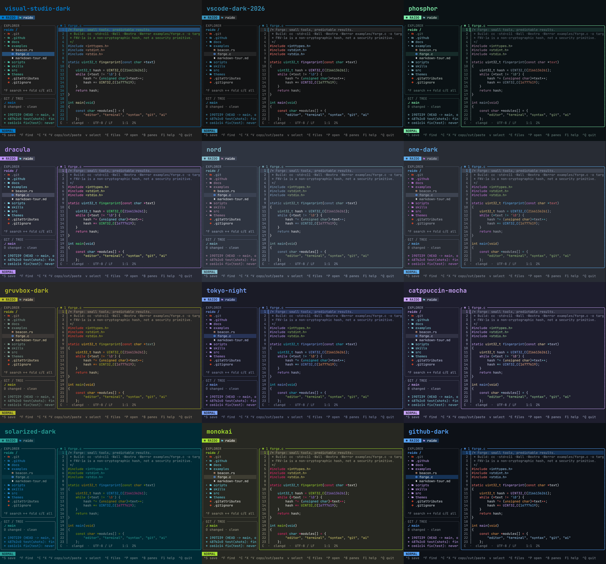

### Bundled light themes

Light versions of the popular editor themes, built in the same way. On light
backgrounds the terminal's "white" is a gray, so programs that print white text
stay readable, and explorer icons darken where they would fade.

| Theme | Command | Palette |
| --- | --- | --- |
| Visual Studio 2022 Light (the IDE) | `:theme visual-studio-light` | White, VS-blue accent, green comments, blue keywords, purple control flow |
| VS Code Light 2026 | `:theme vscode-light-2026` | VS Code's newest built-in light theme: white, blue accent, red keywords, purple functions |
| GitHub Light | `:theme github-light` | White, GitHub blue, red keywords, navy strings |
| One Light | `:theme one-light` | Off-white, blue, violet, green, gold |
| Solarized Light | `:theme solarized-light` | Cream, blue, green, yellow, magenta |
| Catppuccin Latte | `:theme catppuccin-latte` | Pale lavender, mauve, blue, green, peach |
| Gruvbox Light | `:theme gruvbox-light` | Warm cream, olive, deep red, teal |

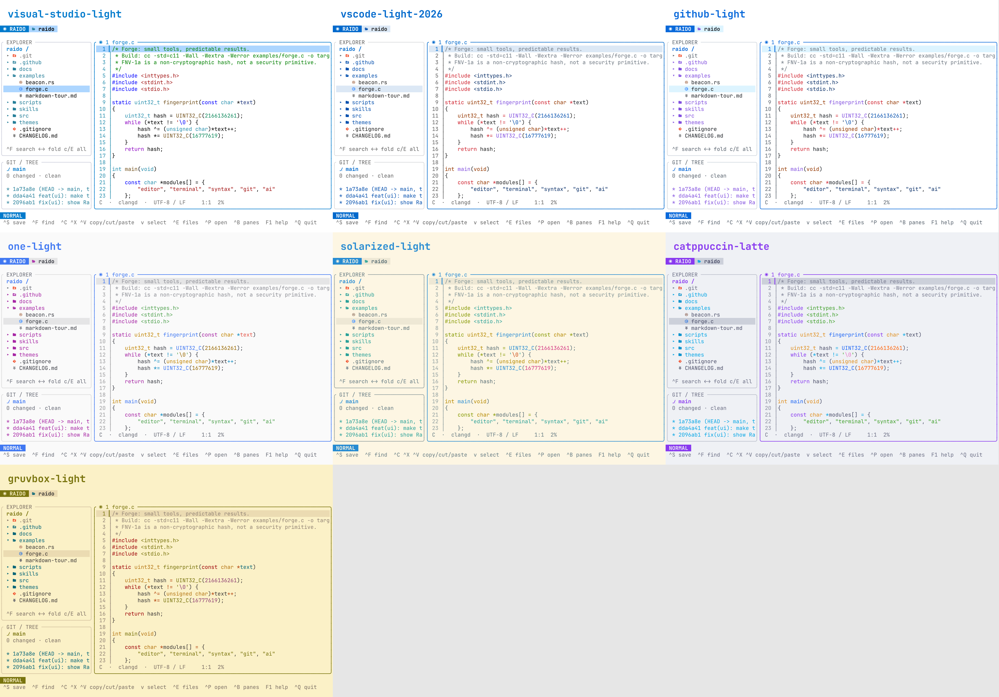

In an editor, press **Esc**, type a command above, then **Enter**. From a terminal
or AI pane, press **Ctrl-b**, then **:**, type `theme dracula` (without another
colon), and press **Enter**. Open buffers and terminal processes are preserved.
The choice is **saved**: Raido starts with it next time. `:theme name` writes (or
creates) the single top-level line in `~/.config/raido/config.toml`, leaving your other
settings and comments untouched:

```toml
theme = "visual-studio-dark"
```

If updating an older Raido checkout, rebuild/reinstall using
`cargo install --path . --locked --force`, then restart Raido. Markdown preview adds
`pulldown-cmark`; VS Code theme import adds `serde_json`. See the [theme guide](themes/README.md) for palette
credits, customization, and compatibility details.

### Theme plugins — no rebuild needed

Themes are plain files loaded at runtime from `~/.config/raido/themes/`
(or `$XDG_CONFIG_HOME/raido/themes/`). Drop a file in, and it is available at once:

- **`name.toml`** — a Raido theme (schema in the [theme guide](themes/README.md)).
- **`name.json`** — a **VS Code color theme**, used as is. Grab any theme's JSON from
  the VS Code Marketplace or a theme's repository; Raido maps its editor, UI, terminal
  and TextMate token colors. A relative `"include"` (e.g. Microsoft's
  `2026-dark.json` → `dark_modern.json` → `dark_plus.json`) is followed when the
  parent file sits next to it.

| Command | Action |
| --- | --- |
| `:themes` (or `:theme`, or **Ctrl-b t**) | Open the **theme picker**, light themes and dark themes listed apart as in VS Code (by the theme's background): ↑↓ previews each theme live, typing filters, Enter keeps it (saved as default), Esc restores the previous one |
| `:theme na` then **Tab** | Complete theme names; Tab again cycles matches |
| `:theme name` | Switch; the footer says whether it is built in or which file it came from |

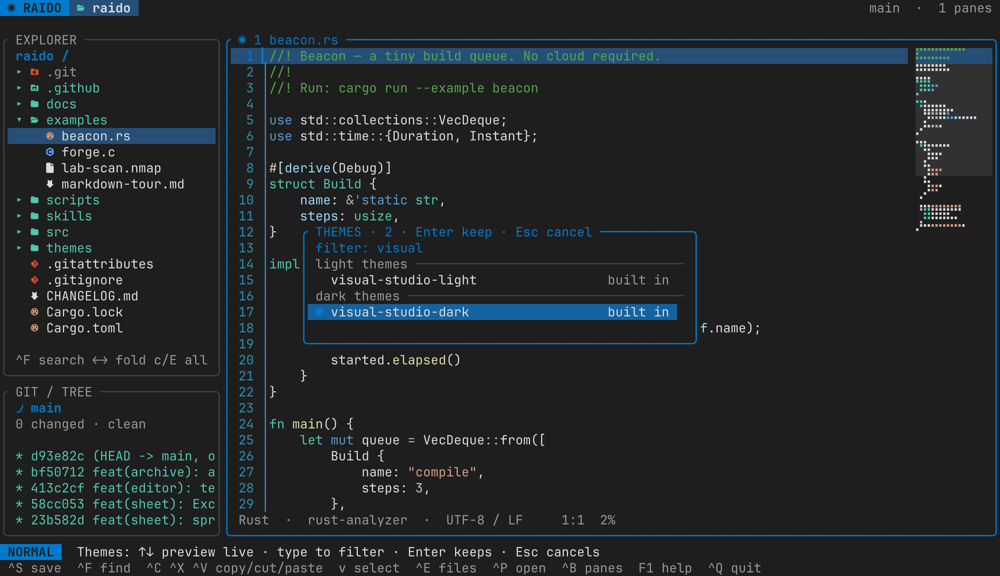

**Omarchy themes are picked up automatically.** On an [Omarchy](https://omarchy.org)
desktop, every installed theme (system and `~/.config/omarchy/themes`) appears in the
picker as `omarchy-<name>` — e.g. `omarchy-tokyo-night`, `omarchy-catppuccin-latte` —
read straight from the theme's `colors.toml`. The special theme **`omarchy`** follows
whatever theme your desktop uses: run `omarchy theme set kanagawa` and Raido re-themes
within two seconds. Themes you create or install with Omarchy show up the next time
you open the picker.

A user file **overrides** a built-in of the same name, so you can customize any
bundled theme by copying it into the themes directory. The active theme file is
**live**: save it and Raido re-themes within two seconds. A broken file keeps the last
good theme and shows the error; a broken startup theme falls back to Phosphor.
Theme files cannot execute code; Raido never loads them from project directories.

### Custom themes and plugins

Copy [themes/ice.toml](themes/ice.toml) to `~/.config/raido/themes/ice.toml`, then use
`:theme ice`. Or copy one of the new TOML files under a **new name**, edit it, and
select that name — or reuse a built-in name to override it.
Legacy `syntax = "base16-ocean.dark"` themes still work. The optional
`[syntax_colors]` table supplies matching semantic syntax colors, and `ansi`
supplies the 16-color terminal palette; see the theme guide for the full schema.

For the default configuration location, these setup commands create the
directories and prompt before replacing existing files:

```sh
mkdir -p "$HOME/.config/raido/themes"
cp -i config.example.toml "$HOME/.config/raido/config.toml"
cp -i themes/ice.toml "$HOME/.config/raido/themes/ice.toml"
```

If you set `XDG_CONFIG_HOME`, use that directory instead of `~/.config`.
Configuration changes take effect on the next launch; `:theme name` changes the
theme immediately. The configuration supports:

| Setting | Default | Meaning |
| --- | --- | --- |
| `theme` | `"visual-studio-dark"` | Any bundled dark or light theme above, `phosphor`/`amber`, or a user theme name |
| `sidebar_width` | `29` | Columns, clamped to 18–60 |
| `auto_hide_sidebar` | `true` | In a [small window](#a-small-window) the sidebar hides by itself (under `sidebar_width` + 70 columns or 16 rows; its Git section under 24 rows) and comes back with room; `false` keeps it, but under 70 columns |
| `tab_width` | `4` | Indentation width when a file and its language don't decide it, clamped to 1–16 |
| `line_endings` | `"lf"` | How lines end in saved files: `"lf"` (`\n`; a file with Windows `\r\n` endings, or lines ending in a lone `\r`, opens with `\n` and is saved so, the status bar showing `CRLF→LF` until then), `"crlf"` (`\r\n`) or `"auto"` (each file's own, what most of its lines use). `.bat` / `.cmd` files keep theirs. Pasted text takes the file's line breaks, whatever it came with (a terminal sends a paste's as `\r`), and copied text leaves with `\n` |
| `smart_indent` | `true` | [Language-aware](#language-aware-typing) Enter, `o`, Tab/Shift-Tab and closers |
| `auto_pairs` | `true` | Brackets and quotes close themselves; typing the closer steps over it |
| `autocomplete` | `true` | Suggestions pop up after two letters of a word (language server, else keywords and words from your files) |
| `inline_diagnostics` | `true` | A language server's error or warning shows its message, faint, after the line its dot marks (the cursor's line shows it in the pane's footer) |
| `relative_numbers` | `false` | Relative line numbers except the current line; type the shown number, then `j`/Enter (down) or `k`/`-` (up) |
| `minimap` | `true` | The [minimap](#minimap) beside editors with room for it; `:minimap` hides it until you quit |
| `icons` | `true` | Explorer file-type icons: `true` picks Nerd Font glyphs when a Nerd Font is available, else colored markers; `"nerd"`/`"basic"` force one; `false` for none |
| `git_pane` | `false` | Open the Git pane (branches, commit graph, details) at startup |
| `restore_session` | `true` | Save each project's panes, buffers and terminals to `.raido/` and reopen them |
| `[ai.name]` | None | Your own AI launcher: `program`, `args` (`{model}`), `model`, `env`; `[ai.local]` backs the Local LLM entry |
| `[model_server]` | None | [Your own model server](#your-own-model-server-ollama-vllm), Ollama or vLLM: `url`, `kind`, `tunnel`, `key_env`; the Local LLM, OpenCode and `review_ai = "local"` use it |
| `ai_split` | `"right"` | Where AI panes open: `"right"` (side by side) or `"below"` (stacked) |
| `mouse` | `true` | Wheel scrolls the pane under the pointer, a click focuses it, a drag selects and copies inside that pane ([Mouse](#mouse)); `false` leaves the mouse to the terminal |
| `ai_sound` | `"default"` | Sound when an AI pane finishes a prompt: `"default"`, `"off"`, `"bell"`, a system sound name (macOS `"Hero"`, Windows `"chimes"`) or a sound file; `:sound` plays it |
| `review_changes` | `true` | Track the files AI panes change, to [review, keep or undo](#review-ai-changes) them (`Ctrl-b v`) |
| `review_summary` | `true` | In the review, list what each file's change added, changed and removed, and sum it up at the end, read from the code without AI |
| `review_ai_auto` | `true` | Explain new agent changes in the review by themselves once the agents stop (`false`: only on `s`) |
| `docs_ai` | `"auto"` | Which AI answers in the [interactive documentation](#interactive-documentation), or a list to try in order: `"auto"`, `"claude"`, `"codex"`, `"gemini"`, `"agy"`, `"opencode"`, `"local"`, each with an optional `:model`, a command, or `"off"` |
| `paste_screenshots` | `true` | macOS: [⌘V pastes a screenshot into an AI pane](#screenshots-and-images-in-ai-panes): while one is open, a screenshot on the clipboard is saved and, while Raido is in front, its path added beside the image as text |
| `review_ignored` | `["*.md", "*.txt"]` | [Gitignored files](#review-ai-changes) the review tracks anyway, by name (`"*.md"`) or path (`"plans/*.md"`); not over 2 MB or in dependency and build folders; `[]` for none |
| `review_ai` | `"auto"` | Which AI explains the changes in the review, or a list to try in order: `"auto"`, `"claude"`, `"codex"`, `"gemini"`, `"agy"`, `"opencode"`, `"local"`, each with an optional `:model`, a command, or `"off"` |
| `claude_ide` | `true` | Let Claude Code [see your editor](#ai-panes-see-your-editor) (the file and selection) as in VS Code |
| `format_on_save` | `["go"]` | Languages whose files get imports organized and formatting from their server on save ([Go: tidy on save](#go-tidy-on-save)) |
| `ai_skill` | `true` | Keep the [Raido skill](#ask-your-ai-agent-about-raido) installed for the AI agents on this machine (at startup and when you launch one) |
| `ai_auto_mode` | `true` | Start the AI CLIs [without them asking](#ai-authentication) before each command or edit: Claude Code in auto mode, Codex, Gemini CLI and Antigravity in yolo mode; `false` starts each in its own default mode |
| `shell` | `$SHELL`, then `/bin/sh` | Executable path for interactive terminal panes |
| `[plugins.name]` | None | Explicit `program` and `args` for `:run name` |

```toml
theme = "visual-studio-dark"
tab_width = 4

[plugins.test]
program = "cargo"
args = ["test"]
```

Run `:run test` to open the configured command in a terminal pane. Programs and
arguments are passed directly, without shell interpolation. There are no startup
hooks or auto-running project tasks. Arbitrary in-process/native/WASM editor
plugins are intentionally not part of v0.1.

## Troubleshooting

| Symptom | What to do |
| --- | --- |
| `cargo` or `rustc` not found | Install Rust with rustup, then open a new shell or run `. "$HOME/.cargo/env"`. |
| Linker / `cc` not found | Install the compiler prerequisites above; on macOS complete the Xcode tools installation. |
| `raido` not found after installing | Add the selected installation's `bin` directory to PATH, or run its executable by full path. |
| Need a specific Raido executable | `command -v raido` shows which installation your shell selects. |
| “Raido needs an interactive terminal” | Launch directly in Terminal, iTerm2, a Linux terminal emulator or an SSH terminal; do not pipe stdout. |
| No syntax colors / monochrome UI | Use a color-capable terminal. If you intentionally inherited `NO_COLOR`, `env -u NO_COLOR raido .` enables normal colors for this run. |
| Sidebar missing or tiny panes | In a [small window](#a-small-window) the sidebar hides by itself: widen the terminal, `Ctrl-e` opens the explorer, `Ctrl-b s` keeps the sidebar, `auto_hide_sidebar = false` stops it. Ctrl-b z zooms a pane. |
| A split shortcut does nothing | Release Ctrl-b before the second key. Use `:vsplit` or `:split` if your keyboard makes `%`/`"` awkward. |
| Running Raido inside tmux | tmux reads Ctrl-b first. Press it twice, then the Raido key (`Ctrl-b Ctrl-b v` opens the review), or give tmux another prefix. (`Ctrl-b b` is the other way round: tmux running in a Raido terminal pane.) |
| C compilation fails | Run from the Raido project directory; ensure `cc` exists and create `target` with `mkdir -p target`. |
| New file is absent from the sidebar | Save it first, then focus the explorer and press `r`. |
| `codex` or `claude` cannot launch | Install that CLI separately and verify `command -v codex` or `command -v claude` in the shell that launches Raido. |
| File changed on disk | With no unsaved edits, the pane shows the new text. With unsaved edits, changes on other lines are merged into yours (`u` undoes the merge). Where both changed the same lines, yours are kept on those lines (Raido names them), the rest still comes in, and saving refuses to overwrite: `:e!` loads the file (`u` brings yours back), `:w!` saves yours over it, or `:w recovery-name` keeps both. |
| Read-only, binary or non-UTF-8 file | Raido respects read-only files. Text in other encodings (UTF-16, Latin-1, Windows-1254…) opens as text and saves as it was; the status bar names the encoding, and `:encoding! NAME` reads it again if the guess was wrong. Files that aren't text open read-only as hex. |
| Custom theme not found | Use a simple name with letters, digits, hyphens or underscores, and place its TOML in the user themes directory. |
| Code turns faint near language-server problems (older Raido in macOS Terminal.app) | Update Raido. Terminal.app doesn't know the colored-underline code and read part of it as "faint"; Raido now draws plain underlines there. |

Files on screen follow external edits within a quarter of a second; unsaved edits of
yours are merged with them, never thrown away.
Raido does not provide automatic crash recovery in v0.1.

### macOS, Linux and Windows

Raido works the same on all three; where the systems differ, each gets its own way:

| Feature | macOS | Linux | Windows |
| --- | --- | --- | --- |
| Clipboard | `pbcopy` / `pbpaste` | `wl-copy` (Wayland), `xclip` / `xsel` (X11) | PowerShell |
| Clipboard fallback (SSH, none of the above) | OSC 52 | OSC 52 | OSC 52 |
| `raido FILE` from a terminal pane | private socket | private socket | local port with a secret |
| AI-finished chime | Glass (`afplay`) | desktop "complete" sound (`paplay`, `pw-play`) | notify sound (PowerShell) |
| Shells reopen in their last folder | yes | yes | in the project folder (Windows can't tell another program's folder) |
| Raido's font while it runs | macOS Terminal switches the tab | set it in your terminal or `:font` | set it in your terminal |
| Text size `Ctrl-b + - 0` | Terminal.app, xterm, kitty; others: Cmd-+ / Cmd-- | xterm, kitty; others: Ctrl-+ / Ctrl-- | Windows Terminal: Ctrl-+ / Ctrl-- |
| Terminal's copy key (shown in hints) | ⌘C | Ctrl-Shift-C | Ctrl-Shift-C |
| AI skill for agents | linked | linked | copied (links need extra rights) |
| One-step install, `raido` on PATH | `scripts/install.sh` | `scripts/install.sh` | `scripts\install.ps1` |

Some keys never reach Raido because the system or the terminal keeps them. Each has
another way in:

| Key | Kept by | Use instead |
| --- | --- | --- |
| Ctrl+arrows (`Ctrl-b Ctrl-arrows` resize) | macOS (switching desktops) | `Ctrl-b r`, then arrows |
| Ctrl-Space (completion) | macOS and fcitx/ibus (switching keyboard languages) | `Ctrl-n`; suggestions also pop up by themselves |
| Cmd+arrows (line start/end) | macOS Terminal | Fn+Shift+←/→ (Home/End) |
| F1 (guide) | GNOME Terminal, Konsole (their help) | `Ctrl-b ?` |
| Shift+←/→ (select) | Konsole (switching tabs) | `v` / `V`, Shift+Option/Alt+←/→ |
| `Ctrl-b Shift-arrows` (move a pane) | Konsole (Shift+←/→) | `Ctrl-b H J K L` |
| Alt+←/→ (word left/right) | Windows Terminal (moving between its panes) | Ctrl+←/→ |
| Ctrl-V (paste) | Windows Terminal (its own paste) | works the same: the paste replaces a selection |
| Your terminal's own mouse selection | Raido, while it has the mouse (drag selects in Raido instead) | `Ctrl-b y` or `Ctrl-b Z` |

`raido --keys` shows exactly what your terminal sends, to check any other shortcut.

## Design and boundaries

- Ropey text storage with structural-sharing undo (200 snapshots).
- Cached Syntect highlighting, incremental work budgets and long-line bounds.
- Ratatui redraws only on input/output/state change, not on every timer tick, at
  most 120 frames a second. Input waiting together (a burst of wheel turns, a held
  key, a typed paste) is handled before one frame. While you type or a terminal
  prints, Raido looks for more every 4 ms, so a terminal's echo and output show at
  once; after a quarter second of quiet it looks every 33 ms. Windows' timer rounds
  the 4 ms up to about 16 ms. Each frame is sent as one synchronized update (DEC
  mode 2026), so terminals that support it (iTerm2, WezTerm, kitty, Ghostty, foot,
  Alacritty, recent Windows Terminal) never show half a frame; the others, macOS
  Terminal among them, ignore it.
- PTY I/O runs off the UI thread. Git refreshes on a worker with process timeouts.
- 16 MiB open-file limit. Text in other encodings is edited and saved in its own;
  files that aren't text open read-only as hex, spreadsheets and databases as a
  grid.
- Atomic same-directory saves preserve Unix permission bits. The original file
  content is checked before replacement, including a second check after writing
  the temporary file. This is conflict detection, not a filesystem transaction
  against a malicious concurrent writer. ACLs/xattrs/hard-link identity are not
  preserved by atomic replacement.
- First-party Rust forbids `unsafe`; dependencies and child processes have their
  own trust boundaries. Terminal output is interpreted into cells, never replayed
  as host escape commands (no host OSC-52 clipboard execution).

**v0.1 intentionally omits:** LSP rename/references/code actions, debugger, block selection,
full Vim emulation, remote collaboration,
and a marketplace. UTF-8 character movement is not grapheme-cluster editing.
The terminal implements a practical VT100/xterm subset, not every Kitty/sixel/
graphics protocol. Standard Codex/Claude CLI operation still depends on the installed
CLI version, its configuration, authentication, and network availability.

## Development

```sh
cargo fmt --all -- --check
cargo clippy --locked --all-targets -- -D warnings
cargo test --locked --all-targets
cargo build --release --locked
python3 scripts/pty_smoke.py target/release/raido
cargo run --example beacon
cc -std=c11 -Wall -Wextra -Werror examples/forge.c -o target/forge
./target/forge
```

To release a version: move the `Unreleased` notes in [CHANGELOG.md](CHANGELOG.md)
under a new `## [X.Y.Z] - YYYY-MM-DD` heading (with its link at the bottom), set
`version` in `Cargo.toml` to match (`cargo build` updates `Cargo.lock`), commit as
`chore(release): X.Y.Z` and tag it `vX.Y.Z`. The version is set only in
`Cargo.toml`; the code reads it from there, and a test fails if the changelog has no
entry for it.

CI runs format, lint, tests and a release build on Linux, macOS and Windows (the PTY
smoke test is Unix-only). Day-to-day use and manual verification happen on Linux.
See [docs/VERIFICATION.md](docs/VERIFICATION.md) for the actual validation record.

MIT licensed.
