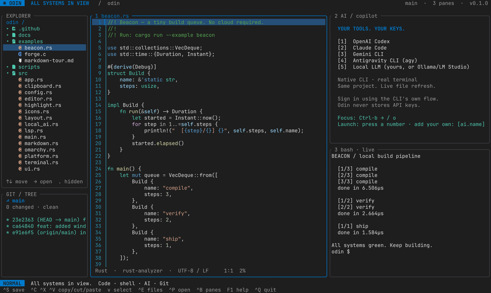
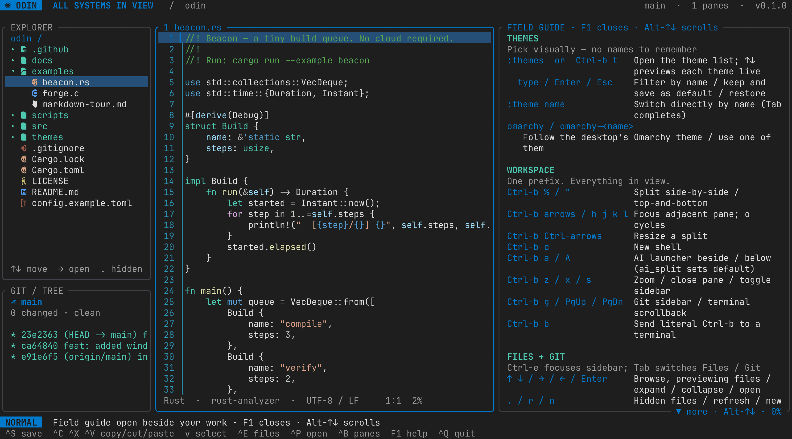
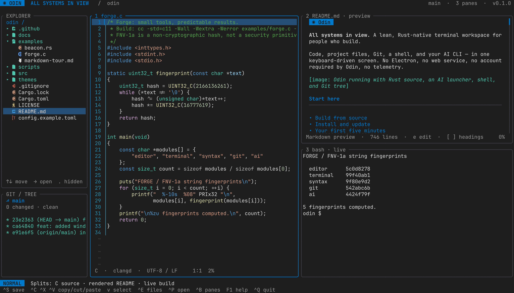
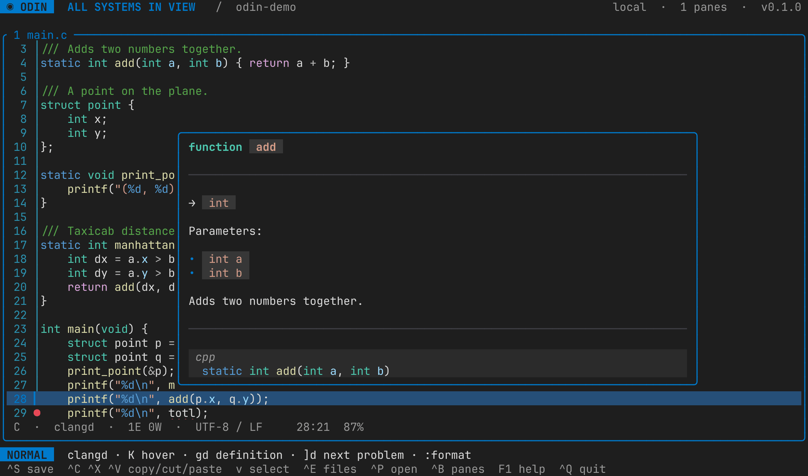
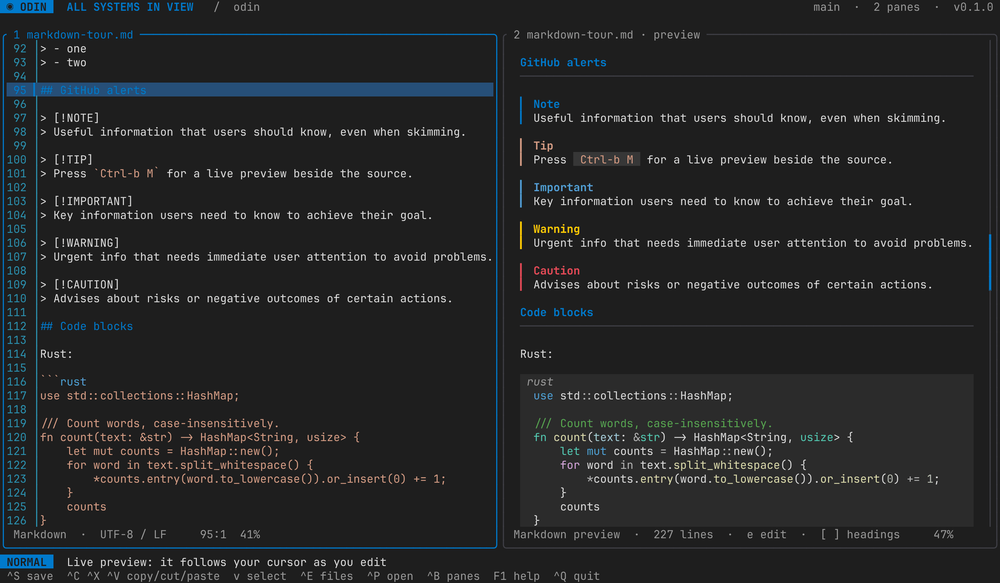
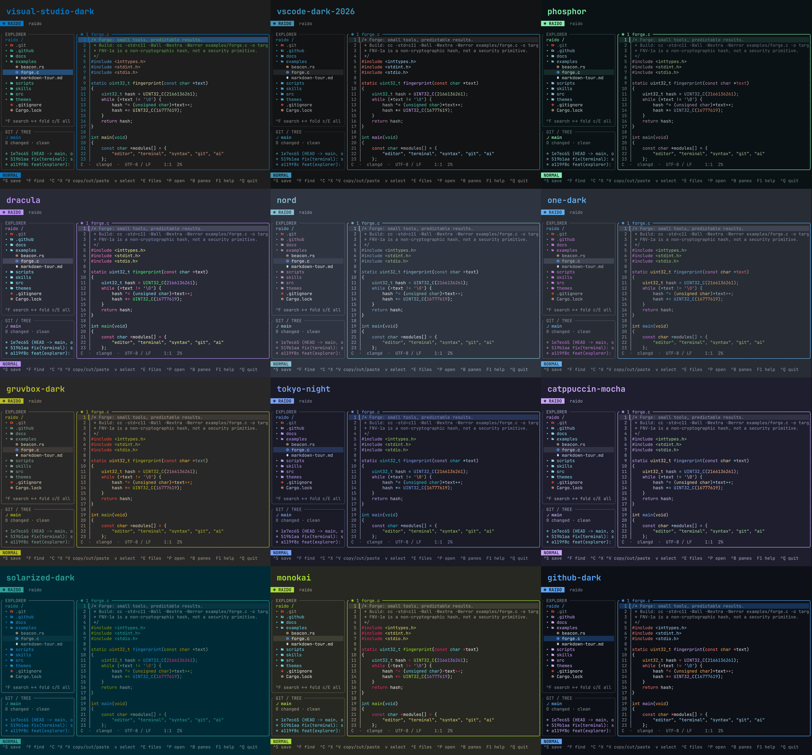
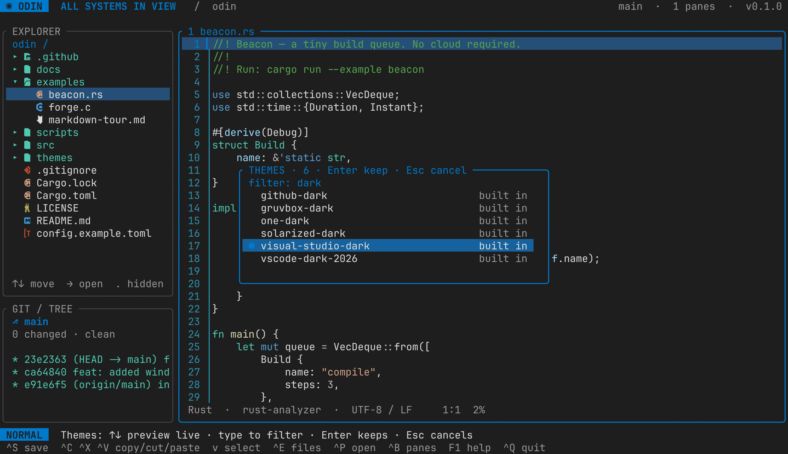

# ◉ Raido

**All systems in view.** A lean, Rust-native terminal workspace for people who build.

Code, project files, Git, a shell, and your AI CLI — in one keyboard-driven screen.
No Electron, no web service, no account required by Raido, no telemetry.



## ᚱ Why Raido

**Raido** (ᚱ, *raidō*) is the fifth rune of the Elder Futhark, the oldest runic
alphabet. Its name means *ride* or *journey*: the steady forward motion of a rider who
knows the road, keeps the rhythm and isn't thrown off course. It is one carved
stroke-shape, a single character with a whole meaning behind it, and it stands for
the right way of moving: in order, unhurried, toward where you mean to go.

That is what this workspace is for:

- **Simplicity.** One screen and one prefix key. What you need to write, run and
  review code is in view, and nothing else is.
- **Free of bloat.** A single native Rust binary: no Electron, no web service, no
  account, no telemetry, no extension marketplace to curate. It starts at once and
  stays out of your way.
- **Free of distractions.** No pop-ups competing for you, no tabs of chrome. An AI
  agent works beside your code and chimes once when it's done; its changes wait
  in a review until you've looked at them.
- **The keyboard is enough.** Every action has a key, and the keys stay where your
  hands already are. The mouse works when you want it, but you never need it.
- **Easy to reach.** One install script on macOS, Linux and Windows, and it runs
  anywhere a terminal does, over SSH included.

Raido was called **Odin** until October 2026. The name changed because Odin is also a
programming language with its own `odin` command. Your settings, themes, sessions and
the agent skill carry over by themselves ([Coming from Odin](#coming-from-odin)).

## Start here

- [Build from source](#build-from-source)
- [Install and update](#install-and-update)
- [Your first five minutes](#your-first-five-minutes)
- [Horizontal and vertical tiles](#horizontal-and-vertical-tiles)
- [Keyboard reference](#keyboard)
- [Markdown preview](#markdown-preview)
- [Copy and paste](#copy-and-paste)
- [Language servers](#language-servers-lsp)
- [Sessions: pick up where you left off](#sessions)
- [Command reference](#commands)
- [AI CLIs: Codex, Claude, Gemini, Antigravity](#ai-authentication)
- [Themes and plugins](#themes-and-command-plugins)
- [Troubleshooting](#troubleshooting)

## Build from source

### Install script

On **macOS or Linux**, one script installs everything Raido needs and then Raido:

```sh
scripts/install.sh
```

Or, without a checkout (it clones Raido first):

```sh
curl -fsSL https://raw.githubusercontent.com/yukselberkay/raido/main/scripts/install.sh | bash
```

It installs, skipping whatever is already there:

1. **A C compiler and linker, Git, curl, xz and fontconfig.** On macOS these come
   with the Xcode Command Line Tools; if they're missing, macOS opens its
   installer, and you run the script again when it's done. On Linux it uses the
   system package manager (apt, dnf, yum, pacman, zypper or apk) through `sudo`.
2. **Rust**, through [rustup](https://rustup.rs), or `rustup update stable` when
   the installed Rust is older than 1.88. Rust from a distribution package that
   is too old is reported, not replaced.
3. **rust-analyzer**, for Rust diagnostics, hover and completion in the editor
   (`--no-lsp` skips it).
4. **JetBrains Mono Nerd Font**, Raido's [font](#fonts) and the source of the explorer's
   Nerd Font file icons, which Raido then shows by default (`icons = true`): Homebrew's cask on macOS
   when Homebrew is installed, otherwise the latest Nerd Fonts release into
   `~/Library/Fonts` or `~/.local/share/fonts` (`--no-font` skips it).
5. **Raido**, built with `cargo install --locked` into `~/.cargo/bin/raido`.
6. **`raido` on your PATH**, so it runs by name. If your terminal can't find it yet, it
   links it into a folder already on your PATH that you can write to
   (`~/.local/bin`, `~/bin`, `/opt/homebrew/bin` or `/usr/local/bin`), so it works in
   that terminal at once; without one, it adds `~/.cargo/bin` to your shell's startup
   file (zsh, bash or fish; once, marked) for new terminals. Another `raido` already
   first on PATH is reported, not replaced. An install from when Raido was called
   Odin (the `odin` command) is removed.
7. **The [Raido skill](#ask-your-ai-agent-about-raido)** for AI agents, for every project
   of your user (`--no-skill` skips it; a failure here only warns).

Run it as yourself, not with `sudo`; it asks for `sudo` only for system packages.
To do the same steps by hand, read on.

### 1. Prerequisites

Raido runs on **Linux, macOS and Windows 10/11** (see [Windows](#windows) for the
Windows specifics). You need:

- Rust **1.88 or newer** and Cargo. Current stable Rust is recommended.
- A C compiler/linker and platform development headers.
- A UTF-8 terminal with 256-color support; true color is recommended.
- Git for the Git sidebar. No Git repository is required just to edit files.
- Python 3 only if you want to run the optional PTY smoke test.

On Debian/Ubuntu, install the compiler and Git:

```sh
sudo apt update
sudo apt install build-essential git curl
```

On Fedora:

```sh
sudo dnf install gcc gcc-c++ make git curl
```

On macOS, install the Xcode Command Line Tools:

```sh
xcode-select --install
```

Install Rust using the official [rustup instructions](https://rustup.rs/).
Choose the stable toolchain. Open a new terminal afterward, or load Cargo's
environment in your current shell:

```sh
. "$HOME/.cargo/env"
rustc --version
cargo --version
cc --version
git --version
```

If Rust is already installed but too old, use `rustup update stable`.

### Windows

On **Windows**, `scripts\install.ps1` does the same in PowerShell, using winget for
the programs: Git, the Visual Studio C++ build tools (Rust's linker; a large
download), Rust through rustup, rust-analyzer, JetBrains Mono Nerd Font (for your
user, no administrator rights), Raido, the AI-agent skill, and `%USERPROFILE%\.cargo\bin`
on your user PATH, so `raido` runs in that window at once and in every new one:

```powershell
powershell -ExecutionPolicy Bypass -File scripts\install.ps1
# without a checkout:
irm https://raw.githubusercontent.com/yukselberkay/raido/main/scripts/install.ps1 | iex
```

`-NoFont`, `-NoLsp` and `-NoSkill` skip those parts. Afterwards pick
"JetBrainsMono Nerd Font Mono" in Windows Terminal (Settings → Profiles → Defaults →
Appearance → Font face). By hand instead:

1. Install Rust with [rustup-init.exe](https://rustup.rs/) and accept the default
   (MSVC) toolchain; when asked, let it install the Visual Studio C++ Build Tools.
2. Install [Git for Windows](https://git-scm.com/download/win).
3. Use **Windows Terminal** (built into Windows 11) for true color and full key
   support. For explorer icons, set a [Nerd Font](https://www.nerdfonts.com/) in its
   profile; without one, Raido shows plain colored markers instead.

Then build and install from PowerShell exactly as below (`cargo build --release
--locked`, `cargo install --path . --locked`); the binary is `raido.exe` in
`%USERPROFILE%\.cargo\bin`, which rustup adds to `PATH`.

On Windows, terminal panes start **PowerShell** (`pwsh`, else Windows PowerShell,
else `cmd.exe`; override with `shell = "…"`), configuration lives in
**`%APPDATA%\raido\config.toml`** (themes in `%APPDATA%\raido\themes`), and the clipboard
goes through PowerShell's `Get-Clipboard` / `Set-Clipboard`. CLIs installed with npm
(`codex`, `gemini`, `pyright-langserver`, …) are found through their `.cmd` shims.
Omarchy themes are Linux-only and simply do not appear.

### 2. Get the source and build

Extract the supplied **source ZIP**, or use your existing Raido checkout, then
enter the directory containing `Cargo.toml`:

```sh
cd raido
cargo build --release --locked
./target/release/raido --version
```

There is no public repository URL or crates.io installation assumed by this
guide. The first build downloads dependencies; subsequent builds reuse Cargo's
cache. `--locked` uses the versions recorded in `Cargo.lock`.

The executable is `target/release/raido`. No Node.js, browser, or Python runtime
is needed to run the editor. The README screenshots come from `scripts/screenshots.sh`
(test-only code plus headless Chrome); none of it is part of the application.

### 3. Run without installing

```sh
./target/release/raido .                   # Browse the current project
./target/release/raido examples/forge.c    # Open a specific file
./target/release/raido . --demo            # Rust example + AI launcher + shell
./target/release/raido --help
```

Run these inside an interactive terminal, not through a pipe. When opening a
file inside a Git repository, Raido uses that repository as its workspace root;
outside Git it uses the file's parent directory.
When opening a directory, that directory is the workspace. Shell panes start
there, and editor command paths are resolved relative to it.

`--demo` looks for `examples/beacon.rs` in the selected directory. It opens an
AI **launcher**, not an authenticated model session. It does not use an API key
or make model requests. Recommended screen: **140 × 40** or larger; a three-pane
layout is more comfortable at **168 × 48**. Below 70 columns the sidebar is hidden.

## Install and update

From the source directory, install into Cargo's user-level bin directory:

```sh
cargo install --path . --locked
raido --version
raido ~/projects/my-project
```

By default the binary is installed at `~/.cargo/bin/raido`. Cargo's bin directory
must be on `PATH`; `. "$HOME/.cargo/env"` sets that up for the current shell.
Do **not** run `cargo install` with `sudo`.

For an explicit alternative installation location:

```sh
cargo install --path . --locked --root "$HOME/.local"
export PATH="$HOME/.local/bin:$PATH"
raido --version
```

Add that PATH line to your shell startup file if you want it to persist.
After obtaining a newer source checkout/archive, update with:

```sh
cargo install --path . --locked --force
```

If you chose a custom root, repeat `--root "$HOME/.local"` when updating.
For a Cargo-managed default installation, uninstall with:

```sh
cargo uninstall raido
```

For the custom-root installation, use
`cargo uninstall --root "$HOME/.local" raido`.
The **package** is named `raido`; its **executable** is named `raido`.
Uninstalling does not remove your projects or user configuration.

### Coming from Odin

Raido is the same workspace under a new name. The install script removes the old
`odin` command (`cargo uninstall odin-editor` does it by hand), and on its first start
Raido moves what Odin kept:

| Odin kept | Raido uses | When it moves |
| --- | --- | --- |
| `~/.config/odin` (settings, themes; `%APPDATA%\odin` on Windows) | `~/.config/raido` | First start |
| A project's `.odin/` session | `.raido/` | When the project opens |
| The `odin` skill in your AI agents' folders | The `raido` skill | When the skill is installed or refreshed (at startup when an agent is installed) |
| `ODIN`, `ODIN_SOCKET`, `ODIN_DOCS` in terminal panes | `RAIDO`, `RAIDO_SOCKET`, `RAIDO_DOCS` | At once |

Only Odin's own files move; a folder or skill named `odin` that belongs to something
else (the Odin language, for one) is left alone.

## Your first five minutes

1. **Open a project:** run `raido /path/to/project` (or the local binary above).
   A directory opens a scratch editor plus the file/Git sidebar.
2. **Choose a file:** press `Ctrl-e`, use Up/Down to select a file or directory,
   Right to expand, Left to collapse, and Enter to open. Focus moves to the editor.
3. **Edit:** the bottom bar initially says `NORMAL`. Press `i` to enter `INSERT`,
   type your changes, then press Escape to return to normal mode.
4. **Save:** press `Ctrl-s`, or type `:w` and Enter from normal mode. For a scratch
   buffer use `:w notes.txt`. To create another file use `:e notes.txt`, then save.
   Parent directories must already exist. A new buffer is not a disk file until saved.
5. **Navigate:** type `:25` and Enter to jump to line 25. Type `/needle` and Enter
   to search; `n` and `N` find the next/previous occurrence.
6. **Run tools:** press `Ctrl-b`, release, then `c` to open a shell below the
   current pane. Type build/run commands there as in any other terminal.
7. **Return to editing:** press `Ctrl-b`, release, then an arrow to focus a pane,
   or `o` to cycle panes. Use `Ctrl-b z` to temporarily maximize the active pane.
8. **Exit:** `Ctrl-q` or `:qa` refuses to exit with unsaved changes. Use `:wa` to
   save modified named buffers first. `:qa!` explicitly discards changes and exits.

Press **F1** for the built-in field guide. It docks on the right and opens focused:
**↑/↓**, `j`/`k`, **PageUp/PageDown**, Space and `g`/`G` scroll it, with no modifier
keys (Alt-↑/↓ also works where Alt is free). **Esc** returns to your work while the
guide stays open, so you can follow it step by step as you type commands and edit;
any other key also goes straight to your work. **F1** focuses the open guide again,
and F1 on a focused guide (or `:help`) closes it. Editor commands
such as `:w` are entered in Raido, not the shell. While a terminal is focused,
use **Ctrl-b then `:`** to open Raido's command prompt.



## Horizontal and vertical tiles

The names describe the dividing border: a **vertical split** creates left/right
panes; a **horizontal split** creates top/bottom panes.

| Layout | Shortcut | Raido command |
| --- | --- | --- |
| Side-by-side editor panes | `Ctrl-b %` | `:vsplit` |
| Stacked editor panes | `Ctrl-b "` | `:split` |
| Shell below the active pane | `Ctrl-b c` | `:term` |
| Shell beside the active pane | `Ctrl-b C` | `:term right` |
| Move the pane (swap, or to a whole side) | `Ctrl-b Shift-arrows` / `H J K L` | `:move right` |
| Side by side ↔ stacked | `Ctrl-b Space` | `:flip` |

Splits nest inside the focused pane. Splitting an editor initially shows the
same buffer in both views; use `:e another-file` in the new view to open something
else. The buffer contents, cursor, and scroll position are shared when two views
show the same buffer. Closing a terminal pane stops its terminal child process.

### Docking panes

`Ctrl-b d` (or `:dock`) hides the focused pane without stopping it: a shell, an AI
agent or a server keeps running, and the panes around it take its room. Docked
panes wait as numbered tabs in the top bar (` dock  1 claude  2 zsh `). Click a tab,
or press `Ctrl-b D` and choose with ↑↓ Enter (or the number), to bring one back to
the same place and size; `x` in that list closes it for good. `:undock 2` or
`:undock claude` works too. An AI pane that finishes while docked still chimes and
says so in the status line. Docked panes are saved with the session; the last pane
on screen can't be docked, and closing it brings back the newest docked one.

### Reproduce the C + terminal screenshot

From the Raido source directory:

```sh
raido .
# Without installing: ./target/release/raido .
```

Then use these keys **inside Raido**:

1. Type `:e examples/forge.c`, then Enter — open the C source in the first pane.
2. `Ctrl-b %` — create a right-hand editor pane (vertical dividing border).
3. Type `:e README.md`, then Enter — open this guide in the right-hand pane.
4. `Ctrl-b c` — create a terminal below the README (horizontal dividing border).
5. In that terminal, compile and run the included C program:

   ```sh
   mkdir -p target
   cc -std=c11 -Wall -Wextra -Werror examples/forge.c -o target/forge
   ./target/forge
   ```

6. `Ctrl-b o` cycles back to the C editor; `Ctrl-b z` zooms/unzooms it.
   To give the C editor more room, use `Ctrl-b Ctrl-Right` a few times.



This is a live application capture, not a mockup. The file explorer and Git
history remain visible alongside both split directions.

Start with `raido .` as above even if you extracted a ZIP: the archive does not
contain Git history. To enable Git for a new project, run `git init` in its root;
the history graph appears after you make commits.

## What works

- **Modal text editing:** Vim-inspired normal/insert modes, arrows/hjkl, words,
  line jumps, delete/change, grouped undo/redo, search with wrap,
  automatic indentation, bracketed paste, horizontal/vertical scrolling.
- **Copy and paste:** `v`/`V` or Shift+arrows select; Ctrl-c/Ctrl-x/Ctrl-v and
  `y`/`d`/`p` share the **system clipboard** with your other apps.
- **Language servers:** diagnostics, hover docs, go-to-definition, completion and
  formatting for Rust, Go, Python, C and C++ via their standard servers.
- **Markdown preview:** `.md` files open rendered — headings, lists, task
  lists, tables, highlighted code blocks, quotes and GitHub alerts — with a live
  side-by-side preview that follows your cursor while you edit.
- **Source highlighting:** bundled Rust, C, C++, Python, Go grammars, plus the
  other bundled Syntect languages. Absolute/relative line numbers.
- **File explorer:** keyboard traversal, folders that fold one at a time or all at
  once, dotfiles always shown, VS Code-style Git status colors and letters, new
  file buffers, visible-path completion, open-buffer cycling.
- **Tiling:** recursively nested horizontal/vertical splits, directional focus,
  resize, zoom, and close. Up to 12 panes; editor views can share buffers.
- **Terminals:** real PTYs, ANSI/256/true-color rendering, resize propagation,
  application cursor keys, bracketed paste, terminal query responses, and
  bounded scrollback. Shells and CLI tools run in the project directory.
  `raido FILE` typed in one opens FILE in a pane of this Raido, not a second Raido.
- **AI panes:** run **OpenAI Codex**, **Claude Code**, **Gemini CLI** or the
  **Antigravity CLI** (`agy`) as installed executables, beside or below your code.
  These are the real tools, not imitations or provider-specific chat widgets.
- **Review AI changes:** everything Codex, Claude Code or any AI pane changes shows
  up as a diff, like VS Code's agent edits; keep or undo each change, each file or
  all of them ([Review AI changes](#review-ai-changes)).
- **Git sidebar:** current branch, changed/untracked files, and recent ASCII
  commit graph. Enter opens a changed file. Git is read-only here; perform
  staging/commits in the terminal or your preferred Git TUI.
- **Changes in the gutter:** VS Code-style added / changed / removed line marks
  against Git, live as you type, with `]c` / `[c` to jump between them.
- **External-change refresh:** clean open files refresh when AI/shell tools edit
  them. Dirty buffers remain yours; saving detects conflicting disk changes.
- **Extensions:** user-owned TOML themes and explicitly invoked command plugins.

## Keyboard

`Ctrl-b` is a prefix: hold Ctrl and press `b`, release both, then press the
following key. `Ctrl-b %` is not three simultaneous keys. `%` and `"` require
Shift on many keyboard layouts. On macOS, **Ctrl means Control, not Command**.

| Shortcut | Action |
| --- | --- |
| `Ctrl-e` | Focus the file explorer (also from the Git section); in the explorer, return to the pane |
| `Ctrl-p` | Open a path; Tab completes files and folders, and inside folders (Enter on a folder opens it in the explorer) |
| `Ctrl-s` | Save editor buffer |
| `Ctrl-q` | Quit, refusing unsaved buffers |
| `Ctrl-b %` / `Ctrl-b "` | Side-by-side / stacked editor split |
| `Ctrl-b arrows` or `Ctrl-b h/j/k/l` | Move between panes; the one taking your keys has Raido's `◉` before its title |
| `Ctrl-b Ctrl-arrows` | Resize the closest split on that axis |
| `Ctrl-b r` | Resize mode: arrows or `h j k l` resize the focused pane, as often as you like, Enter or Escape when done (macOS keeps Ctrl+arrows for switching desktops, so use this there) |
| `Ctrl-b Shift-arrows` or `Ctrl-b H/J/K/L` | Move the pane: it trades places with the pane on that side, or, at the edge already, takes that whole side of the window (`:move right`) |
| `Ctrl-b Space` | Flip the pane's split between side by side and stacked (`:flip`) |
| `Ctrl-b o` | Cycle panes |
| `Ctrl-b c` / `Ctrl-b C` | New terminal below / beside |
| `Ctrl-b a` / `Ctrl-b A` | New AI launcher beside / below; 1 Codex, 2 Claude, 3 Gemini, 4 Antigravity |
| `Ctrl-b z` / `x` | Maximize (zoom) / close current pane; a maximized pane shows `⛶ MAXIMIZED · N more panes` on its border |
| `Ctrl-b y` | Hand the mouse to the terminal for selecting and copying (layout unchanged); again to take it back ([Mouse](#mouse)) |
| `Ctrl-b d` / `Ctrl-b D` | Dock (hide) the pane, still running / list docked panes to bring one back ([Docking panes](#docking-panes)) |
| `Ctrl-b +` / `-` / `0` | [Text size](#text-size) bigger / smaller / reset; keep pressing `+` or `-` to repeat |
| `Ctrl-b s` / `g` | Toggle sidebar / focus the sidebar's Git section |
| `Ctrl-b G` | Open the [Git pane](#git-pane); again focuses it, and when focused maximizes / restores it |
| `Ctrl-b v` | [Review what AI agents changed](#review-ai-changes): keep or undo each change; again focuses the review, and when focused maximizes / restores it |
| `PageUp` / `PageDown` (Fn-↑/↓ on a Mac) | Scroll a terminal or AI pane's history half a page; then ↑/↓ one line, Home/End top/bottom, Esc or typing returns. Full-screen programs (vim, less) get the keys instead |
| `Ctrl-b [` | [Copy mode](#copying-from-terminal-and-ai-panes) in a terminal or AI pane |
| `Ctrl-b Z` | [Copy view](#copying-from-terminal-and-ai-panes): only the focused pane's text; again to return |
| `Ctrl-b b` | Send literal Ctrl-b to the terminal |
| `Ctrl-b :` | Command prompt, including from terminal panes |
| `F1` | Field guide beside your work, focused: ↑/↓ PgUp/PgDn scroll, Esc back to work (stays open); F1 refocuses / closes |

`Ctrl-q`, `Ctrl-e`, `Ctrl-p`, F1 and the Ctrl-b prefix are reserved by Raido even
inside a terminal. Other ordinary terminal keys go to the child CLI; Escape alone
does **not** leave a terminal pane. `Ctrl-s` saves in an editor but passes through
in terminal panes. Use Ctrl-b plus arrows or `o` to leave a terminal.

### File explorer and Git

These shortcuts apply while the sidebar has focus (`FILES` or `GIT` in the status bar).

| Key | Action |
| --- | --- |
| Up/Down or `k`/`j` | Select previous/next entry; a selected file is **previewed** in the editor pane while focus stays here |
| PageUp/PageDown (Fn-↑/↓ on a Mac), Home/End | Move 5 entries up/down, or to the first/last entry (also in the Git section and in search results) |
| Right or `l` | Expand directory; enter its first child if already expanded; open file |
| Left or `h` | Collapse current directory or select parent |
| Enter | Toggle directory / open selected file and move focus to it |
| Space | Fold or unfold the selected folder; on a file, fold the folder holding it |
| `c` | Collapse all folders (also `:collapse`) |
| `E` | Expand the selected folder and every folder inside it; on a top-level file, the whole project. `.git`, `target` and `node_modules` stay folded (also `:expand`) |
| `r` | Refresh file tree (e.g. after creating files in a terminal) |
| `n` | Start a new-file command; supply the path and press Enter |
| Tab | Switch between file explorer and Git section |
| Escape | Return focus to the active pane |
| `Ctrl-e` | From the Git section: jump to the explorer; in the explorer: return to the pane |
| `Ctrl-f` | [Search the project](#search-the-project): file names and text in files |

### Search the project

`Ctrl-f` in the explorer turns it into a search: type, and the results come in as
you type, grouped by file — files whose names match first, then every line holding
the text (with its line number). Case is ignored until you type a capital letter.
↑↓ preview a result in the editor with the match highlighted, Enter (or a click)
opens it with the cursor on the match, `Ctrl-u` clears, and Escape goes back to the
file tree; the search stays until then, so `Ctrl-e` returns to it. It searches what
Git sees (ignored files left out) or, outside a repository, everything but `.git`,
`target` and `node_modules`; binary files and files over 2 MB are skipped, and it
stops at 2,000 results.

Dotfiles and dot-directories (`.github`, `.env`, `.git`, `.raido`, …) are always shown.
Only `target` and `node_modules` build output is left out of the tree; `Ctrl-p` still
opens files there.

Like VS Code, the explorer shows what Git sees, refreshed every few seconds:

| Mark | Color | Meaning |
| --- | --- | --- |
| `M` | yellow | Modified |
| `U` | green | Untracked (new, not yet added) |
| `A` | green | Added to the index |
| `R` | green | Renamed or copied |
| `D` | red | Deleted (shown on the folder that held it) |
| `!` | red | Merge conflict |
| `●` | most urgent inside | A folder holding changes |
| dimmed | — | Ignored by `.gitignore`, and `.git` itself |

The name takes the mark's color too. Colors come from the theme's terminal palette
(bright green and red) and its `warning` color.

Each entry shows a **file-type icon** in its language's color, the same Nerd Font glyphs
Omarchy's terminal tools use (Rust, C/C++, Python, Go, JS/TS, Markdown, TOML, YAML,
shell, images, archives, Git files, Docker, licenses…). They need a Nerd Font in your
terminal, which Omarchy ships by default. With the default `icons = true`, Raido uses
them when your terminal bundles Nerd Font symbols (kitty, WezTerm, Ghostty) or a Nerd
Font is installed, and otherwise shows plain markers in the same colors (`●` files,
`■` folders) instead of `?` or boxes. Force a style with `icons = "nerd"` or
`icons = "basic"`, or hide icons with `icons = false`.

Browsing reuses a single preview buffer (like a VS Code preview tab), so walking past
many files does not leave them all open. A previewed file stays open once you press
Enter on it or edit it. In the Git section, Up/Down previews changed files the same way
and Enter opens one. Git is
read-only in the sidebar and refreshes periodically. Common status codes include
`??` (untracked), `M` (modified), and `A` (added); the two columns distinguish
index and working-tree status. Symlink directories are not recursively expanded.

### Text size

`Ctrl-b +` (or `=`) zooms in, `Ctrl-b -` zooms out and `Ctrl-b 0` resets; right
after one of them, `+`, `-` and `0` keep working without the prefix for a second.
`:zoom in`, `:zoom out` and `:zoom reset` do the same (`:zoom` alone maximizes the
pane, like `Ctrl-b z`). The layout, editors and terminal panes reflow to the new size.

A terminal program can't scale its own text, so Raido asks the terminal window:

| Terminal | How |
| --- | --- |
| macOS Terminal | AppleScript, 1 pt per step, only for Raido's own tab; your profile is untouched and reset returns to its size |
| xterm | Its font menu escape (`allowFontOps`, on by default) |
| kitty | `kitty @ set-font-size`, when remote control is on (`allow_remote_control` and `listen_on`) |
| Others (iTerm2, Ghostty, WezTerm, Alacritty, Windows Terminal, …) | Raido names your terminal's own keys: Cmd-+ / Cmd-- / Cmd-0 on macOS, Ctrl-+ / Ctrl-- / Ctrl-0 elsewhere |

### Fonts

Raido's font is **JetBrains Mono Nerd Font Mono at 14 pt** (`font` and `font_size` in
`config.toml`). The font belongs to the terminal window, so how far Raido can apply
it depends on the terminal:

- **macOS Terminal:** while Raido runs, its tab switches to that font and size, and
  gets its own font back when Raido exits. Your profile and other tabs don't change.
  `Ctrl-b 0` returns to 14 pt.
- **Other terminals** can't have one window's font changed from outside, so they
  keep their own font. Make JetBrains Mono your terminal's font with
  `:font family "JetBrainsMono Nerd Font Mono"` (below) or in its settings.
- **Font not installed:** every terminal keeps its own font.
  [`scripts/install.sh`](#install-script) installs it.

Set `font = ""` to always keep the terminal's font. To change it in the terminal
itself, `:font` edits the terminal's config:

| Command | What it does |
| --- | --- |
| `:font` | Names your terminal and how its font is set |
| `:font size 12` (or `:font 12`) | Saves the size in the terminal's config: foot (`foot.ini`), Ghostty, Kitty, Alacritty — Alacritty and Kitty also change at once |
| `:font family "JetBrainsMono Nerd Font"` | On **Omarchy** runs `omarchy font set` (all terminals); elsewhere saves it in the terminal's config |
| `:font list` | Installed monospace fonts |
| `:font +` / `-` / `reset` | Same as `Ctrl-b +` / `-` / `0` above |

Raido finds the terminal from its environment, or on Linux from the process that
started it (foot under Omarchy sets no variable). Only the font lines change; the
rest of the file is kept. For WezTerm, Windows Terminal and macOS terminals, `:font`
says where the setting lives. Use a [Nerd Font](https://www.nerdfonts.com/) for the
explorer icons.

### Git pane

The sidebar shows a short summary. For the full picture, `:git` or `Ctrl-b G` opens
the **Git pane**, docked full-width along the bottom:

- **Branches** — every local and remote branch, yours first (`●`), then by recent
  activity, with ahead/behind counts against the upstream (`↑2 ↓1`) and their age.
- **Commit graph** — up to 400 commits across all branches, newest first. Each lane
  keeps its own color, so a branch reads as one line from where it forks to where it
  merges. Refs appear as badges (`◉ main` checked out, local branches, `origin/…`
  remotes, `◆ v1.0` tags), then the subject, author and age.
- **Details** — the selected commit's author, date, full message and changed files.
- **Changes** — Enter on a commit shows its whole diff: the message and file summary,
  then each changed file with its hunks, old and new line numbers, added lines in
  green and removed lines in red (the same colors as the editor's change marks).
  Renames show as `old → new`, and tabs are expanded so Go code lines up.

It refreshes every few seconds while you work. Press `Ctrl-b G` while it is focused
to maximize it (same as `Ctrl-b z`) and again to put it back; set `git_pane = true`
to have it open on every start.

| Key | Action |
| --- | --- |
| Tab | Switch between the branch list and the commit graph |
| Up/Down or `k`/`j`, PageUp/PageDown, `g`/`G` | Move; selecting a branch jumps to its newest commit |
| Enter | On a branch: show only its history (again: all); on a commit: show its changes |
| `a` or Escape | Show all branches again |
| `d` | Show/hide the details panel |
| `y` | Copy the selected commit hash |
| `r` | Refresh now |

In a commit's changes:

| Key | Action |
| --- | --- |
| `j`/`k`, Up/Down, Space/PageDown/PageUp, `Ctrl-d`/`Ctrl-u` | Scroll |
| `n` / `N` (or `]` / `[`) | Next / previous file (back from the first file: the message) |
| `h` / `l` | Scroll long lines sideways |
| `g` / `G` | Top / bottom |
| `y` | Copy the commit hash |
| Escape, `q` or Enter | Back to the graph |

Very large commits are cut off after 20,000 lines. `Ctrl-b G` maximizes the pane for
more room.

### Review AI changes

Like VS Code shows what Copilot or Claude changed, Raido shows what your AI panes
change, whichever CLI runs in them (Codex, Claude Code, Gemini, a local model):
**`Ctrl-b v`** or `:changes` opens the review. Each changed file is listed with its
hunks, old and new line numbers, added lines in green and removed lines in red, and
the agent that made it. It updates live while the agent works.

```text
╭ ◉ 4 CHANGES · 2 files +2 −1 ─────────────────────────────╮
│── y keep  x undo  Y X file  A U all  n N next  ⏎ open ────│
│▌app.py                                       +1 −1 · Codex │
│ @@ -1,1 +1,1 @@                            y keep · x undo │
│    1      - print(1)                                       │
│         1 + print(2)                                       │
│                                                            │
│ notes.md new file                            +1 −0 · Codex │
│ @@ -0,0 +1,1 @@                                            │
│         1 + note                                           │
╰────────────────────────────────────────────────────────────╯
```

The bar on the left is the cursor. **`y` keeps** the change it's on, and the review
stops showing it. **`x` undoes** it: that part of the file goes back to how it was
before the agent. On a file's heading, or with `Y` / `X`, they act on the whole
file; `A` keeps everything and `U` undoes everything. Undoing a whole file or
everything asks first (`y` to confirm), because the agent's version is gone after.
An undone new file is deleted, and an undone deletion brings the file back. Enter
opens the file at that line.

| Key | Action |
| --- | --- |
| `j`/`k`, Up/Down, Space/PageDown/PageUp, `Ctrl-d`/`Ctrl-u`, `g`/`G` | Move the cursor |
| `n` / `N` | Next / previous change (hunk) |
| `]` / `[` | Next / previous file |
| `y` / `x` | Keep / undo the change under the cursor (the whole file on its heading) |
| `Y` / `X` | Keep / undo the whole file |
| `A` / `U` | Keep / undo every file (`:changes keep`, `:changes undo`) |
| Enter or `o` | Open the file at that line |
| `h` / `l` | Scroll long lines sideways |
| `r` | Look again now |
| `q` | Close the review |

When an AI pane finishes a prompt, the status line says how many files it changed
(`Claude finished · 3 files to review: Ctrl-b v`), and its title shows
`✎ 3 files · ^B v` until you've kept or undone them.

**How it knows what the agent changed:** while AI panes are open, Raido snapshots the
project with Git every couple of seconds while an agent works, and every few seconds
while they wait. Files that change while an agent is working are the agent's; the
review compares each one with how it was before the agent first touched it, so
changes from several prompts add up until you keep or undo them. Files you change
while no agent works, or save from Raido's editor, are yours and stay out of the
review. Edits you make in another editor *while* an agent works can't be told apart
and show up too (keep them with `y`). It works with every CLI, needs no setup, and
never writes to your repository: the snapshots go into Raido's own Git index and
object store in your cache folder, deleted when Raido quits. `.gitignore`d files
(build output, `node_modules`) are left out.

The review needs a Git repository (`git init` makes one) and lasts while Raido runs.
Set `review_changes = false` to turn it off.

### Editor: normal mode

| Key | Action |
| --- | --- |
| Arrows or `h j k l` | Move left/down/up/right |
| `w` / `b` | Next / previous word |
| `0` / `^` / `$` | Line start / first non-whitespace / line end |
| `gg` / `G` | First / last line |
| `42G` or `:42` then Enter | Go to line 42 (line numbers are one-based) |
| `15j` / `15k`, `15` Enter / `15-`, `:+15` / `:-15` | Jump 15 lines down / up — the numbers shown by `:set rnu` |
| `10j`, `3w`, `5x` | Repeat a movement or character deletion |
| PageUp / PageDown | Move 20 lines up/down |
| `Ctrl-u` / `Ctrl-d` | Move 15 lines up/down |
| `i` / `a` | Insert at cursor / append after cursor |
| `I` / `A` | Insert at line start / append at line end |
| `o` / `O` | Open an indented line below / above and enter insert mode |
| `x` / Delete | Delete character under cursor |
| `dd` | Cut the line (to the clipboard) |
| `D` / `C` | Delete to line end / delete to end and enter insert mode |
| `yy` / `p` / `P` | Copy line / paste below (after cursor) / above (at cursor) |
| `v` / `V` | Select characters / whole lines (see [Copy and paste](#copy-and-paste)) |
| `K` / `gd` / `Ctrl-o` | Hover docs / go to definition / jump back |
| `]d` / `[d` | Next / previous diagnostic |
| `]c` / `[c` | Next / previous [change from Git](#changes-in-the-gutter) |
| `u` / `Ctrl-r` | Undo / redo |
| `/text` then Enter | Search, wrapping through the file |
| `n` / `N` | Next / previous search result |
| `Ctrl-f` / `Ctrl-h` | [Find / find and replace](#find-and-replace), like VS Code |
| `:noh` | Clear search highlights |
| Tab / Shift-Tab | Cycle next / previous open buffer |
| `:` | Open command prompt; Enter runs it, Escape cancels |

### Language-aware typing

Typing follows the language of the file, like VS Code:

| Language | Enter indents after | Also |
| --- | --- | --- |
| Python | a line ending in `:` (`def f():`, `if x:`) | dedents after `return`, `pass`, `break`, `continue`, `raise`; `else:` / `elif` / `except` / `finally` move back under their `if` / `try` |
| Rust, Go, C/C++, JS/TS, Java, Kotlin, Swift, C#, PHP, CSS, JSON | `{`, `(`, `[` | Go and Makefiles indent with tabs |
| YAML, Makefile | `:` | |
| Shell | `then`, `do`, `else`, `case … in` | |
| Lua / Ruby | `then`, `do`, `function` / `def`, `class`, `if`, `do \|x\|` … | |
| Markdown | | lists continue (`- `, `1.` → `2.`, `- [ ]`); Enter on an empty item ends the list |

- Enter between brackets (`{|}`) opens an indented line and puts the closer on its own
  line; a closer typed on a blank line lines up with its opener.
- `(`, `[`, `{`, `"`, `'` (and `` ` `` in JS, Go, shell, Markdown) close themselves when
  the next character is a space, a closer or the line end, never right after a letter
  (`don't`; Python's `f"` and `r'` still close). Typing the closer steps over it,
  Backspace in an empty pair removes both, and typing an opener over a Shift-selection
  wraps it. Python's `"""` and `/*` in C-like languages close as you open them
  (`"""|"""`, `/*| */`), so the rest of the file doesn't turn into string or comment
  color while you write.
- The indentation unit comes from the file (tabs, or its most common step), else the
  language (tabs for Go, 4 spaces for Python, 2 for YAML), else `tab_width`. Tab goes to
  the next stop, Shift-Tab dedents the line, and Backspace in leading spaces removes a
  whole level.
- `o` indents the new line the same way Enter would.

These rules are instant and local; language servers keep to completions, diagnostics
and formatting on save. Turn them off with `smart_indent = false` / `auto_pairs = false`.

### Find and replace

**`Ctrl-f`** opens a find bar in the editor's top-right corner, filled in with the
selection, or else the word under the cursor (select it and Ctrl-f to find a
variable). Matches light up as you type, the current one in the accent color, and
the bar counts them ("3 of 12"). Typing replaces the filled-in text.

| Key in the bar | Action |
| --- | --- |
| Enter / ↓, ↑ | Next / previous match |
| `Ctrl-w` | Whole words only (`count` no longer matches `counter`) |
| Tab or `Ctrl-h` | Show the replace field and switch between the two |
| Enter (in Replace) | Replace this match and go to the next |
| `Ctrl-a` | Replace all matches; one `u` undoes them all |
| `Ctrl-u` / `Ctrl-v` | Clear the field / paste into it |
| Esc | Close; `n` / `N` keep going, `:noh` clears the highlights |

**`Ctrl-h`** opens the bar with the replace field ready. Searches ignore case until
you type a capital letter (`Count` then matches only `Count`; the bar shows `Aa`).

Character movement is UTF-8-aware, not grapheme-cluster-aware. This is a documented
Vim subset, not full Vim: block selection, arbitrary operators, macros and numeric
counts for `dd` or `yy` are not implemented.

### Changes in the gutter

Like VS Code, the editor marks lines that differ from Git in the column between the
line numbers and the text, updating as you type (unsaved edits count):

| Mark | Color | Meaning |
| --- | --- | --- |
| `▌` | green | Added line |
| `▌` | blue | Changed line |
| `▁` | red | Lines removed below this line (`▔` above the first line) |

The comparison is with the file's version in the Git index, as in VS Code and
`git diff`: after `git add` or a commit, those marks go away. Untracked files and
files outside Git have none. `]c` / `[c` jump to the next / previous change. Colors
come from the theme's terminal palette (bright green, blue and red).

### Editor: insert mode

Type normally. Enter indents for the language ([Language-aware
typing](#language-aware-typing)); Tab indents. Backspace/Delete, arrows, Home/End and
PageUp/PageDown work. Escape returns to normal mode. `Ctrl-s` saves without leaving
insert mode.

**Autocomplete:** after two letters of a word, suggestions pop up: the language
server's (Rust, Go, Python, C/C++, when installed), or else the language's keywords
and the words already in your open files of that language, most used first. They
also pop up after `.`, and `Ctrl-Space` or `Ctrl-n` asks any time (macOS keeps
Ctrl-Space for switching keyboard languages when you have more than one). Up/Down or `Ctrl-n`/`Ctrl-p`
choose, **Tab** accepts, Escape closes the list, and typing keeps filtering it. Enter
accepts a suggestion you picked with Up/Down (or one you asked for); otherwise it
starts a new line, so a list that popped up never eats a newline.
The list stays inside the pane you're typing in, never over another, and one that
pops up by itself shows at most six suggestions. `autocomplete = false` keeps it to
`Ctrl-Space` and `.`.

Mac-style moves work in insert and normal mode, as far as your terminal passes the
keys on (`raido --keys` shows what arrives; a key that prints nothing never reaches
Raido):

| Keys | Action |
| --- | --- |
| Option+← / → (Alt; Ctrl on Linux and Windows) | Previous word / end of word |
| Shift+Option+← / → | Select by word |
| Option+Backspace | Delete the word before the cursor |
| Cmd+← / → / ↑ / ↓ (with Shift: select) | Line start / end, top / bottom of the file |
| Fn+Shift+← / → in macOS Terminal | Line start / end (Terminal sends Home / End) |

macOS Terminal keeps Cmd+arrows for itself, so use Fn+Shift+←/→ there, or a terminal
that passes Cmd on (kitty, WezTerm, Ghostty). If a combination prints nothing in
`raido --keys`, macOS Terminal can be taught to send it in Settings → Profiles →
Keyboard; for example Shift+Option+← / → as `\033[1;4D` / `\033[1;4C`.

### Copy and paste

One clipboard, shared with the rest of your desktop: everything you copy in Raido can
be pasted in other apps and vice versa (via `wl-copy`/`wl-paste` on Wayland,
`xclip` or `xsel` on X11, `pbcopy`/`pbpaste` on macOS; without them Raido copies through
the terminal's OSC 52, which most terminals support, even over SSH).

| Keys | Action |
| --- | --- |
| Shift + arrows / Home / End | Select from the cursor, in normal or insert mode |
| `v` / `V` | Start a character / line selection, then move with any motion |
| `Ctrl-c` or `y` | Copy the selection — or, with nothing selected, the whole line |
| `Ctrl-x` or `d` | Cut the selection — or the whole line |
| `Ctrl-v` | Paste at the cursor; a copied **line** goes above the cursor line |
| `p` / `P` | Paste after / before the cursor; lines go below / above |
| `c` | Replace the selection: delete it and start typing |
| Backspace / Delete | Delete the selection without copying |
| Escape | Cancel the selection |

A Shift-selection made while typing behaves like any text field: typing replaces it
and a plain arrow cancels it. Your terminal's own paste (⌘V on a Mac, `Ctrl-Shift-V` on Linux, `Ctrl-V` in
Windows Terminal) also works in any mode: it inserts at the cursor, or replaces the
selection.

### Mouse

The wheel scrolls whatever is under the pointer, focused or not: an editor (the
cursor stays on screen), a terminal's history, the Git pane, the Markdown preview,
the explorer or the guide. Programs that handle the mouse themselves get the wheel:
Claude Code's full-screen mode, htop; other full-screen programs like `less` get
arrow keys, as in a normal terminal. A click focuses a pane, puts the editor cursor
on the character you clicked, or opens an explorer entry.

While Raido has the mouse, your terminal's click-and-drag selection is off. To select
and copy with the mouse:

- **`Ctrl-b y`** (or `:mouse off`) hands the mouse back to the terminal and leaves the
  layout as it is: drag to select, ⌘C (Ctrl-Shift-C on Linux), paste anywhere. A
  `⇱ MOUSE RELEASED` badge in the top bar reminds you; `Ctrl-b y` again (or
  `:mouse on`) brings back the wheel and clicks.
- **Copy view (`Ctrl-b Z`)** does the same with only the focused pane on screen, edge
  to edge, so a selection can't pick up the explorer, borders or line numbers.
- Your terminal's bypass key works too (Option in iTerm2, Shift in most Linux
  terminals), and `mouse = false` in config.toml leaves the mouse to the terminal
  for good.

### Copying from terminal and AI panes

Your terminal's mouse selection copies whole screen rows, so in a split layout it
also picks up the explorer, borders and line numbers. Two ways around that:

**Copy mode (`Ctrl-b [`, or `:copymode`)** freezes the focused terminal or AI pane,
including its scrollback (2,000 lines), and gives you a cursor, like tmux:

| Keys | Action |
| --- | --- |
| Arrows / `h` `j` `k` `l` | Move |
| `w` / `b`, `0` / `^` / `$` | Next / previous word; line start / first character / end |
| PageUp / PageDown, `Ctrl-u` / `Ctrl-d` | Page / half page |
| `g` / `G` | Oldest line / bottom |
| `/` / `?` then Enter, `n` / `N` | Search down / up (case-insensitive); next / previous match |
| `v` / `V` | Select characters / whole lines (again to cancel) |
| `y`, Enter or `Ctrl-c` | Copy the selection (or the cursor line) to the clipboard and leave |
| `q` / Escape | Leave (Escape first clears a selection) |

Lines the terminal wrapped are copied as one line, and the padding at line ends is
dropped. Text a program wrapped itself (many AI CLIs do) keeps its line breaks. The
pane keeps running underneath; leaving shows its live output again. `Ctrl-b` and
`Ctrl-q` still work and leave copy mode first.

**Copy view (`Ctrl-b Z`, or `:copyview`)** shows only the focused pane, edge to edge:
no sidebar, header, status lines, borders, line numbers or change marks, and Raido
lets go of the mouse. Select with the mouse as usual, then `Ctrl-b Z` again to
return. Keys keep working in the pane, so you can scroll a terminal with PageUp
while in it. A reminder
shows for the first two seconds only, so it can't end up in a copy.

In editors, select with `v` / `V` and copy with `y` instead: that copies the exact
text, however long, without anything from the screen.

### Language servers (LSP)

Raido starts the standard language server for a file the first time you open it, in
the project root, and talks to it in the background. Install the server once:



| Language | Server Raido looks for | Install |
| --- | --- | --- |
| Rust | `rust-analyzer` | `rustup component add rust-analyzer` |
| Go | `gopls` | `go install golang.org/x/tools/gopls@latest` |
| Python | `pyright-langserver`, `basedpyright-langserver`, `pylsp` or `jedi-language-server` | `npm install -g pyright` or `pip install python-lsp-server` |
| C / C++ | `clangd` | Arch `pacman -S clang` · Debian/Ubuntu `apt install clangd` · macOS Xcode tools |

| Feature | How |
| --- | --- |
| Diagnostics | A `●` in the gutter, underlined code, and the message at the bottom of the pane when the cursor is on that line; `]d` / `[d` jump between them |
| Hover | `K` shows types and docs in a popup; any key closes it |
| Go to definition | `gd` opens the definition (even in another file); `Ctrl-o` jumps back |
| Completion | Pops up after two letters or `.`; `Ctrl-Space` or `Ctrl-n` asks; keywords and words from your files without a server |
| Format | `:format` formats the file with the server's formatter (rustfmt, gofmt, clang-format…) |
| Tidy on save | Go files are tidied every time you save, as in VS Code: [details below](#go-tidy-on-save) |
| Status | The pane footer names the server and counts errors/warnings; `:lsp` lists every language; `:lsp restart` restarts them |

A missing server is reported once, with its install command, and never interrupts
editing. C/C++ projects give clangd the best results with a `compile_commands.json`
(CMake: `-DCMAKE_EXPORT_COMPILE_COMMANDS=ON`). To use a different server, or turn
LSP off, see `lsp` and `lsp_enabled` in [config.example.toml](config.example.toml).

#### Go: tidy on save

Saving a `.go` file (`Ctrl-s`, `:w`, `:wq`, `:wa`) first lets **gopls** do what VS Code's
Go extension does on save:

1. **Organize imports** (like `goimports`): add missing imports, remove unused ones,
   and sort and group them.
2. **Format** the file (`gofmt`): tabs, spacing and alignment.

Then the file is written. Both steps are ordinary edits, so `u` undoes them. The
status line says what happened (`imports organized and formatted by gopls`). If gopls
isn't installed, fails, or takes longer than two seconds (it may while loading a
large module), the file is saved exactly as typed and the status line says why.
`:w other.go` (a different name) also saves the text as is.

The languages are listed in `format_on_save` (default `["go"]`). Add `"rust"`,
`"python"` or `"c"` to do the same with their servers, or set `format_on_save = []`
to turn it off.

### Markdown preview

Existing `.md`/`.markdown` files open **rendered**; new or empty ones open as
source so you can write. The preview is read-only and re-renders on every edit,
and when an AI or shell tool rewrites the file on disk.



| Key / command | Action |
| --- | --- |
| `j` `k` / arrows | Scroll one line |
| Space, `Ctrl-d` `Ctrl-u`, PageUp/PageDown | Page down / half page / page up |
| `g` / `G` | Top / end |
| `]` / `[` | Next / previous heading |
| `e`, `i` or Enter | Edit the source at the block you were reading |
| `/` | Switch to the source and search it |
| `:preview` or `Ctrl-b m` | Toggle rendered view / source, keeping your place |
| `:preview split` or `Ctrl-b M` | Live preview beside the source; it follows the cursor |

Rendered: headings, emphasis, strikethrough, inline code, links (their target is
shown dimmed), images (as alt text), nested bullet/numbered/task lists, block quotes,
GitHub alerts (`> [!NOTE]`, `[!TIP]`, `[!IMPORTANT]`, `[!WARNING]`, `[!CAUTION]`),
fenced code with syntax highlighting, tables with alignment, rules, footnotes and
YAML front matter. HTML is reduced to its text. Prose wraps to the pane and is
centered at a 100-column reading width; wide tables shrink and truncate cells.
Colors come from the active theme.

### Prompt and buffer behavior

Command/search/path prompts support typing, Backspace, Enter and Escape. In the
Ctrl-p path prompt, Tab completes like a shell, from the files on disk: a single
match is filled in, folders with a trailing `/` so the next Tab completes what's
inside; several matches fill in what they share and are listed, and more Tabs step
through them. Hidden names complete once you type the leading `.`, and case is
ignored when nothing matches exactly. Enter on a folder opens it in the explorer.
It is not a fuzzy full-project index. Editor paths may be absolute or workspace-relative;
`~` and shell variables are not expanded there. Type paths with spaces directly,
without shell quotes. Shell commands follow your shell's normal quoting rules.

### Opening files from a terminal pane

Inside one of Raido's terminal panes, `raido FILE` doesn't start a second Raido inside
the first. It opens FILE in this Raido, in a new editor pane beside the terminal,
and returns you to the shell prompt with `Opened FILE in Raido`. Relative paths are
relative to the shell's current directory.

- A file that doesn't exist yet opens as a new buffer; `Ctrl-s` creates it.
- A file already on screen brings its pane forward instead of opening another.
- Markdown files open rendered, as they do from the explorer.
- `raido DIR` (or bare `raido`) for a folder of this project shows it in the explorer.
  A folder of another project, or `raido --nested FILE`, starts a separate Raido as before.

On macOS and Linux, Raido listens on a socket in a private temporary directory (mode
`0700`, removed when Raido exits) and passes its path to every terminal pane as
`RAIDO_SOCKET`. On Windows it listens on a local port (127.0.0.1 only) and hands its
panes a random secret with the port; a request without it is turned away.

### Sessions

Raido reopens a project the way you left it. When you quit — or simply close the
terminal window — and later run `raido` in the same project, you get back:

- the same panes in the same layout, with the same pane focused (and zoomed);
- every open file at its cursor position, **including unsaved edits** (still marked
  unsaved, so nothing is written to disk until you `:w`);
- each terminal's output and scrollback, with the shell started again in the
  directory you had `cd`'d to;
- AI panes back in their conversation. Each Claude Code pane is started with its own
  conversation id (`--session-id`) and reopens exactly that conversation
  (`--resume <id>`), even with several Claude panes or other Claude sessions in the
  same folder. If you switch conversations inside the pane (`/resume`, `/clear`, a
  fork), Raido follows: it reads which conversation the pane's Claude is in from
  Claude's own registry (`~/.claude/sessions/<pid>.json`) whenever it saves, and
  reopens that one. A pane that never got a message starts fresh under the same id.
  Codex (`resume --last`), Gemini (`--resume latest`) and Antigravity (`--continue`)
  cannot be pinned to an id, so they reopen their latest conversation in the
  project. Other launchers restart below their previous output. Claude panes from a
  session saved by an older Raido open Claude's conversation picker;
- the AI launcher, Markdown previews, the Git pane and its branch filter.

The session lives in `.raido/session.json` in the project root, readable only by you.
`.raido/` contains its own `.gitignore`, so it is never committed. Raido saves on quit and every few seconds while you work (only when something
changed), so a closed window or a crash loses at most a few seconds.

Sessions are kept automatically in Git repositories and wherever `.raido/` exists, so
opening Raido in an arbitrary directory leaves nothing behind; `:session save` starts
one anywhere. Programs that were running are started again, not continued:
a shell gets a fresh prompt below its old output, and `:run` plugins come back as a
shell instead of running again.

| Command | Action |
| --- | --- |
| `:session` | Where this project's session is saved, or why it is not |
| `:session save` | Save now, and keep a session here even outside a Git repository |
| `:session forget` | Delete the saved session and stop saving until the next start |
| `raido --fresh` | Start without reopening the session (it is replaced when you quit) |

Set `restore_session = false` in `config.toml` to turn sessions off everywhere.

### Commands

```text
:w [path]                 Save atomically; unnamed buffers need a path
:wa                       Save all modified buffers
:wq                       Save and close view
:q / :q!                  Close view / allow closing an unsaved view
:qa / :qa!                Quit / discard unsaved changes and quit
:e path                   Open a file, or a new buffer if absent
:reload                   Reload a clean file
:new                      New scratch editor pane
:split / :vsplit          Stack / side-by-side split
:term                     New shell (in it, `raido FILE` opens FILE here)
:ai [codex|claude|gemini|agy] [right|below]
                          AI launcher, or launch a CLI, beside or below
:ai local [model]         Your local LLM ([ai.local], else Ollama / LM Studio)
:ai <name> [model]        A launcher you defined as [ai.<name>]
:themes                   Theme picker with live preview (also Ctrl-b t)
:theme name               Switch theme directly (e.g. dracula or visual-studio-dark)
:preview [split]          Rendered Markdown in place / beside the source
:format                   Format the file with its language server
:lsp / :lsp restart       Language server status / restart all servers
:font [size N|family X|list]  Terminal font: show, save size or family, list fonts
:docs                     Open the full Raido manual (rendered)
:skill [install|remove]   Install / remove the Raido skill for AI agents
:set rnu / :set nornu     Relative / absolute line numbers
:run name                 Launch an explicitly configured command plugin
:git / :git all           Git pane: open, focus, or maximize / show all branches
:changes [keep|undo]      Review AI agents' changes / keep all / undo all (asks)
:files / :git side        Focus sidebar section
:session [save|forget]    Session status / save now / delete and stop saving
:bn / :bp                 Next / previous buffer
:help                     Field guide
```

Closing a view does not delete its buffer: reopen it with Tab or `:bn` in an editor.
With multiple panes, `:q!` allows closing an unsaved view but retains its buffer;
closing the last pane with `:q!` exits and discards unsaved buffers.
`:qa!` explicitly discards all unsaved buffers. Raido does not automatically save
files on exit. `:wa` stops on an error (for example an unnamed dirty buffer); use
`:w filename` on that buffer before retrying.

## Ask your AI agent about Raido

Raido ships an **agent skill** — interactive documentation your AI agent reads on its
own. Ask it things like *"how do I make the font bigger in Raido?"*, *"how do I open
Git?"* or *"set my theme to Dracula"*, and it answers with the exact keys (or edits
your config for you).

The skill uses the open [Agent Skills](https://agentskills.io) format (`SKILL.md`),
so it works with **Claude Code, Codex, Gemini CLI, OpenCode, GitHub Copilot** and any
other agent that reads skills. It is installed **once per user, not per project**, so
every project on the machine has it; there is nothing in a project's `.raido` folder.
It lives in Raido's data folder (`~/.local/share/raido/skills/raido`,
`~/Library/Application Support/raido/…` on macOS, `%APPDATA%\raido` on Windows), linked
into the shared `~/.agents/skills` (read by Codex, Gemini CLI, OpenCode, Copilot and
others) and into `~/.claude/skills` and `~/.codex/skills` when Claude Code or Codex is
installed or has been used, so even an agent's very first session finds it. This is
the same layout Omarchy uses for its own skills. Windows gets copies instead of
links. Raido never replaces an `raido` skill it did not create.

It gets there, and stays current with your Raido version:

- **`scripts/install.sh`** installs it as its last step (`--no-skill` skips it). If
  that step fails, the script only warns: Raido is installed either way.
- **Each time Raido starts**, it refreshes the skill in the background, but only when
  an AI agent is installed or has been used on the machine. Without one, Raido
  leaves the agents' folders alone, and nothing in Raido needs an agent.
- **Launching an agent** from Raido's launcher checks it again.

The skill bundles this manual, the theme guide and the example config, so answers
match your Raido version. Agents without skill support can still read it: every Raido
pane sets **`$RAIDO_DOCS`** to the manual's path. You can read it yourself with `:docs`.

| Do it yourself | |
| --- | --- |
| `raido --install-skill` / `:skill` | Install or refresh now (without launching an agent) |
| `raido --remove-skill` / `:skill remove` | Remove every link and copy Raido made |
| `ai_skill = false` | Never install or refresh it automatically |

## AI authentication

Install the desired CLI separately using its official instructions:

| Launcher key | CLI | Command | Install |
| --- | --- | --- | --- |
| 1 | [OpenAI Codex](https://github.com/openai/codex) | `codex` | `npm install -g @openai/codex` |
| 2 | [Claude Code](https://code.claude.com/docs/en/overview) | `claude` | see its docs |
| 3 | [Gemini CLI](https://github.com/google-gemini/gemini-cli) | `gemini` | `npm install -g @google/gemini-cli` |
| 4 | [Antigravity CLI](https://codelabs.developers.google.com/genai-for-dev-antigravity-cli) | `agy` | `curl -fsSL https://antigravity.google/cli/install.sh \| bash` |
| 5 | **Local LLM** — your `[ai.local]`, else Ollama or LM Studio | see below | see below |
| 6–9 | **Your own** `[ai.<name>]` entries | anything | — |

**Placement:** `Ctrl-b a` or `:ai` opens AI panes **beside** your code; `Ctrl-b A` or
`:ai below` stacks them **below**. Add `below`/`right` to any `:ai` command
(`:ai claude below`), or set the default with `ai_split = "below"` in config.toml.
A missing CLI is reported with its install command.

**Done sound:** when an AI pane finishes a prompt, or stops to ask you something,
Raido plays a short chime (macOS Glass; the desktop's "complete" sound on Linux;
Windows' notification sound) and,
if you're in another pane, names the pane in the status line. Raido hears the agent
working (its spinner keeps drawing after you press Enter) and then going quiet, or
the agent ringing the terminal bell, so it works with every CLI and needs no setup.
Pick another sound with `ai_sound` (a system sound such as macOS `"Hero"` or Windows
`"Windows Ding"`, a file, `"bell"`, or `"off"`);
`:sound` plays it.

**Review what it changed:** `Ctrl-b v` shows every file the AI panes changed as a
diff, to keep or undo change by change ([Review AI changes](#review-ai-changes)).

### Bring your own model (local LLMs)

Any AI tool or local model becomes a launcher entry with a few lines in
`~/.config/raido/config.toml`. Raido runs it in a real terminal pane in your project —
no API keys or model traffic pass through Raido.

```toml
[ai.<name>]            # shows up in the launcher (keys 6–9) and as :ai <name>
program = "aider"      # any executable on PATH
args = ["--model", "openai/{model}"]   # {model} = :ai <name> <model>, else `model`
model = "qwen2.5-coder"
env = { OPENAI_API_BASE = "http://localhost:8080/v1", OPENAI_API_KEY = "local" }
```

**`[ai.local]`** is special: it is what launcher key **5** and `:ai local [model]` run.
Without it, Raido finds a local runtime on its own — **Ollama** (`ollama run` with your
first pulled model, or the one you name) or **LM Studio** (`lms chat`) — and otherwise
tells you how to add one. Defining `[ai.codex]` etc. overrides a built-in entry.

Recipes:

| Setup | Config |
| --- | --- |
| Ollama chat | nothing — key 5 works; or `:ai local qwen3-coder` |
| Claude Code / Codex / OpenCode on Ollama (v0.15+) | `[ai.local]` `program = "ollama"`, `args = ["launch", "claude"]` (or `"codex"`, `"opencode"`) |
| Codex on a local model | `[ai.codex-local]` `program = "codex"`, `args = ["--oss", "--local-provider", "ollama", "-m", "{model}"]`, `model = "gpt-oss:20b"` (`lmstudio` also works) |
| llama.cpp | `[ai.local]` `program = "llama-cli"`, `args = ["-m", "/models/qwen.gguf", "-cnv"]` |
| Any OpenAI-compatible server (llama-server, vLLM, LM Studio, LocalAI) + aider | the `[ai.<name>]` example above, pointing `OPENAI_API_BASE` at the server |

Make the CLIs you want available on `PATH`; launch them in an AI pane and
follow their own sign-in/authentication flow. Existing CLI logins work normally.
For API-key authentication, use the CLI's documented credential manager or
environment setup **outside Raido**, then start Raido from that environment.
Do not put API keys into project files or Raido's TOML config.

Raido does not store keys, wrap model requests, disable approvals, or bypass the
CLI's sandbox/permission settings. AI tools run with the same OS permissions as
the user, and their own usage/billing applies. No model request is made by Raido
itself. A missing CLI produces a visible error without destroying a pane.

## Themes and command plugins

Configuration lives at `~/.config/raido/config.toml` on Linux and macOS,
`%APPDATA%\raido\config.toml` on Windows, or `$XDG_CONFIG_HOME/raido/config.toml` when
that is set. See [config.example.toml](config.example.toml).
Raido never loads configuration or executable plugins from the project being opened.

### Bundled dark themes

These themes are embedded in the binary: **no downloads, plugins, or file copying
are required**. Each coordinates the UI, syntax highlighting, and terminal's 16
ANSI colors. The original `phosphor` (default) and `amber` also remain available.

| Theme | Command | Palette |
| --- | --- | --- |
| Visual Studio 2022 Dark (the IDE) | `:theme visual-studio-dark` | Charcoal, VS-blue accent, teal line numbers, lilac control flow |
| VS Code Dark 2026 | `:theme vscode-dark-2026` | VS Code's newest built-in dark theme: near-black #121314, teal-blue accent |
| Dracula | `:theme dracula` | Purple, pink, mint, pale yellow |
| Nord | `:theme nord` | Polar gray, frost blue, soft green |
| One Dark | `:theme one-dark` | Slate, blue, violet, gold |
| Gruvbox Dark | `:theme gruvbox-dark` | Warm charcoal, olive, orange, aqua |
| Tokyo Night | `:theme tokyo-night` | Midnight blue, lavender, cyan |
| Catppuccin Mocha | `:theme catppuccin-mocha` | Dark mauve, pastel blue, pink, peach |
| Solarized Dark | `:theme solarized-dark` | Deep teal, restrained blue, green, yellow |
| Monokai | `:theme monokai` | Warm black, lime, hot pink, cyan |
| GitHub Dark | `:theme github-dark` | Near-black, blue, coral, lavender |



In an editor, press **Esc**, type a command above, then **Enter**. From a terminal
or AI pane, press **Ctrl-b**, then **:**, type `theme dracula` (without another
colon), and press **Enter**. Open buffers and terminal processes are preserved.
The choice is **saved**: Raido starts with it next time. `:theme name` writes (or
creates) the single top-level line in `~/.config/raido/config.toml`, leaving your other
settings and comments untouched:

```toml
theme = "visual-studio-dark"
```

If updating an older Raido checkout, rebuild/reinstall using
`cargo install --path . --locked --force`, then restart Raido. Markdown preview adds
`pulldown-cmark`; VS Code theme import adds `serde_json`. See the [theme guide](themes/README.md) for palette
credits, customization, and compatibility details.

### Theme plugins — no rebuild needed

Themes are plain files loaded at runtime from `~/.config/raido/themes/`
(or `$XDG_CONFIG_HOME/raido/themes/`). Drop a file in, and it is available at once:

- **`name.toml`** — a Raido theme (schema in the [theme guide](themes/README.md)).
- **`name.json`** — a **VS Code color theme**, used as is. Grab any theme's JSON from
  the VS Code Marketplace or a theme's repository; Raido maps its editor, UI, terminal
  and TextMate token colors. A relative `"include"` (e.g. Microsoft's
  `2026-dark.json` → `dark_modern.json` → `dark_plus.json`) is followed when the
  parent file sits next to it.

| Command | Action |
| --- | --- |
| `:themes` (or `:theme`, or **Ctrl-b t**) | Open the **theme picker**: ↑↓ previews each theme live, typing filters, Enter keeps it (saved as default), Esc restores the previous one |
| `:theme na` then **Tab** | Complete theme names; Tab again cycles matches |
| `:theme name` | Switch; the footer says whether it is built in or which file it came from |



**Omarchy themes are picked up automatically.** On an [Omarchy](https://omarchy.org)
desktop, every installed theme (system and `~/.config/omarchy/themes`) appears in the
picker as `omarchy-<name>` — e.g. `omarchy-tokyo-night`, `omarchy-catppuccin-latte` —
read straight from the theme's `colors.toml`. The special theme **`omarchy`** follows
whatever theme your desktop uses: run `omarchy theme set kanagawa` and Raido re-themes
within two seconds. Themes you create or install with Omarchy show up the next time
you open the picker.

A user file **overrides** a built-in of the same name, so you can customize any
bundled theme by copying it into the themes directory. The active theme file is
**live**: save it and Raido re-themes within two seconds. A broken file keeps the last
good theme and shows the error; a broken startup theme falls back to Phosphor.
Theme files cannot execute code; Raido never loads them from project directories.

### Custom themes and plugins

Copy [themes/ice.toml](themes/ice.toml) to `~/.config/raido/themes/ice.toml`, then use
`:theme ice`. Or copy one of the new TOML files under a **new name**, edit it, and
select that name — or reuse a built-in name to override it.
Legacy `syntax = "base16-ocean.dark"` themes still work. The optional
`[syntax_colors]` table supplies matching semantic syntax colors, and `ansi`
supplies the 16-color terminal palette; see the theme guide for the full schema.

For the default configuration location, these setup commands create the
directories and prompt before replacing existing files:

```sh
mkdir -p "$HOME/.config/raido/themes"
cp -i config.example.toml "$HOME/.config/raido/config.toml"
cp -i themes/ice.toml "$HOME/.config/raido/themes/ice.toml"
```

If you set `XDG_CONFIG_HOME`, use that directory instead of `~/.config`.
Configuration changes take effect on the next launch; `:theme name` changes the
theme immediately. The configuration supports:

| Setting | Default | Meaning |
| --- | --- | --- |
| `theme` | `"phosphor"` | Any bundled theme above, `phosphor`/`amber`, or a user theme name |
| `sidebar_width` | `29` | Columns, clamped to 18–60 |
| `tab_width` | `4` | Indentation width when a file and its language don't decide it, clamped to 1–16 |
| `smart_indent` | `true` | [Language-aware](#language-aware-typing) Enter, `o`, Tab/Shift-Tab and closers |
| `auto_pairs` | `true` | Brackets and quotes close themselves; typing the closer steps over it |
| `autocomplete` | `true` | Suggestions pop up after two letters of a word (language server, else keywords and words from your files) |
| `relative_numbers` | `false` | Relative line numbers except the current line; type the shown number, then `j`/Enter (down) or `k`/`-` (up) |
| `icons` | `true` | Explorer file-type icons: `true` picks Nerd Font glyphs when a Nerd Font is available, else colored markers; `"nerd"`/`"basic"` force one; `false` for none |
| `git_pane` | `false` | Open the Git pane (branches, commit graph, details) at startup |
| `restore_session` | `true` | Save each project's panes, buffers and terminals to `.raido/` and reopen them |
| `[ai.name]` | None | Your own AI launcher: `program`, `args` (`{model}`), `model`, `env`; `[ai.local]` backs the Local LLM entry |
| `ai_split` | `"right"` | Where AI panes open: `"right"` (side by side) or `"below"` (stacked) |
| `mouse` | `true` | Wheel scrolls the pane under the pointer, a click focuses it ([Mouse](#mouse)); `false` leaves the mouse to the terminal |
| `ai_sound` | `"default"` | Sound when an AI pane finishes a prompt: `"default"`, `"off"`, `"bell"`, a system sound name (macOS `"Hero"`, Windows `"chimes"`) or a sound file; `:sound` plays it |
| `review_changes` | `true` | Track the files AI panes change, to [review, keep or undo](#review-ai-changes) them (`Ctrl-b v`) |
| `format_on_save` | `["go"]` | Languages whose files get imports organized and formatting from their server on save ([Go: tidy on save](#go-tidy-on-save)) |
| `ai_skill` | `true` | Keep the [Raido skill](#ask-your-ai-agent-about-raido) installed for the AI agents on this machine (at startup and when you launch one) |
| `shell` | `$SHELL`, then `/bin/sh` | Executable path for interactive terminal panes |
| `[plugins.name]` | None | Explicit `program` and `args` for `:run name` |

```toml
theme = "phosphor"
tab_width = 4

[plugins.test]
program = "cargo"
args = ["test"]
```

Run `:run test` to open the configured command in a terminal pane. Programs and
arguments are passed directly, without shell interpolation. There are no startup
hooks or auto-running project tasks. Arbitrary in-process/native/WASM editor
plugins are intentionally not part of v0.1.

## Troubleshooting

| Symptom | What to do |
| --- | --- |
| `cargo` or `rustc` not found | Install Rust with rustup, then open a new shell or run `. "$HOME/.cargo/env"`. |
| Linker / `cc` not found | Install the compiler prerequisites above; on macOS complete the Xcode tools installation. |
| `raido` not found after installing | Add the selected installation's `bin` directory to PATH, or run its executable by full path. |
| Need a specific Raido executable | `command -v raido` shows which installation your shell selects. |
| “Raido needs an interactive terminal” | Launch directly in Terminal, iTerm2, a Linux terminal emulator or an SSH terminal; do not pipe stdout. |
| No syntax colors / monochrome UI | Use a color-capable terminal. If you intentionally inherited `NO_COLOR`, `env -u NO_COLOR raido .` enables normal colors for this run. |
| Sidebar missing or tiny panes | Widen the terminal; the sidebar hides below 70 columns. Ctrl-b s toggles it; Ctrl-b z zooms a pane. |
| A split shortcut does nothing | Release Ctrl-b before the second key. Use `:vsplit` or `:split` if your keyboard makes `%`/`"` awkward. |
| Running Raido inside tmux | tmux normally consumes Ctrl-b first. Send its literal prefix with Ctrl-b b, then the Raido action, or configure a different tmux prefix. |
| C compilation fails | Run from the Raido project directory; ensure `cc` exists and create `target` with `mkdir -p target`. |
| New file is absent from the sidebar | Save it first, then focus the explorer and press `r`. |
| `codex` or `claude` cannot launch | Install that CLI separately and verify `command -v codex` or `command -v claude` in the shell that launches Raido. |
| File changed on disk | Raido refuses to overwrite it. Save your buffer under a new name with `:w recovery-name`, then compare with the disk version. |
| Read-only, binary or non-UTF-8 file | Raido respects read-only files and only edits UTF-8 text. Convert a copy externally if needed. |
| Custom theme not found | Use a simple name with letters, digits, hyphens or underscores, and place its TOML in the user themes directory. |

Clean buffers refresh after external edits; buffers with unsaved changes do not.
Raido does not provide automatic crash recovery in v0.1.

### macOS, Linux and Windows

Raido works the same on all three; where the systems differ, each gets its own way:

| Feature | macOS | Linux | Windows |
| --- | --- | --- | --- |
| Clipboard | `pbcopy` / `pbpaste` | `wl-copy` (Wayland), `xclip` / `xsel` (X11) | PowerShell |
| Clipboard fallback (SSH, none of the above) | OSC 52 | OSC 52 | OSC 52 |
| `raido FILE` from a terminal pane | private socket | private socket | local port with a secret |
| AI-finished chime | Glass (`afplay`) | desktop "complete" sound (`paplay`, `pw-play`) | notify sound (PowerShell) |
| Shells reopen in their last folder | yes | yes | in the project folder (Windows can't tell another program's folder) |
| Raido's font while it runs | macOS Terminal switches the tab | set it in your terminal or `:font` | set it in your terminal |
| Text size `Ctrl-b + - 0` | Terminal.app, xterm, kitty; others: Cmd-+ / Cmd-- | xterm, kitty; others: Ctrl-+ / Ctrl-- | Windows Terminal: Ctrl-+ / Ctrl-- |
| Terminal's copy key (shown in hints) | ⌘C | Ctrl-Shift-C | Ctrl-Shift-C |
| AI skill for agents | linked | linked | copied (links need extra rights) |
| One-step install, `raido` on PATH | `scripts/install.sh` | `scripts/install.sh` | `scripts\install.ps1` |

Some keys never reach Raido because the system or the terminal keeps them. Each has
another way in:

| Key | Kept by | Use instead |
| --- | --- | --- |
| Ctrl+arrows (`Ctrl-b Ctrl-arrows` resize) | macOS (switching desktops) | `Ctrl-b r`, then arrows |
| Ctrl-Space (completion) | macOS and fcitx/ibus (switching keyboard languages) | `Ctrl-n`; suggestions also pop up by themselves |
| Cmd+arrows (line start/end) | macOS Terminal | Fn+Shift+←/→ (Home/End) |
| F1 (guide) | GNOME Terminal, Konsole (their help) | `Ctrl-b ?` |
| Shift+←/→ (select) | Konsole (switching tabs) | `v` / `V`, Shift+Option/Alt+←/→ |
| `Ctrl-b Shift-arrows` (move a pane) | Konsole (Shift+←/→) | `Ctrl-b H J K L` |
| Alt+←/→ (word left/right) | Windows Terminal (moving between its panes) | Ctrl+←/→ |
| Ctrl-V (paste) | Windows Terminal (its own paste) | works the same: the paste replaces a selection |
| Mouse drag (select) | Raido, while it has the mouse | `Ctrl-b y` or `Ctrl-b Z` |

`raido --keys` shows exactly what your terminal sends, to check any other shortcut.

## Design and boundaries

- Ropey text storage with structural-sharing undo (200 snapshots).
- Cached Syntect highlighting, incremental work budgets and long-line bounds.
- Ratatui redraws only on input/output/state change, not on every timer tick.
- PTY I/O runs off the UI thread. Git refreshes on a worker with process timeouts.
- UTF-8 text only; 16 MiB open-file limit; binary files are rejected.
- Atomic same-directory saves preserve Unix permission bits. The original file
  content is checked before replacement, including a second check after writing
  the temporary file. This is conflict detection, not a filesystem transaction
  against a malicious concurrent writer. ACLs/xattrs/hard-link identity are not
  preserved by atomic replacement.
- First-party Rust forbids `unsafe`; dependencies and child processes have their
  own trust boundaries. Terminal output is interpreted into cells, never replayed
  as host escape commands (no host OSC-52 clipboard execution).

**v0.1 intentionally omits:** LSP rename/references/code actions, debugger, block selection,
full Vim emulation, mouse selection and drag in the editor, remote collaboration,
and a marketplace. UTF-8 character movement is not grapheme-cluster editing.
The terminal implements a practical VT100/xterm subset, not every Kitty/sixel/
graphics protocol. Standard Codex/Claude CLI operation still depends on the installed
CLI version, its configuration, authentication, and network availability.

## Development

```sh
cargo fmt --all -- --check
cargo clippy --locked --all-targets -- -D warnings
cargo test --locked --all-targets
cargo build --release --locked
python3 scripts/pty_smoke.py target/release/raido
cargo run --example beacon
cc -std=c11 -Wall -Wextra -Werror examples/forge.c -o target/forge
./target/forge
```

CI runs format, lint, tests and a release build on Linux, macOS and Windows (the PTY
smoke test is Unix-only). Day-to-day use and manual verification happen on Linux.
See [docs/VERIFICATION.md](docs/VERIFICATION.md) for the actual validation record.

MIT licensed.
